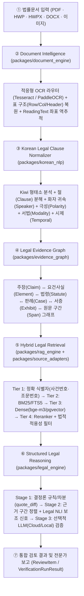

# AegisLAW (ACASia_LAW) 차세대 목표 아키텍처 및 모듈 상세 설계서 (Step B)

- **작성일**: 2026-11-19
- **대상 버전**: `v0.23.x` ~ `v0.25.0` 차세대 아키텍처 (`Legal Evidence Graph + Hybrid Retrieval + Structured Legal Reasoning`)
- **설계 원칙**:
  1. **기존 결정론 엔진 보존**: 정규식·형식 검증·수치/날짜 검증·단서/부정 차분(`quote_diff.py`)을 폐기하지 않고 **1차 고속 필터 및 확정 규칙 계층**으로 유지한다.
  2. **Fail-Closed & 무근거 단정 금지**: 공식 원문이나 검증된 근거 구간(`Evidence` span) 없이 LLM이나 NLI 점수만으로 `VERIFIED` 또는 `CONTRADICTED`를 단정하지 않는다(부록 C 제3항, `classify_claim` 불변식 유지).
  3. **폐쇄망(`LOCAL_ONLY`) 및 보안 불변식 준수**: `QUARANTINE_SEVERITIES` 격리, `ADVERSARIAL_SCANNING → LLM → Output Scan` 순서, PII 가명처리(`PseudonymStore`) 및 무출구 검증을 모든 신규 계층에 강제한다.

---

## 1. 전체 계층 아키텍처 다이어그램



---

## 2. 핵심 모듈별 상세 설계

### 2.1 [P0] 평가체계 분리 및 102건 미판정 경고 아키텍처 (`packages/evaluation/`)

#### 2.1.1 오프라인 법률 결함 3분류 매트릭스
기존 `123개 법률 항목 중 43개 적중(35.0%)`을 단일 숫자로만 보던 한계를 해결하기 위해, 오프라인 법률 결함 항목을 다음 3가지 도달 가능성 범주로 분리 집계한다:
1. **`OFFLINE_VERIFIABLE` (오프라인 결정론 검증 가능 항목)**: 사건번호 형식 오류(`FMT.*`), 대역 밖 번호, 문서 내 자체 모순, `config/legal_rules/rules.json` 내장 조문·법리로 판정 가능한 항목.
2. **`EXTERNAL_SOURCE_REQUIRED` (외부 공식 원문 필수 항목)**: 실존 사건번호의 직접 인용문 날조(`CIT-FAB-Q`), 판시사항 취지 왜곡(`CIT-MIS`), 미수록 특별법 조문 부존재(`LAW-NX`) 등 공식 DB 또는 고정 스냅샷 없이는 판정이 원천 불가능하여 오프라인에서 `UNVERIFIED`가 정상 판정인 항목.
3. **`SOURCE_AVAILABLE_MISSED` (원문·규칙 확보 후 판정 실패 항목)**: 로컬 규칙표나 스냅샷에 원문이 존재함에도 문장 변형·절 분리·인용 연결 실패로 놓친 순수 알고리즘 미탐 항목.

#### 2.1.2 102건 미판정 경고 라벨링 스키마
Protected Path(`scripts/scorecard.py`, `scripts/evaluation_v2.py`)를 건드리지 않고 [`packages/evaluation/schemas.py`](file:///home/antigravity/stevelee0119/ACASia_LAW/packages/evaluation/schemas.py)에 `AlertAdjudicationRecord` 모델을 추가한다:
- **분류 라벨 (`AdjudicationVerdict`)**:
  - `TRUE_DEFECT_UNLISTED`: 문서에 실제로 존재하는 결함을 정당하게 탐지했으나 기존 정답지(`ground_truth.json`)에 누락된 항목.
  - `TRUE_DEFECT_TOKEN_MISMATCH` (`EVAL_ARTIFACT`): 정답지에 있는 결함을 탐지했으나 `match_spec.json`의 어휘 토큰과 표현이 달라 매칭에서 탈락한 항목.
  - `DUPLICATE_FINDING`: 이미 적중한 결함과 동일 원인의 중복 경고(현행 24건 추정).
  - `OVERREACH_FALSE_POSITIVE`: 부정·가정·상대방 주장 인용·정당한 법리 주장을 결함으로 잘못 판정한 실질 오탐.
  - `ADVISORY_MISCLASSIFIED`: 참고 신호(`advisory_only=True`)로 내려야 할 항목이 본문 확정 경고로 노출된 항목.

---

### 2.2 [P0] 온라인 Drive RAG 사전 색인(Pre-indexing) 및 스냅샷 리플레이 (`packages/rag_engine/` & `packages/source_adapters/`)

#### 2.2.1 백그라운드 사전 색인 워커 및 영구 `PARTIAL` 해소
1. **버그 수정 (TK-208 D1/D2 연계)**:
   - [`packages/rag_engine/extract.py`](file:///home/antigravity/stevelee0119/ACASia_LAW/packages/rag_engine/extract.py#L266): `native is None`일 때 시각 전용 페이지가 `continuation=None`인 채 `CAUSE_BUDGET_EXHAUSTED`로 빠지지 않도록 `next_continuation`을 생성하거나 `RENDER_UNAVAILABLE`로 정확히 분리한다.
   - [`packages/rag_engine/library.py`](file:///home/antigravity/stevelee0119/ACASia_LAW/packages/rag_engine/library.py#L486-L489): `prior["status"] == STATUS_PARTIAL`이고 미완독 페이지가 남아 있으면 `continuation` 유무와 무관하게 재시도 경로(`continuing = True`)로 진입시킨다.
2. **Pre-indexing CLI / 백그라운드 태스크 (`packages/rag_engine/preindex.py`)**:
   - 사용자 검증 요청 시점에 동기적으로 5페이지씩 OCR을 수행하는 대신, 사전 색인 모드(`LV_RAG_PREINDEX_MAX_OCR_PAGES=0` 무제한 또는 배치 단위 루프)에서 Drive 폴더 내 모든 문서의 페이지가 `STATUS_COMPLETE`가 될 때까지 반복 추출한다.
   - 문서별 **페이지 완독률(`pages_extracted / pages_total`)**, **OCR 저품질 페이지 비율**, **청크 해시(`sha256`)** 를 `coverage_ledger`에 기록한다.

#### 2.2.2 결정론적 온라인 스냅샷 리플레이 (Cassette Replay)
- **설계 위치**: [`packages/source_adapters/transport.py`](file:///home/antigravity/stevelee0119/ACASia_LAW/packages/source_adapters/transport.py) 및 [`packages/rag_engine/drive.py`](file:///home/antigravity/stevelee0119/ACASia_LAW/packages/rag_engine/drive.py).
- **동작 모드 (`LV_SOURCE_REPLAY_MODE`)**:
  - `LIVE` (기본): 기존과 동일하게 외부 API 호출.
  - `RECORD`: 정규화된 요청 서명(`adapter + canonical_query + params_hash`)과 응답 페이로드(PII 마스킹 및 응답 해시 포함), 수신 시각(`recorded_at`), 스키마 버전을 지정된 카세트 디렉터리(`LV_SOURCE_CASSETTE_DIR`)에 JSONL/SQLite로 기록.
  - `REPLAY`: 네트워크 연결 없이(`LV_ALLOW_NETWORK=0` 호환) 카세트에서 일치하는 요청 서명의 응답을 즉시 반환. 카세트에 없는 요청은 `AdapterStatus.DISABLED`(`REPLAY_MISS`)로 fail-closed 처리.
- **보안·신선도 통제**:
  - 카세트 저장 전 [`packages/pii_engine/`](file:///home/antigravity/stevelee0119/ACASia_LAW/packages/pii_engine)의 `PIIEngine`으로 개인정보 유입 여부를 스캔하여 PII가 포함된 레코드는 저장을 거부한다.
  - 카세트 매니페스트에 `max_age_days`와 `dataset_sha256`을 기록하여 만료된 스냅샷을 경고한다.

---

### 2.3 [P1] 한국어 법률 문장 정규화기 — Korean Legal Clause Normalizer (`packages/korean_nlp/`)

#### 2.3.1 모듈 구조
신규 패키지 `packages/korean_nlp/`를 신설하여 `claim_engine`과 `legal_engine`이 공통으로 사용하는 단일 문장·절 정규화 계층을 제공한다:
- `packages/korean_nlp/__init__.py`
- `packages/korean_nlp/tokenizer.py`: `kiwipiepy` 래퍼 (미설치 환경에서는 결정론적 어절·조사 분리 폴백 `RegexFallbackTokenizer` 제공 — 지연 로딩 싱글턴으로 프로세스당 1회 초기화).
- `packages/korean_nlp/clause_normalizer.py`: 문장(`Sentence`) → 절(`NormalizedClause`) 분해 및 속성 태깅.
- `packages/korean_nlp/legal_dictionary.py`: 법률 복합명사·당사자 호칭·사건부호·법령 접미사 사용자 사전 등록.

#### 2.3.2 핵심 데이터 구조 (`NormalizedClause`)
```python
@dataclass(frozen=True)
class NormalizedClause:
    clause_id: str
    sentence_index: int
    raw_text: str
    normalized_text: str
    reading_span: Tuple[int, int]          # ReadingText 상의 정확한 (start, end)
    block_id: Optional[str]
    page: Optional[int]
    # 구문·화자·서법 속성
    speaker_role: str                      # "AUTHOR" | "OPPONENT" | "COURT" | "THIRD_PARTY" | "UNKNOWN"
    speaker_surface: Optional[str]         # 원문상 주어 표면형 (예: "원고는", "대법원은")
    attribution_type: str                  # "DIRECT_ASSERTION" | "REPORTED_SPEECH" | "QUOTED_PRECEDENT" | "OPPONENT_SUMMARY"
    polarity: str                          # "ASSERTED" | "NEGATED" | "DOUBLE_NEGATED_ASSERTED"
    negation_count: int
    modality: str                          # "DEFINITIVE" | "MANDATORY" | "PERMISSIVE" | "HYPOTHETICAL" | "ALTERNATIVE" | "INTERROGATIVE"
    temporal_aspect: str                   # "PAST_FACT" | "PRESENT_STATE" | "FUTURE_PLAN" | "ATEMPORAL_RULE"
    discourse_relation: str                # "MAIN" | "CONDITION" | "CONCESSION" | "CAUSE" | "EXCEPTION_PROVISO"
    predicate_lemma: Optional[str]         # 서술어 기본형
    quantifiers: List[str]                 # 전칭/한정 수량사 ("언제나", "원칙적으로" 등)
    cited_spans: List[Tuple[int, int]]     # 절 내부 또는 직전 연결 문장의 인용 위치
    parse_confidence: float                # 0.0 ~ 1.0 (복문이거나 주어 생략 시 감점)
    uncertainty_reasons: List[str]         # ["OMITTED_SUBJECT", "NESTED_QUOTATION" 등]
```

#### 2.3.3 기존 엔진과의 통합 방식
- [`NormalizedDocument`](file:///home/antigravity/stevelee0119/ACASia_LAW/packages/common/schemas.py#L122) 파싱 직후 또는 `build_reading_text(doc)` 호출 시 `doc.structure["normalized_clauses"]`에 캐싱한다.
- 기존 [`packages/legal_engine/polarity.py`](file:///home/antigravity/stevelee0119/ACASia_LAW/packages/legal_engine/polarity.py), `claim_engine/structure.py`, `date_verifier.py`, `evidence_consistency.py`, `internal_inconsistency.py`의 개별 정규식을 `NormalizedClause` 조회로 단계적 위임(Shadow 비교 후 전환)한다.
- **불확실성 보존 원칙**: 한국어 법률 문장에서 주어 생략이나 다중 내포절로 인해 `speaker_role == "UNKNOWN"` 또는 `parse_confidence < 0.7`인 경우, 작성자의 단정 주장으로 강제 귀속하지 않고 `uncertainty_reasons`를 하위 검증기에 전달하여 A등급 확정 오탐을 방지한다.

---

### 2.4 [P1] 하이브리드 법률 검색 및 법적 적용성 필터 (`packages/rag_engine/` & `packages/legal_engine/`)

#### 2.4.1 4단계 하이브리드 검색 파이프라인 (`packages/rag_engine/hybrid_retriever.py`)
1. **Tier 1 — Exact Legal Identifier Lookup (결정론적 식별자 색인)**:
   - 청크 색인 시 추출된 정규화 사건번호(`canonical_case_number`), 법령명+조문번호(`law_name + canonical_article`), 서증 번호(`갑 제N호증`)를 SQLite `chunk_identifiers` 역색인 테이블에서 $O(1)$ 조회.
2. **Tier 2 — Lexical BM25 + 형태소 토큰 검색**:
   - 기존 음절 바이그램(`relevance.py:tokens`)에 Kiwi 명사·용언 어간 토큰을 결합한 SQLite FTS5(또는 BM25 가중치) 스코어링.
3. **Tier 3 — Dense Semantic Retrieval (`bge-m3` / `KURE-v1` + `pgvector` / SQLite BLOB)**:
   - 운영 환경(PostgreSQL)에서는 이미 선언된 [`DocumentBlock.embedding`](file:///home/antigravity/stevelee0119/ACASia_LAW/apps/api/db.py#L305) 및 HNSW 인덱스를 활성화하고, 로컬/SQLite 환경에서는 `library.sqlite3`의 `chunk_embeddings` 테이블(Float32 binary blob + NumPy 코사인 유사도)을 사용하여 동일한 인터페이스로 Top-K(예: $K=30$) 후보를 추출한다.
   -Tier 2와 Tier 3 결과를 **Reciprocal Rank Fusion (RRF, $k=60$)** 으로 결합한다.
4. **Tier 4 — Cross-Encoder Reranker + 법적 적용성 필터(Legal Applicability Filter)**:
   - 상위 30개 청크를 한국어 Cross-Encoder(`bge-reranker-v2-m3` 등, 설정 `LV_RAG_RERANKER_MODEL`)로 재순위화하여 Top-5~10을 선정한다.
   - **법적 적용성 메타데이터 검증**: 단순 텍스트 유사도가 높아도 다음 조건에 해당하면 `APPLICABILITY_WARNING` 태그를 부여하고 자동 지지(`SUPPORTED`) 근거에서 배제한다:
     - 행위시/기준시점(`case_date`, `incident_date`) 이후에 시행되었거나 폐지된 구법 조문([`temporal_review.py`](file:///home/antigravity/stevelee0119/ACASia_LAW/packages/legal_engine/temporal_review.py) 연동).
     - 전원합의체 판결이나 헌재 위헌결정으로 변경·실효된 판례/조문([`authority_status.py`](file:///home/antigravity/stevelee0119/ACASia_LAW/packages/legal_engine/authority_status.py) 연동).
     - 절차법적 사건 유형 불일치(예: 형사 공소장 요건 판례를 민사 손해배상 요건에 원용).

---

### 2.5 [P1] 근거 구간 정렬 및 한국어 Legal NLI 보조 검증 (`packages/legal_engine/nli_verifier.py`)

#### 2.5.1 역할과 한계 (불변 규칙)
- **절대 원칙**: NLI 모델은 **법률적 타당성의 최종 판정기가 아니다**.
- NLI는 **오직 공식 원문(또는 검증된 참고자료 원문)의 특정 구간(`Premise`)이 확보된 상태에서**, 서면의 인용·요지 진술(`Hypothesis`)이 해당 원문 구간과 어미·어휘 변형을 넘어 의미상 함의(`ENTAILMENT`), 모순(`CONTRADICTION`), 중립/무관(`NEUTRAL`) 관계에 있는지를 계산하는 **보조 신호(Stage 2 Signal)** 로만 사용한다.

#### 2.5.2 3단계 캐스케이드 검증 흐름
1. **Stage 1 (결정론적 정렬 및 차분)**:
   - 기존 [`evidence_basis.py:align_quote()`](file:///home/antigravity/stevelee0119/ACASia_LAW/packages/legal_engine/evidence_basis.py#L140)와 [`quote_diff.py:quote_changes()`](file:///home/antigravity/stevelee0119/ACASia_LAW/packages/legal_engine/quote_diff.py#L75) 실행.
   - 완전 일치(`similarity >= 0.98`)이거나 결정론적 반전(`NEGATION`, `MODALITY`, `PARTY_SWAP`, `PROVISO_OMISSION`, `NUMERIC`)이 명확히 검출되면 NLI 호출 없이 즉시 확정.
2. **Stage 2 (Sliding-Window Span Alignment + Legal NLI)**:
   - 간접 인용(요지 인용)이거나 퍼지 유사도가 중간 대역(`0.55 <= similarity < 0.88`)인 경우, 공식 판결문(`판시사항`, `판결요지`, `이유`)을 문장 단위 슬라이딩 윈도우(1~3문장)로 분할하여 후보 구간 Top-3를 추출한다.
   - `(Premise=공식 원문 구간, Hypothesis=서면 인용 요지)` 쌍에 대해 NLI 확률 분포 $(P_{\text{entail}}, P_{\text{contradict}}, P_{\text{neutral}})$와 구조적 차분(단서 누락 여부, 주체 일치 여부)을 함께 계산한다.
3. **Stage 3 (판정 결합 및 Stage 3 LLM 에스컬레이션)**:
   - NLI가 높은 모순($P_{\text{contradict}} \ge 0.85$)을 가리키더라도, **원문 내 대응 근거 구간(`grounded_quote` / `passage`)이 문자 단위로 특정되고 구조적 반전 요소(부정·단서·요건 방향 반전)가 동반될 때만** `CONTRADICTED` 후보로 올린다([`classify_claim()`](file:///home/antigravity/stevelee0119/ACASia_LAW/packages/legal_engine/argument_validity_verifier.py#L157-L174) 규칙 준수).
   - NLI만으로 모순이 의심되나 결정론적 차분이 불분명한 경우에는 `SUSPICIOUS` / `PENDING_REVIEW`(전문가 확인 필요) 또는 Stage 3 LLM Critic 검증으로 넘긴다.

---

### 2.6 [P2] 문서 레이아웃·표 복원 및 적응형 OCR 라우터 (`packages/document_engine/`)

#### 2.6.1 적응형 OCR 폴백 라우터 (`packages/document_engine/ocr.py`)
- 기존 [`OCRAdapter`](file:///home/antigravity/stevelee0119/ACASia_LAW/packages/document_engine/ocr.py#L100) 인터페이스를 유지하면서 `PaddleOCRAdapter`(또는 `OnnxPaddleOCRAdapter`)와 `CompositeOCRAdapter`를 추가한다.
- **라우팅 정책**:
  1. 1차로 가벼운 `TesseractOCRAdapter`로 페이지를 인식하고 [`page_quality()`](file:///home/antigravity/stevelee0119/ACASia_LAW/packages/document_engine/ocr.py#L56)(`confidence`, `hangul_ratio`)를 측정한다.
  2. `low_quality == True`이거나 다단 표·기울어짐이 감지된 페이지에 한해 `PaddleOCRAdapter`로 해당 페이지만 재인식(Fallback)한다.
  3. 두 엔진 모두 품질 기준 미달 시 기존과 동일하게 `low_quality=True`를 유지하여 해당 페이지에서 무결함 단정을 금지한다.

#### 2.6.2 표 구조(Table Grid) 복원 (`packages/document_engine/table_structure.py`)
- 현재 표 블록을 단순히 `" | "` 문자열로 합쳐 `prose_blocks()`에서 제외하던 한계를 보완하여, 표 내부의 각 셀을 `TableCell(row_idx, col_idx, row_span, col_span, header_path, text, bbox)` 구조로 `Block.attributes["table_grid"]`에 보존한다.
- 이를 통해 [`CalculationEngine`](file:///home/antigravity/stevelee0119/ACASia_LAW/packages/claim_engine/calculation.py)과 [`date_verifier.py`](file:///home/antigravity/stevelee0119/ACASia_LAW/packages/claim_engine/date_verifier.py)가 표의 행 머리글(항목명)·열 머리글(청구액/인정액/일자) 문맥을 정확히 읽고 검산할 수 있게 한다.

---

### 2.7 [P2] `LocalLLMProvider` 엔터프라이즈 고도화 (`packages/llm_router/providers.py`)

[`LocalLLMProvider`](file:///home/antigravity/stevelee0119/ACASia_LAW/packages/llm_router/providers.py#L479-L523)를 클라우드 공급자(`OpenAIProvider` 등)와 동일한 계약 수준으로 격상한다:
1. **구조화 JSON 스키마 강제 (`request.schema`)**:
   - 설정 `LV_LOCAL_LLM_BACKEND` (`vllm` | `ollama` | `openai_compat`)에 따라:
     - `vllm` / `openai_compat`: `response_format={"type": "json_schema", "json_schema": {"name": "aegislaw_response", "strict": True, "schema": request.schema}}` 전송 (미지원 모델 폴백 시 `{"type": "json_object"}` + 시스템 프롬프트 스키마 주입).
     - `ollama`: `format=request.schema` 전송.
2. **절단 검사 및 토큰 사용량 계측**:
   - `choice.get("finish_reason")` 추출 후 [`_checked(text, stop_reason, self.name, model)`](file:///home/antigravity/stevelee0119/ACASia_LAW/packages/llm_router/providers.py#L114) 호출로 토큰 상한 절단 시 `LLMTruncatedResponseError` 발생.
   - `usage = data.get("usage") or {}`에서 `prompt_tokens`, `completion_tokens`를 파싱하여 `LLMResponse(input_tokens=..., output_tokens=...)` 및 `ModelExecutionRow`에 정확히 기록.
3. **보안 게이트 일관성**:
   - `LOCAL_ONLY` 정책에서도 [`LLMRouter`](file:///home/antigravity/stevelee0119/ACASia_LAW/packages/llm_router/router.py)의 입력 Adversarial Scan과 출력 `validate_output_safety()`는 절대 우회하지 않는다.

---

### 2.8 [P3] Legal Evidence Graph 통합 (`packages/evidence_graph/`)

#### 2.8.1 설계 철학
문서 내 개별 문장·인용을 고립시켜 검증하는 대신, **문서(및 사건 프로젝트 내 복수 문서) 전체의 법리적 주장-요건-근거-증거 관계를 방향성 그래프(Directed Property Graph)** 로 구성하여 **누락된 전제 사실, 뒷받침되지 않는 요건, 변경된 법령/판례에 의존하는 사슬**을 구조적으로 탐지한다.
> **주의**: 그래프는 사건의 승패나 법률적 결론을 자동 확정하는 장치가 아니라, **주장이 성립하기 위해 필요한 법적·사실적 연결고리의 충족/결여/모순 상태를 명시하는 검증 보조 장치**다.

#### 2.8.2 그래프 노드(`GraphNode`) 및 엣지(`GraphEdge`) 스키마
- **노드 유형 (`NodeKind`)**:
  - `LEGAL_CLAIM`: 당사자의 법적 효과 주장 (예: "위법성이 조각된다", "계약은 무효이다", "손해를 배상할 책임이 있다").
  - `REQUIREMENT_ELEMENT`: 해당 법적 효과가 성립하기 위한 법정 요건사실 (예: `직무상 정당한 명령의 존재`, `명령의 적법성`, `기망행위`, `인과관계`) — 기존 [`pleading_structure.py`](file:///home/antigravity/stevelee0119/ACASia_LAW/packages/legal_engine/pleading_structure.py)의 `check_cause_of_action_elements` 및 `config/legal_rules/rules.json` 요건표와 연동.
  - `FACT_ASSERTION`: 서면에 진술된 구체적 사실 주장 (`ClaimType.FACT`, `Event`).
  - `AUTHORITY_SOURCE`: 인용된 법령 조문(`STATUTE`), 판례(`CASE`), 행정규칙(`ADMIN_RULE`).
  - `EXHIBIT_EVIDENCE`: 서증(`갑 제1호증`, 첨부 계약서·명령서·진단서 — [`attachments.py`](file:///home/antigravity/stevelee0119/ACASia_LAW/packages/claim_engine/attachments.py) 연동).
  - `SOURCE_SPAN`: 원문 블록 및 문자 오프셋 `(document_id, page, block_id, start, end)`.
- **엣지 유형 (`EdgeKind`)**:
  - `REQUIRES_ELEMENT` (`LEGAL_CLAIM` → `REQUIREMENT_ELEMENT`): 법적 주장이 성립하기 위해 필요한 요건.
  - `ASSERTS_SATISFACTION` (`FACT_ASSERTION` → `REQUIREMENT_ELEMENT`): 서면의 사실 진술이 특정 요건을 주장함.
  - `GROUNDED_IN_AUTHORITY` (`LEGAL_CLAIM` / `REQUIREMENT_ELEMENT` → `AUTHORITY_SOURCE`): 법령·판례 근거 연결.
  - `PROVED_BY_EXHIBIT` (`FACT_ASSERTION` → `EXHIBIT_EVIDENCE`): 사실 주장을 뒷받침하는 서증 연결.
  - `CONTRADICTS` / `UNDERMINES` (노드 간 반박·모순 관계: 단서 조항, 반대 사실, 부존재 판례, 제출 누락 서증).
  - `LOCATED_AT` (모든 노드 → `SOURCE_SPAN`).

#### 2.8.3 그래프 기반 4대 검증 규칙
1. **근거 결여 연쇄 탐지 (`BROKEN_AUTHORITY_CHAIN`)**: `LEGAL_CLAIM`이 유일하게 의존하는 `AUTHORITY_SOURCE`가 `NOT_FOUND` / `INVALID_FORMAT` / `OVERRULED`인 경우, 해당 주장을 `근거 사슬 단절`로 표기하고 [`HallucinationTableRow`](file:///home/antigravity/stevelee0119/ACASia_LAW/packages/legal_engine/argument_validity_verifier.py#L177) 및 `ReviewItem`의 `issue_ids`에 연결한다.
2. **요건사실·단서 누락 탐지 (`MISSING_PREREQUISITE_ELEMENT`)**: 법적 효과를 주장하면서 조문상 필수 요건 또는 단서 예외 요건에 대한 사실 주장(`ASSERTS_SATISFACTION`)이 문서 내 어디에도 없는 경우 `C등급 참고/검토 신호` 생성.
3. **사실-서증 불일치 연쇄 탐지 (`UNSUPPORTED_FACT_ELEMENT`)**: 요건사실을 뒷받침하는 `FACT_ASSERTION`이 인용한 `EXHIBIT_EVIDENCE`가 첨부 누락이거나 첨부 서증 원문(`SOURCE_TEXT`)의 날짜·금액·당사자와 모순되는 경우.
4. **동일 원인 경고 중복 병합 (Alert Deduplication)**: 동일한 깨진 노드(예: 허위 판례 1건 또는 날짜 오기 1건)에서 파생된 여러 문장의 하위 경고를 그래프 연결 컴포넌트 단위로 묶어 대표 `Finding` 1건과 하위 위치 목록으로 병합(현재 102건 미판정 경고 중 24건의 동일 문서·유형 중복 해소).

---

## 3. API, DB 마이그레이션 및 하위 호환성 설계

### 3.1 DB 스키마 및 마이그레이션 방침
1. **기존 테이블 재사용 우선**:
   - [`DocumentBlock.embedding`](file:///home/antigravity/stevelee0119/ACASia_LAW/apps/api/db.py#L305) (`EmbeddingType`, `vector(1536)` / JSON fallback)은 초기 마이그레이션(`20260906_98e07fd05c9e_initial_schema.py`)에 이미 생성되어 있으므로 **별도의 파괴적 컬럼 변경 없이 즉시 활용 가능**하다. 임베딩 차원이 다른 로컬 모델(예: `bge-m3` 1024차원) 지원을 위해 `LV_EMBEDDING_DIM` 설정과 SQLite 로컬 RAG 인덱스(`library.sqlite3` 내 `chunk_embeddings` 테이블)를 분리 운영한다.
   - `ClaimRow.data`, `FindingRow.data`, `VerificationRun.result_json`은 `JSONType`(PostgreSQL `JSONB`, SQLite `TEXT`)이므로 `NormalizedClause` 메타데이터와 `EvidenceGraph` 직렬화 데이터(`doc.engine_data["evidence_graph"]`)를 스키마 다운타임 없이 저장할 수 있다.
2. **선택적 신규 Alembic 마이그레이션 (P3 단계)**:
   - 프로젝트 단위 그래프 영속 조회가 필요한 시점에만 `evidence_graphs` 테이블(`id`, `run_id`, `project_id`, `document_id`, `nodes_json`, `edges_json`, `summary_json`, `created_at`)을 추가하는 additive 마이그레이션을 작성한다.

### 3.2 API 및 `ReviewItem` 하위 호환성
- [`ReviewItem`](file:///home/antigravity/stevelee0119/ACASia_LAW/packages/common/schemas.py#L619)의 기존 필드(`item_id`, `kind`, `official_status`, `reference_status`, `verdict_label`, `severity`, `source_comparison`, `claim_verdict`)를 100% 유지한다.
- 그래프 분석 및 절 정규화 결과는 `ReviewItem.reasoning_sections`, `ReviewItem.issue_ids`, 그리고 `DocumentResult.engine_data["clause_summary"]` / `DocumentResult.engine_data["evidence_graph"]`에 선택적(optional) 필드로 추가하여 기존 프론트엔드 및 채점기(`eval_testset.py`, `evaluation_v2.py`)와의 호환성을 보장한다.

---

## 4. 의존성 및 리스크 관리 (Fallback 설계)

| 신규 컴포넌트 | 권장 라이브러리 / 모델 | 미설치·폐쇄망·저사양 환경 Fallback |
| --- | --- | --- |
| **한국어 형태소 분석** | `kiwipiepy >= 0.18.0` (Apache-2.0, C++ 기반 CPU 고속 동작) | `kiwipiepy` 미설치 시 `RegexFallbackTokenizer`(기존 `reading_text.py` + `polarity.py` 규칙 통합판)로 자동 폴백하여 CI 및 경량 환경에서 예외 없이 동작 |
| **Dense Embedding** | `sentence-transformers` / `onnxruntime` + `BAAI/bge-m3` 또는 `nlpai-lab/KURE-v1` | 모델 가중치 미존재 시 Tier 1(식별자) + Tier 2(BM25/FTS5)만으로 동작하며 `reference_health.retrieval_mode = "LEXICAL_ONLY"` 기록 |
| **Cross-Encoder Reranker** | `BAAI/bge-reranker-v2-m3` (ONNX 양자화 지원) | 미설치 또는 지연시간 예산 초과 시 Tier 1~3 RRF 점수로만 순위 결정 |
| **한국어 Legal NLI** | 한국어 NLI Cross-Encoder (ONNX Runtime CPU 추론 가능) | 미설치 시 Stage 1(`evidence_basis.py` + `quote_diff.py`) 결정론 판정만 수행 |
| **보조 OCR 엔진** | `paddleocr` / `rapidocr_onnxruntime` (선택 설치) | 기본 `TesseractOCRAdapter`(tesseract 5.3.4) 유지 |
