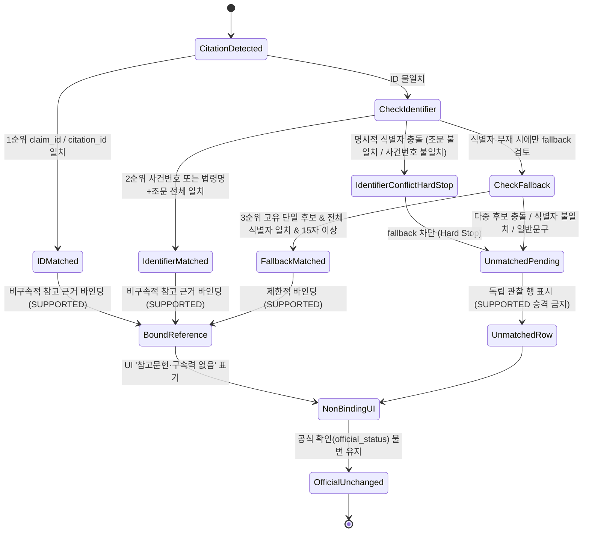

# [설계 메모] TK-127 2단계: 인용 행(판례·법령)의 Google Drive 색인 대조

- **작성일**: 2026-10-26 (7차 개정)
- **작성자**: Antigravity (구현 에이전트)
- **대상 브랜치**: `Steve_ACASiaLAW` (기준 제품 코드 SHA: `3fee071c17921c9add11167250744f646903cee3`)
- **문서 성격**: 설계 제안 메모 (본 PR에서는 제품 코드 및 시험 수정 0줄 유지)
- **상태**: 평가 측(Codex) 재검토 및 사용자 승인 대기

---

## 1. 배경 및 목적

- **배경**: TK-127 1단계(#183, Steve `3fee071c17921c9add11167250744f646903cee3`)를 통해 주요 참고문헌(Google Drive) 대조 의견이 웹 검토 표의 행에 바인딩되었습니다. 2단계는 사용자 요구(2026-10-25) *"공식데이터베이스의 자료를 API로 검색하는 것에 추가로 구글 DRIVE의 자료를 활용"* 중 미이행분인 **인용 행(판례·법령)을 Google Drive 색인에서도 직접 찾아 근거로 연결**하는 기능을 다룹니다.
- **원칙**:
  1. 엔진 및 데이터 파이프라인의 확장이 수반되므로 제품 코드 수정에 앞서 본 설계 제안을 제출하여 평가 측(Codex) 검토와 사용자 승인을 득한 후 별도 구현 티켓으로 착수합니다. 사용자의 설계 승인을 받기 전에는 제품 코드 구현 착수로 넘기지 않습니다.
  2. 점수나 테스트 결과를 임의로 고정하거나 성능을 사전 단정하지 않으며, 코드 참조는 유동적인 행 번호 대신 파일 경로와 심볼명을 기준으로 관리합니다.
  3. **오근거 연결 방지 및 인용 식별자 중심 바인딩**: 짧거나 흔한 문구 우연 일치에 따른 오매칭을 원천 차단하기 위해 8자 부분 문자열만으로 근거를 자동 연결하는 로직을 전면 폐지하며, 안정적인 식별자(`claim_id`/`citation_id`, 정규화된 사건번호·법령명·조문) 일치를 최우선으로 합니다. 특히 명시적인 식별자 충돌(법령명 동일·조문 불일치, 사건번호 불일치)은 fallback을 원천 차단하는 종료 조건(Hard Stop)으로 확정하고, fallback은 식별자 정보가 없는 경우에만 제한적으로 검토하며 식별 근거 조건을 키워드 일부가 아닌 해당 인용의 전체 식별자 일치로 강화합니다.

---

## 2. 항목별 세부 설계 및 근거 코드 심볼

### 1) 인용 행의 Drive 조회 및 매칭 메커니즘
*(근거 심볼: `packages/rag_engine/review.py` 내 `_match_citations_to_references`, `review_document`, `packages/rag_engine/library.py` 내 `ReferenceLibrary.select`, `ReferenceLibrary.match_case`)*
- **질의 생성 및 정규화 규칙**:
  - **판례 사건번호**:
    - 법원명 및 불필요한 공백 제거 후 연도·사건부호·일련번호 정규화.
    - 정규식 경계 매칭: `rf"(?<!\d){re.escape(canonical_case_no)}(?!\d)"` (사건번호 앞뒤 비숫자 경계 대조, `_match_citations_to_references`).
    - 색인 조회: `ReferenceLibrary` 내 전문 색인에서 정규화된 사건번호를 단일 질의어로 조회하거나, 표준 판례표가 존재할 경우 `ReferenceLibrary.match_case`로 정확 일치 조회.
  - **법령명 및 조문**:
    - 법령명 내 특수기호(`「`, `」`, `『`, `』`) 및 공백 제거 (예: `민법`, `근로기준법`).
    - 조문 정규화 패턴: `rf"제\s*{re.escape(str(article))}\s*조"`
    - 근접 윈도우 대조: 조문 출현 위치 기준 앞뒤 100자 이내에 정규화된 법령명이 함께 출현하는지 대조 (`_match_citations_to_references`).
- **단계별 용량·처리 한도 구분 (기준 SHA `3fee071c17921c9add11167250744f646903cee3` 설정 대조)**:
  - **색인/동기화 단계 한도 (`ReferenceLibrary._sync_files`)**:
    - `rag_inventory_max_files`: Drive 폴더 내 인벤토리 수집 상한. 기본값 **20,000개 파일** (설정: `LV_RAG_INVENTORY_MAX_FILES`, `packages/common/config.py`).
    - `rag_max_files`: 1회 동기화 시 새로 색인(파싱/저장)할 파일 수 예산 한도. 기본값 **1,000개 파일** (설정: `LV_RAG_MAX_FILES`, `packages/common/config.py`, `library.py`의 `_sync_files`).
    - `rag_download_mb`: 파일 다운로드 크기 한도. 기본값 **128MB** (설정: `LV_RAG_DOWNLOAD_MB`, `packages/common/config.py`).
    - `rag_sync_seconds`: 동기화 실행 타임아웃. 기본값 **120초** (설정: `LV_RAG_SYNC_SECONDS`, `packages/common/config.py`).
  - **검색/선택 단계 한도 (`ReferenceLibrary.select`)**:
    - `ReferenceLibrary.select(text, limit=12)`: 서면 본문 및 키워드 기반으로 색인 코퍼스에서 연관성이 높은 참고자료 발췌(`sources`)를 선택하는 함수. 기본값 **최대 12개 발췌** (`library.py`).
    - `ReferenceLibrary.search_case_table(text, limit=5)`: 구조화 판례 사건표 대조 시 선택 개수. 기본값 **최대 5개 행** (`library.py`).
  - **외부 모델 배치 단계 한도 (`review.py`의 `_split_sources_into_batches`)**:
    - `max_items_limit = 6`: 배치당 최대 참고자료 개수 **6개**.
    - `max_chars_limit = 6000`: 배치당 최대 발췌 글자 수 합계 **6,000자**.
    - *(주의: 5~6개 파일은 색인 상한이 아니며, 외부 모델 호출 프롬프트에 실어 보낼 때의 단일 배치 묶음 한도임).*
  - **발췌 목표 길이 (향후 구현 설계 목표)**:
    - 판례 인용은 사건번호 출현 전후 200~400자, 법령 인용은 해당 조문 윈도우 200~500자(최대 1,000자 이내)로 한정하여 토큰 소비를 최소화하도록 구현 목표 설정.
- **로컬 전용(`LOCAL_ONLY`) 및 빠른 검토(`QUICK`) 원칙**:
  - `context.profile == VerificationProfile.QUICK` 또는 `context.external_ai_policy == ExternalAIPolicy.LOCAL_ONLY`인 경우(`review.py`의 프로필 분기), 외부 LLM 호출을 전면 배제하고 파이썬 정규식 및 텍스트 윈도우 기반의 결정론적 로컬 매칭(`_match_citations_to_references` 확장)만 수행.
- **공식 확인(`OFFICIAL_CONFIRMED`) 격상 불가 원칙 및 화면 표시**:
  - Google Drive 자료는 사설 참고문헌이므로, 공식 DB(대법원·국가법령정보) API 확인 없이 `OFFICIAL_CONFIRMED`로 격상하지 않음 (`official_status` 불변 유지).
  - 참고자료 지지 상태(`reference_status`)는 식별자 일치 또는 엄격 검증을 통과한 경우에만 `SUPPORTED`로 갱신하거나 `evidence_sources`에 Drive 출처를 추가 (`packages/verification_engine/review_items.py`).
  - 화면 표시 문구는 1단계와 동일하게 `참고문헌(구속력 없음, 공식 확인 아님)` 또는 `주요 참고문헌 대조(구속력 없음)`를 유지하여 사용자의 법적 효력 오인을 방지 (`apps/web/static/app.js`의 `referenceObservationBlock`).

### 2) 서버 연결 및 정규화·식별자 중심 매칭 계약
*(근거 심볼: `packages/verification_engine/review_items.py` 내 `build_document_review_items`, `packages/verification_engine/pipeline.py` 내 `reference_review`, `packages/common/schemas.py` 내 `ReviewItem`, `apps/web/static/app.js` 내 `attachReferenceObservations`)*

- **서버 생성 방식**:
  - 1단계에서는 클라이언트 브라우저(`app.js`)가 `attachReferenceObservations()`를 통해 렌더링 시점에 동적 바인딩하던 로직을 서버 파이프라인의 `packages/verification_engine/review_items.py`(`build_document_review_items`)로 이전.
  - `ReviewItem` 도메인 모델(`packages/common/schemas.py`)에 `reference_observations: List[Dict[str, Any]] = field(default_factory=list)` 필드를 추가하고 `to_dict()`에 직렬화 포함.

- **공백 정규화 계약 (Python과 JavaScript 간 명시적 문자 집합 규약)**:
  - **배경 및 원인**:
    - JavaScript 정규식 `\s`와 Python `re \s`는 매칭하는 유니코드 공백 집합이 다릅니다 (`U+FEFF`, `U+001C~U+001F` 등 취급 차이).
    - 따라서 언어별 메타문자 `\s`에 동작을 위임하면 서버와 브라우저 간 정규화 결과가 어긋나 매칭이 깨질 수 있습니다.
  - **권위 있는 공통 공백 문자 집합 (White-list of Whitespace) 확정**:
    두 구현은 언어별 `\s`를 직접 쓰지 않고, 아래 **명시적 문자 코드포인트 집합을 완전히 동일하게 제거 대상 공백으로 확정**합니다:
    1. **기본 ASCII 공백 및 제어문자**: `\u0020`(스페이스), `\u0009`(`\t`), `\u000A`(`\n`), `\u000D`(`\r`), `\u000B`(`\v`), `\u000C`(`\f`)
    2. **ASCII 정보 분리 제어문자 (명시적 포함 확정)**: `\u001C`(FS), `\u001D`(GS), `\u001E`(RS), `\u001F`(US) — 서면 파싱/OCR 텍스트에 포함될 수 있으므로 양쪽 모두 공백 제거 대상에 명시적으로 포함함.
    3. **유니코드 특수 공백**: `\u00A0`(NBSP), `\u1680`, `\u2000`~`\u200A`(En/Em Space 등), `\u2028`(Line Separator), `\u2029`(Paragraph Separator), `\u202F`(Narrow NBSP), `\u205F`(Math Space), `\u3000`(전각 공백)
    4. **무폭 제어/BOM 문자**: `\uFEFF`(BOM / Zero Width No-Break Space)
  - **명시적 구현 표현 (언어별 `\s` 사용 금지)**:
    - **공통 명시적 정규식 문자 클래스**:
      `[\u0009-\u000D\u001C-\u0020\u00A0\u1680\u2000-\u200A\u2028\u2029\u202F\u205F\u3000\uFEFF]+`
    - **Python 구현 규약**:
      ```python
      EXPLICIT_WHITESPACE_RE = re.compile(
          r"[\u0009-\u000D\u001C-\u0020\u00A0\u1680\u2000-\u200A\u2028\u2029\u202F\u205F\u3000\uFEFF]+"
      )
      def compact_text(text: str) -> str:
          return EXPLICIT_WHITESPACE_RE.sub("", str(text or ""))
      ```
    - **JavaScript 구현 규약**:
      ```javascript
      const EXPLICIT_WHITESPACE_RE = /[\u0009-\u000D\u001C-\u0020\u00A0\u1680\u2000-\u200A\u2028\u2029\u202F\u205F\u3000\uFEFF]+/g;
      function compactText(text) {
        return String(text || "").replace(EXPLICIT_WHITESPACE_RE, "");
      }
      ```

- **개정된 매칭 우선순위 및 엄격 매칭 계약 (오근거 연결 차단)**:
  짧고 일반적인 문구의 우연한 일치로 인한 오연결을 차단하기 위해, **8자 이상 부분 문자열 단독 조건에 의한 자동 연결 및 SUPPORTED 승격을 전면 폐지**하고 아래의 엄격한 3계층 우선순위 및 종료 조건(Hard Stop) 계약을 적용합니다:

  1. **1순위: 구조적 ID 기반 우선 매칭 (최우선 확정)**:
     - 관찰의 `claim_id` $\rightarrow$ 문서 `claims[].citation_ids` 조회 $\rightarrow$ 검토 행의 `citation_id`가 해당 목록에 포함되면 즉시 매칭 (`app.js`의 `attachReferenceObservations`).
     - 상태: 즉시 매칭 성공 $\rightarrow$ 비구속적 참고 근거 바인딩.

  2. **2순위: 인용 식별자(Citation Identifier) 완전 일치 매칭**:
     - 1순위 ID 매칭이 없을 때, 인용의 핵심 법률 식별자를 엄격 대조:
       - **판례 인용**: 정규화된 사건번호(`canonical_case_no`)가 Drive 발췌 문맥과 정확히 경계 일치(`(?<!\d)...(?!\d)`)하는 경우.
       - **법령 인용**: 정규화된 법령명과 조문 번호(`제N조`)가 근접 윈도우(100자) 내에 동시 출현하여 모두 일치하는 경우.
     - **명시적 식별자 충돌 시 Hard Stop (종료 조건 확정)**:
       - 법령명은 동일하나 조문 번호가 다른 경우(예: 민법 제103조 vs 제104조) 또는 사건번호가 다른 경우(예: 2020도16420 vs 2020도16421)는 **명시적 식별자 충돌(Conflict)**로 판정합니다.
       - **식별자 충돌 발생 시 3순위 fallback으로 넘어가지 않고 즉시 매칭을 종료(Hard Stop)**합니다.
       - 어떠한 경우에도 자동 연결 및 `SUPPORTED` 승격을 금지하며, `UNMATCHED`/`PENDING_REVIEW` 상태로 남깁니다.

  3. **3순위: 극히 제한적 텍스트 Fallback (식별자 정보 부재 시 한정 & 전체 식별자 일치 필수)**:
     - **진입 제한**: 서면 인용 또는 후보 자료에 식별자 충돌이 없는 경우 중에서, **식별자 정보(사건번호·조문)가 아예 존재하지 않는 경우에만 극히 제한적으로 fallback 검토에 진입**합니다. 명시적 식별자가 존재하는 인용은 2순위에서 일치하지 않거나 충돌하면 위 Hard Stop에 의해 즉시 종료됩니다.
     - 단순 문자열 포함만으로는 연결하지 않으며 **다음 4가지 조건을 모두 만족할 때만 극히 예외적으로 허용**:
       - **조건 A (최소 길이)**: 정규화된 인용문(`quote_compact`) 및 주장 텍스트(`claim_compact`)가 모두 **15자 이상** (기존 8자에서 상향).
       - **조건 B (상호 부분 포함)**: `(quote_compact in claim_compact) or (claim_compact in quote_compact)`.
       - **조건 C (고유 단일 후보, Unique Candidate)**: 위 조건을 만족하는 행 후보가 **정확히 1개**여야 함. 동일/유사 문구를 포함하는 후보 행이 2개 이상이면 **충돌로 간주하여 자동 연결 금지**.
       - **조건 D (전체 식별자 완전 일치)**: 식별 근거 조건은 키워드 일부가 아니라 **해당 인용의 전체 식별자(사건번호 전체 또는 법령명+조문 전체)가 발췌문 내에 온전히 일치**해야 함. 키워드 단편 일치나 일부 누락은 불인정하며, 충돌 시 즉시 탈락.

  4. **미매칭 및 검토 대기 (`UNMATCHED` / `PENDING_REVIEW`)**:
     - 위 1~3순위 조건을 충족하지 못하거나, 명시적 식별자 충돌(Hard Stop), 복수 후보 경쟁, 또는 식별자 불일치 시:
       - **절대로 `reference_status=SUPPORTED`로 자동 승격하지 않음**.
       - 해당 관찰은 `unmatched`로 분류되어 인용 행에 바인딩되지 않고, 표 하단의 독립된 참고문헌 관찰 행(`kind: "REFERENCE"`)으로만 표시되거나 `PENDING_REVIEW` 상태로 유지.



- **향후 구현 회귀 시험 계획 (오매칭 차단 및 정확도 통제 시험)**:
  - `tests/test_tk127_stage2_server_reference_observations_sync.py`:
    1. **식별자 충돌 Hard Stop 및 오매칭 방지 반례 시험 (자동 연결 및 SUPPORTED 승격 금지 검증)**:
       - **법령명 동일·조문 불일치 반례 (15자 이상·유일 후보·텍스트 포함 충족 시에도 차단)**:
         - 조건: 서면 `"민법 제103조에 위반되어 무효이다"` (15자 이상) vs 발췌문 `"민법 제104조에 위반되어 무효이다"`.
         - 상세 시나리오: 후보 발췌문에 15자 이상의 서면 문구가 상호 포함되거나 유일 후보로 검색되더라도, 서면의 조문(`제103조`)과 발췌문의 조문(`제104조`)이 불일치하면 **Hard Stop이 발동되어 3순위 fallback 진입이 차단**됨.
         - 예상 결과: 자동 연결 배제, fallback 차단, `reference_status=SUPPORTED` 승격 금지 (`UNMATCHED` / `PENDING_REVIEW` 유지).
       - **사건번호 불일치 반례 (15자 이상·유일 후보·텍스트 포함 충족 시에도 차단)**:
         - 조건: 서면 `"대법원 2020도16420 판결에 따르면"` (17자) vs 발췌문 `"대법원 2020도16421 판결에 따르면"`.
         - 상세 시나리오: 후보 발췌문이 고유 단일 후보이고 15자 이상의 텍스트 상호 포함 조건을 충족하더라도, 사건번호의 일련번호(`2020도16420` vs `2020도16421`)가 불일치하면 **Hard Stop이 발동되어 3순위 fallback 진입이 차단**됨.
         - 예상 결과: 자동 연결 배제, fallback 차단, `reference_status=SUPPORTED` 승격 금지 (`UNMATCHED` / `PENDING_REVIEW` 유지).
       - **다중 후보 경쟁**: 동일하거나 비슷한 텍스트(예: 15자 이상 문구)를 가진 검토 행이 2개 이상 존재하는 경우 $\rightarrow$ 충돌로 간주하여 자동 연결 배제, 미매칭 유지, SUPPORTED 승격 방지.
       - **일반 상용구 우연 포함**: "이유 없다", "주문과 같이 판결한다", "법률상 근거가 없다" 등 흔한 일반 문구가 포함된 경우 $\rightarrow$ 전체 인용 식별자 불일치 시 자동 연결 금지.
    2. **정답 통제 자료 기반 1:1 비교 및 집계 검증**:
       - 정답 매칭 라벨이 구축된 통제 테스트셋(Ground Truth Control Dataset)을 구성.
       - 서버 파이프라인(`build_document_review_items`)과 브라우저(`attachReferenceObservations`)의 실행 결과를 각각 비교하여 **정확 연결(True Positive)**과 **오연결(False Positive)**을 집계.
       - 단언 기준: **오연결(False Positive) = 0건**, 양측 구현의 매칭 결과 일치율 100%.
    3. **공통 공백 문자 집합 경계 및 무폭 제어문자 검증**:
       - `U+FEFF`(BOM), `U+001C~U+001F`(FS~US 4종), `U+00A0`, `U+3000` 포함 입력 시 양 언어 정규화 동등성 검증.

### 3) 보고서 반영 계획
*(근거 심볼: `packages/report_engine/pdf_report.py` 내 `build_report_pdf`, `packages/report_engine/docx_report.py` 내 `build_report_docx`, `packages/report_engine/exporters.py` 내 `to_payload`, `to_json`)*
- **반영 대상 형식**: PDF, Word(docx), Excel(xlsx), JSON 내보내기.
- **배치 위치**:
  - 인용 검토 표의 '근거 자료 / 대조 결과' 열(3열)에 `[참고문헌 대조]` 소제목과 함께 출처 파일명 및 발췌 내용을 표시.
- **모든 지원 출력에 대한 비공식성 안내 명시**:
  - 모든 내보내기 형식에 "본 참고문헌 대조 의견은 사설 Google Drive 자료를 기반으로 한 보조 검토 의견이며, 공식 판정·등급·점수 또는 공식 확인(OFFICIAL_CONFIRMED)이 아닙니다"라는 안내 문구를 명시.
  - **PDF / Word**: 표 상단 및 각 행 대조 결과 블록에 `참고문헌(구속력 없음, 공식 확인 아님)` 문구 표시.
  - **Excel (xlsx)**:
    - 검토 표 상단에 눈에 띄는 안내 행(`[안내] 본 참고문헌 대조 결과는 사설 Google Drive 자료에 기반한 비구속적 참고 의견이며 공식 확인이 아닙니다`) 추가.
    - 3열 헤더 또는 별도 열에 `참고문헌 대조(구속력 없음)` 명시.
  - **JSON**:
    - `reference_observations` 항목에 기계 판독 가능한 메타데이터(`"source": "google_drive"`, `"official": false`, `"binding": false`, `"notice": "비구속적 사설 참고문헌 대조 결과"`)를 표준 필드로 포함.
  - **CSV 지원 범위 명시**:
    - 현재 시스템의 공식 보고서 내보내기는 PDF, DOCX, XLSX, JSON의 4종을 지원하며, 일반 CSV 내보내기는 지원 범위에 포함되지 않음(XLSX 및 JSON 스냅샷으로 대체). 향후 CSV 내보내기가 추가될 경우 XLSX와 동일하게 최상단 메타데이터 안내 행 및 비공식성 고지 열을 필수로 반영하도록 규정.
- **TK-129 '외부 AI 참고 의견' 절과의 명확한 분리**:
  - 향후 TK-129가 병합되면 들어올 '외부 AI 질의 답변' 독립 절(`doc_result.external_ai_answers`)과 본 Drive 대조를 완전히 분리.
  - 인용 검토 표 내의 개별 행 근거 자료(3열)에 독립 표기.

### 4) 측정 방안 및 품질·안정성 기준
*(근거 심볼: `scripts/score_gate.py`, `docs/scorecards/baseline.json`, `scripts/scorecard.py`, `scripts/check_case_literals.py`, `scripts/check_test_edits.py`)*

- **오프라인 점수 게이트의 역할 및 출처 (회귀 방지 전용)**:
  - 권위 있는 점수 판정은 CI에서 실행되는 `python scripts/score_gate.py`가 동일 SHA에서 권위 있는 기준선 파일(`docs/scorecards/baseline.json`)과 비교하여 점수 하락이 없음을 검증하는 것입니다.
  - 현재 기준선(`docs/scorecards/baseline.json`, 기준 SHA `3fee071c17921c9add11167250744f646903cee3`)에 기록된 관찰값은 다음과 같습니다:
    - 개발 세트 (`sets.dev`): 가중 재현율 `weighted_recall: 0.826` (82.6점), 오탐 `false_positives: 0`
    - 홀드아웃 세트 (`sets.holdout`): 가중 재현율 `weighted_recall: 0.819` (81.9점), 오탐 `false_positives: 0`
  - 위 수치는 기준선의 현재 관찰값이며, 별도의 독립된 임의 합격 기준선이 아닙니다. 향후 구현 시에도 별도 기준을 신설하지 않고 `score_gate.py`의 기준선 대조 판정을 단일 권위 기준으로 삼습니다.
  - 개발(dev), 홀드아웃(holdout), 은퇴(retired) 세트는 고정 오프라인 서면이며 Google Drive 연동이 비활성화(`RAG_DRIVE_FOLDER_ID=""`)되어 있으므로, 오프라인 점수 게이트로는 Google Drive 검색/대조의 실제 효과나 성능 향상을 입증할 수 없습니다. 오프라인 게이트 통과는 기존 검증 기능에 대한 '회귀 없음(No Regression)'만을 보증합니다.

- **운영 Drive 환경 실측 및 품질 검증 기준 (단순 매칭 건수 단독 사용 금지)**:
  - **단순 매칭 건수(Hit Count) 단독 사용 금지**:
    - 단순히 "Drive 대조 결과 N건 매칭"과 같은 집계 지표는 잘못 연결된 오연결(False Positive)을 숨길 수 있으므로, 품질 통과 증거로 단독 사용할 수 없습니다.
  - **비식별화된 품질 측정 지표**:
    - 실측 검증 시 통제 서면 표본에 대해 다음 지표를 분리 산출:
      1. **정답 연결 수 (True Positive Matches)**: 인용 식별자(사건번호 또는 법령명+조문)와 내용이 실제로 일치하여 올바른 행에 연결된 건수.
      2. **오연결 수 (False Positive Matches)**: 다른 조문, 다른 사건, 또는 일반 문구 유사성으로 잘못된 행에 바인딩된 건수.
      3. **미매칭 건수 (Unmatched Observations)**: 기준 미달로 연결되지 않고 독립 관찰로 남은 건수.
  - **합격 기준 (Pass Criteria)**:
    - **오연결 수(False Positive Matches) = 0건** (오연결 발생 시 해당 매칭 규칙 불합격 및 롤백).
    - 정답 연결 정밀도(Precision): $TP / (TP + FP) = 100\%$.
  - **수동 교차 검증 절차 (Manual Review)**:
    - 운영 Drive 실측 검증 시, 매칭된 결과 중 최소 10건 이상(전체 매칭이 10건 미만인 경우 전수)을 무작위 추출하여 검토자가 원본 인용과 Drive 발췌문의 법률적 부합 여부를 1:1 수동 교차 검증.
  - **보안 및 개인정보 보호 엄수**:
    - 운영 Drive 실측 검증 결과 보고 시 실제 사건번호, 당사자명, 서면 원문, 구체적 문구의 노출을 엄격히 금지합니다 (`check_case_literals.py` 준수).
    - 증빙 자료는 **비식별화된 집계 지표(정답 연결 수, 오연결 수, 정밀도, 수동 검증 확인 결과)** 및 개인정보/사건 식별정보가 완전 마스킹된 웹 화면 캡처 1건으로 한정합니다.

### 5) 성능 및 개인정보 보호 (PII)
*(근거 심볼: `packages/rag_engine/review.py` 내 `_split_sources_into_batches`, `packages/pii_engine/detector.py` 내 `PIIEngine.mask_text`, `packages/common/enums.py` 내 `ExternalAIPolicy`)*
- **성능 목표 (향후 구현 설계 목표)**:
  - 인용 행 다수 존재 시 인용별 개별 색인 호출을 지양하고, 서면 내 모든 인용(사건번호·법령조문)을 1회의 역색인/필터링 패스로 일괄 매핑하는 아키텍처 지향.
  - 인용 행 대조 단계 전체에 대해 타임아웃 상한(예: 3~5초 시간 예산 목표)을 두어 초과 시 안전하게 graceful degradation(로컬 매칭 결과까지만 반환)하도록 설계.
  - *(주의: 3~5초는 측정된 확정 제약이 아니라 향후 구현에서 달성해야 할 설계 목표 예산임).*
- **개인정보 보호 정책 준수**:
  - Drive 발췌문 및 서면 인용문을 외부 모델에 전송해야 할 경우 `context.external_ai_policy` 철저 준수:
    - `LOCAL_ONLY`: 외부 전송 원천 금지 (로컬 정규식 매칭만 수행).
    - `MASKED`: `PIIEngine.mask_text()`를 거쳐 개인식별정보를 비식별화 후 전송.
    - `ORIGINAL`: 사용자 명시적 허용 시에만 전송.

---

## 3. 사전에 확인할 기존 시험 및 코드 위치 요약표 (기준 SHA: `3fee071c17921c9add11167250744f646903cee3`)

본 PR에서는 제품 코드 및 시험을 전혀 수정하지 않으며, 향후 구현 착수 시 연계될 핵심 모듈과 시험은 다음과 같습니다. 파일별 행 번호는 커밋 및 포맷팅에 따라 유동적일 수 있으므로 **파일 경로와 심볼명**을 기준으로 관리합니다.

| 구분 | 파일 경로 | 주요 함수 / 설정 심볼 (기준 SHA `3fee071c17921c9add11167250744f646903cee3`) | 역할 및 검증 포인트 |
| :--- | :--- | :--- | :--- |
| **RAG 엔진** | `packages/rag_engine/review.py` | `_match_citations_to_references`<br>`review_document`<br>`_split_sources_into_batches` | 사건번호 경계 일치, 법령명+조 근접 대조<br>서면 인용 대조 및 결과 수집, QUICK/LOCAL_ONLY 분기<br>모델 배치 분할 (최대 6개, 6,000자) |
| **Drive 라이브러리** | `packages/rag_engine/library.py` | `ReferenceLibrary._sync_files`<br>`ReferenceLibrary.select`<br>`ReferenceLibrary.search`<br>`ReferenceLibrary.has_case_tables`<br>`ReferenceLibrary.case_table_status`<br>`ReferenceLibrary.match_case`<br>`ReferenceLibrary.search_case_table` | 파일 동기화 및 신규 색인 예산 (`rag_max_files`)<br>문서 연관 자료 선택 (기본 `limit=12` 발췌)<br>단순 검색 래퍼<br>표 후보 존재 여부 확인<br>표 후보 색인 상태 반환<br>구조화 판례표 정확 대조<br>사건표 행 단위 관련 검색 (기본 `limit=5`) |
| **검토 항목 생성** | `packages/verification_engine/review_items.py` | `derive_item_severity`<br>`build_document_review_items` | Finding 심각도 순수 파생<br>단일 문서 검토 항목 생성 메인 함수 (인용 행 루프, `reference_status` 결정, `evidence_sources` 출처 생성, 미연결 Finding 루프) |
| **파이프라인 단계** | `packages/verification_engine/pipeline.py` | `manifest.stage("reference_sync")`<br>`manifest.stage("reference_review")` | 참고자료 동기화 파이프라인 단계<br>문서별 Drive 대조 실행 파이프라인 단계 |
| **공통 스키마** | `packages/common/schemas.py` | `ReviewItemKind` (Enum)<br>`ReviewItem` (dataclass)<br>`ReviewItem.to_dict()` | 검토 항목 종류 정의<br>`reference_observations` 필드 추가 대상<br>직렬화 사전 변환 |
| **웹 화면** | `apps/web/static/app.js` | `compactText`<br>`attachReferenceObservations`<br>`referenceObservationRow`<br>`referenceObservationBlock`<br>`referenceStatusLine` | 공백 제거 정규화 함수<br>브라우저 측 행 연결 (1순위 ID, 2순위 식별자 일치, 식별자 충돌 시 Hard Stop 차단, 3순위 고유단일 fallback)<br>미매칭 관찰 행 생성<br>3열 참고문헌 대조 블록 렌더링<br>표 위 상태 줄 렌더링 |
| **보고서 엔진** | `packages/report_engine/pdf_report.py`<br>`packages/report_engine/docx_report.py`<br>`packages/report_engine/exporters.py` | `build_report_pdf`<br>`build_report_docx`<br>`to_payload`, `to_json` | PDF 검토 표 렌더링<br>Word 검토 표 렌더링<br>JSON/Excel `review_items` 내보내기 (안내 행 및 official=false 메타데이터 반영)<br>*(참고: `external_answers.py`는 기준 SHA 시점 미존재)* |
| **설정** | `packages/common/config.py` | `Settings.rag_drive_folder_id`<br>`Settings.rag_sync_seconds`<br>`Settings.rag_max_files`<br>`Settings.rag_inventory_max_files`<br>`Settings.rag_download_mb` | Drive 폴더 ID<br>동기화 타임아웃 (기본 120초)<br>신규 색인 파일 상한 (기본 1,000개 파일)<br>인벤토리 수집 상한 (기본 20,000개 파일)<br>다운로드 한도 (기본 128MB) |
| **관련 기존 시험** | `tests/test_drive_rag_relevance.py`<br>`tests/test_f2_review_screen_browser.py`<br>`tests/test_tk126_flat_tabs_answer_import.py` | 파일 전체 | Drive RAG 관련성 시험<br>검토 화면 통합 렌더링 시험<br>1단계 평면 탭 시험 |

---

## 4. 향후 절차

1. 본 설계 메모 7차 개정안 제출 및 평가 측(Codex) 재검토, 사용자 승인.
2. **사용자 승인 완료 전 제품 코드 구현 착수 절대 금지**.
3. 사용자 승인 완료 후 세부 구현 티켓 발행 및 제품 코드/시험 구현 착수.
4. 제품 코드 수정 전후 오프라인 회귀 게이트(`score_gate.py`) 및 운영 Drive 실측 검증(오연결 0건, 정밀도 100%, 수동 교차 검증) 완료 후 병합.
