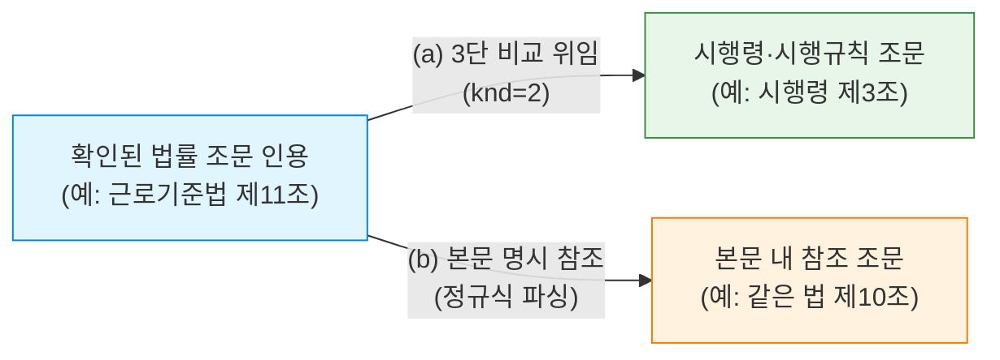

# [설계 메모] TK-137 제한형 관련 근거 탐색 설계 메모 (깊이 1 위임 및 명시 참조)

- **문서 위치**: `docs/handoff/requests/TK-137_related_basis_design_memo.md`
- **작성일**: 2026-11-03 | **작성자**: Antigravity (구현 에이전트)
- **기준 브랜치**: Steve_ACASiaLAW `cf57cb7`
- **근거 자료**: `docs/handoff/TK-137_related_basis_memo_request.md` 및 법제처 3단 비교 API 사실(11-03)
- **수칙 준수**: 본 문서는 **설계 메모 전용(제품/시험 코드 0줄)**이며, finding 승격 금지·오프라인 점수 변화 0·사건 고유값 하드코딩 금지 수칙을 엄수함.

---

## 1. 개요 및 설계 원칙

본 설계는 서면에서 공식 확인된 인용 조문에 대하여, 법적 맥락 검토를 돕는 **깊이 1(Depth=1)의 관련 법령 근거(시행령·시행규칙 위임 및 조문 본문 명시 참조)**를 탐색하여 순수 검토 자료로 제공하는 기능이다.

### 4대 설계 원칙
1. **순수 검토 자료 격리 (Zero Finding Impact)**: 관련 근거는 검토 편의를 위한 참고 자료 슬롯에만 제공되며, finding 생성·심각도 부여·점수 게이트 산정에 절대 반영되지 않는다.
2. **엄격한 깊이 1 한정 (Depth = 1 Strict Bound)**: 인용된 조문에서 직결된 위임 조문 및 명시 참조 조문까지만 1단계 탐색하며, 탐색된 결과로부터 재귀적 추가 탐색은 일체 수행하지 않는다.
3. **오프라인 0 영향 보장 (Offline Zero Overhead)**: 네트워크 비활성화(`LV_ALLOW_NETWORK=0`) 또는 API 키 부재 시 즉시 안전 생략(Skip)하여 기존 오프라인 테스트 및 고정/은퇴 세트 점수에 0의 영향을 보장한다.
4. **엄격한 호출 상한 및 개인정보 보호 (Budget & Privacy)**: 문서당/인용당 조회 상한 및 시간 예산을 강제하며, 외부 전송 인자는 법령 고유키(MST)와 조번호로 한정하여 당사자 정보를 원천 격리한다.

---

## 2. 세부 설계 및 10대 요구사항 반영

### 2.1 [입력] 탐색 출발 조건 및 배제 원칙
- **탐색 대상**: 서면 검토 엔진(`source_review`)에서 공식 법제처 API를 통해 실재성이 확인되고 기준일(효력일) 버전이 확정된 **정상 법률 조문 인용**만 대상.
- **탐색 배제**:
  - 실재하지 않는 법령(`STATUTE_NONEXISTENT`), 미확인 조문(`ARTICLE_NONEXISTENT`), 검증 보류/오류 상태의 인용은 탐색을 즉시 중단(탐색 대상에서 제외).
  - 법령 수준이 법률이 아니거나(예: 조례, 행정규칙 등), 3단 비교 대상이 아닌 경우 건너뜀.

### 2.2 [관계 및 추출 규칙] 위임 관계 및 본문 명시 참조 (깊이 1 한정)
탐색 관계는 오직 아래 2가지로 한정하며, 비재귀적 단발 호출로 깊이 1을 강제한다.



1. **(a) 3단 비교 위임 관계 (`knd=2`)**:
   - 법제처 3단 비교 API `lawService.do?target=thdCmp&MST=...&knd=2` 활용 (`packages/source_adapters/law_go_kr.py`의 `_http_get` 재사용).
   - `LspttnThdCmpLawXService`의 `위임조문삼단비교.법률조문` 목록 중 인용된 `조번호`(`조가지번호`)와 일치하는 항목을 조회.
   - 해당 조문 행에 연결된 `시행령조문` 및 `시행규칙조문` 추출:
     - `시행령조문`이 단일 객체이든 리스트(`list`)이든 안전하게 정규화하여 순회.
     - `법령명`, `조번호`, `조제목`, `조내용` 발췌.
   - `삼단비교존재여부 == 'N'`이거나 위임조문이 없는 경우 빈 목록 반환.
2. **(b) 인용 조문 본문 명시 참조 (`explicit_reference`)**:
   - 이미 취득된 조문 본문 텍스트에서 명시적 조문 참조 패턴만 추출:
     - `(?:제\s*(\d+)조(?:의(\d+))?(?:\s*제\s*(\d+)항)?\s*(?:에\s*(?:따라|의하여|따른|의한)))`
     - `(?:같은\s*법\s*제\s*(\d+)조(?:의(\d+))?)`
     - `(?:대통령령으로\s*정하는)` $\to$ 위임 관계 (a)와 연결 플래그 설정.
3. **깊이 1 한정 보장**:
   - 추출된 (a), (b) 대상 조문에 대해 다시 `thdCmp`나 본문 파싱을 재귀 호출하는 함수 경로를 일체 두지 않음(평탄한 단일 리스트 반환).

### 2.3 [출력 위치 및 형식] Finding 격리 보장
- **출력 위치**: 진단 결과 루트의 검토 자료 컨테이너 `auxiliary_materials.related_authorities` 또는 `LegalCitationReview` 내 `related_authorities` 리스트.
- **스키마 형식**:
  ```json
  {
    "relation_type": "delegation | explicit_reference",
    "source_citation": {"law_name": "근로기준법", "article_no": "0011"},
    "target_authority": {
      "law_name": "근로기준법 시행령",
      "article_no": "0003",
      "title": "상시 사용하는 근로자 수의 산정 방법",
      "excerpt": "법 제11조제3항에 따른 상시 사용하는 근로자 수는..."
    },
    "provenance": "law_go_kr_thd_cmp | statute_text"
  }
  ```
- **Finding 미생성 보장 구조**:
  - `Finding` 클래스 인스턴스를 생성하지 않음.
  - 심각도(`Severity`) 필드를 갖지 않음.
  - `scorecard.py`, `score_gate.py`의 평가 집계 대상에 등록되지 않는 순수 보조 메타데이터 슬롯에 격리.

### 2.4 [상한 (Budget & Limits)]
- **문서당 최대 조회 건수**: 문서 전체 최대 20건.
- **인용 조문당 최대 근거 수**: 인용당 최대 3건(위임 우선, 초과 시 절삭).
- **시간 예산**:
  - 단일 HTTP 호출 타임아웃 2.0초 (`_http_get(timeout=2.0)`).
  - 문서당 관련 근거 탐색 누적 시간 상한 5.0초.
- **응답 크기 제한**: 1MB 초과 XML 스트림 파싱 중단.
- **상한 도달 시 상태 명시**: 조용히 누락(silent drop)하지 않고, `status: "limit_reached"` 또는 `"timeout"`을 메타데이터에 명시.

### 2.5 [캐시 원칙] 단일 실행 메모리 캐시
- **단일 프로세스 메모리 캐시**: 단일 서면 검토 프로세스 라이프사이클 내에서만 유효한 `dict` 형태 메모리 캐시(`_in_memory_thd_cmp_cache: Dict[Tuple[str, str], dict]`) 사용.
- **영속 캐시 금지**: 디스크 파일, 외부 캐시 서버 등 프로세스 간 영속 캐시는 E2 영속 캐시 보류 결정과의 정합성을 위해 일체 생성하지 않음.

### 2.6 [오프라인 및 환경 가드] `LV_ALLOW_NETWORK=0` 처리
- **네트워크 가드**: `os.environ.get("LV_ALLOW_NETWORK") == "0"` 또는 `LAW_GO_KR_OC` 환경변수 부재 시 탐색 단계 진입 자체를 생략.
- **상태 표기**: `status: "network_disabled"` 또는 `"oc_missing"` 기록.
- **영향 0 보장**: 오프라인 벤치마크 및 고정/은퇴 세트 평가 환경에서는 외부 API 호출이 원천 차단되므로 성능 지연이나 점수 변동이 0임을 구조적으로 보장.

### 2.7 [개인정보 보호 (Privacy Guarantee)]
- **요청 파라미터 화이트리스트**: 외부(법제처)로 전송되는 파라미터는 `target=thdCmp`, `MST={법령MST}`, `knd=2`, `efYd={시행일}` 및 법령명에 한정.
- **서면 본문 차단**: 서면 본문의 사건번호, 당사자 인적사항, 금액, 주장 내용은 외부 요청에 절대 포함되지 않음.

### 2.8 [시험 계획]
- **보호 경로 준수**: `tests/fixtures/`는 보호 경로이므로 수정하지 않으며, 새 시험 파일(`tests/test_tk137_related_basis.py`) 내 인라인 합성 XML 응답(Mock) 사용.
- **테스트 케이스 구성**:
  1. *양성 1*: 단일 위임 조문 (법률 제11조 $\to$ 시행령 제3조)
  2. *양성 2*: 복수 위임 조문 (시행령 목록 + 시행규칙 목록 정상 파싱)
  3. *양성 3*: 본문 명시 참조 ('같은 법 제10조에 따라' 추출)
  4. *대조 1*: 3단 비교 없는 법령 (`삼단비교존재여부 == 'N'`)
  5. *대조 2*: 위임 조문이 없는 법률 조문 (빈 결과 처리)
  6. *대조 3*: 상한 초과 (인용당 3건 초과 시 절삭 및 `limit_reached` 표기)
  7. *대조 4*: 네트워크 차단 (`LV_ALLOW_NETWORK=0` 시 호출 생략 및 `network_disabled` 표기)

### 2.9 [효과 측정 계획]
- **온라인 OFF/ON 쌍 비교**:
  - 운영 0.17.0 온라인 탐침 서면(28건) 대상 `LV_ALLOW_NETWORK=1` 환경에서 비교.
  - 지표:
    - 관련 근거 제공 건수 및 정확도 (위임령/규칙 일치율 100%)
    - 오연결(엉뚱한 조문 또는 무관한 법령 연결) 0건
    - 기존 진단 finding 수 및 점수 게이트 변동 0건

### 2.10 [TK-138과의 접점]
- **공용 검토 자료 슬롯**: TK-138(관련 판례 및 권위 가중치)과 상호 충돌 없이 공존하도록 `auxiliary_materials.related_authorities`를 상위 컨테이너로 사용.
- **판례 슬롯 및 가중치 필드 예약**: `authority_type: "statute" | "precedent"`, `authority_weight: Optional[float]` 필드를 스키마에 선제 예약하여 향후 TK-138 도입 시 하위 호환성을 완벽히 유지.

---

## 3. 결론 및 향후 일정

본 설계는 깊이 1과 단일 실행 캐시, 엄격한 상한, finding 완전 격리를 통해 시스템 안정성과 평가 지표를 훼손하지 않으면서도 실무상 필요한 법령 위임 체계를 안전하게 제공합니다. 평가 측 검토 및 승인 회신 후 세부 구현 PR을 제출하겠습니다.
