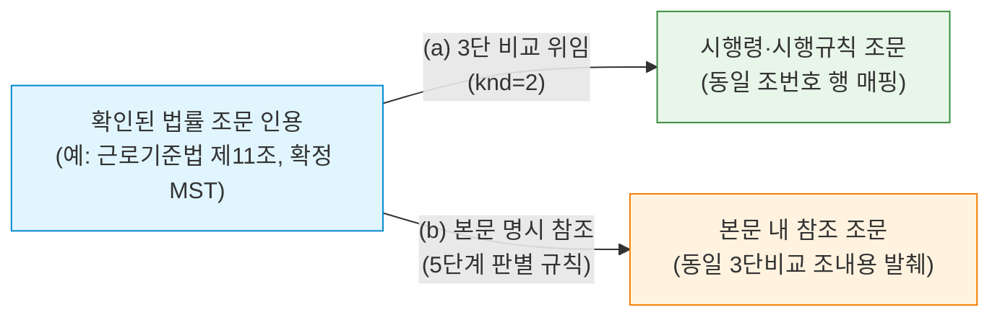

# [설계 메모] TK-137 제한형 관련 근거 탐색 설계 메모 (깊이 1 위임 및 명시 참조, 보정본)

- **문서 위치**: `docs/handoff/requests/TK-137_related_basis_design_memo.md`
- **작성일**: 2026-11-04 (보정본) | **작성자**: Antigravity (구현 에이전트)
- **기준 브랜치**: Steve_ACASiaLAW `cf57cb7`
- **근거 자료**: `docs/handoff/TK-137_related_basis_memo_request.md` 및 평가 측 보정 지시(C1~C7, 11-03)
- **수칙 준수**: 본 문서는 **설계 메모 전용(제품/시험 코드 0줄)**이며, finding 승격 금지·오프라인 점수 변화 0·사건 고유값 하드코딩 금지 수칙을 엄수함.

---

## 0. 평가 측 보정 지시(C1~C7) 반영 요약표

| 항목 | 핵심 지적 사항 | 보정 반영 내용 |
|---|---|---|
| **C1. 병렬 출력 자리 금지** | `auxiliary_materials` 신설 금지, 기존 `engine_data["related_authorities"]` 파이프라인/렌더러 확장 필수 | 기존 `packages/legal_engine/related_authorities.py`, 파이프라인 단계 `related_authorities`, `engine_data["related_authorities"]` dict 내 `delegations`·`explicit_references` 키 확장. 국가계약법 결과 공존, AI 탭 배제(인용·참고자료 영역 렌더링), 화면 캡처 승인 절차 명시. |
| **C2. 상한값 실측 재조정** | 1MB/2.0s는 건축법(1.3MB·3.04s) 등에서 실패 | 응답 크기 상한 **2.5MB**, 단일 호출 5.0초(`settings.http_timeout`), 문서 누계 **15.0초**로 상향. **법령(MST)당 1회 단일 조회 및 조문 간 응답 공유 캐시** 구조 도입. |
| **C3. 환경 변수·네트워크 가드** | 키 이름 오류(`LV_LAW_GO_KR_OC`), `os.environ` 직접 접근 지양 | 키 이름 `LV_LAW_GO_KR_OC` 정정. `settings.allow_network` 및 `LawGoKrAdapter.status == AdapterStatus.READY` 기존 인프라 재사용. |
| **C4. 판 선택 및 부재 처리** | `efYd` 미확인 동작 의존 금지, 3단 비교 부재 처리 규정 | `source_review`에서 확정된 **판의 MST**를 그대로 전달. 3단 비교 미지원(`삼단비교존재여부 == 'N'`) 시 `status: "thd_cmp_not_supported"` 명시. |
| **C5. 명시 참조 대상 법 판별** | 대상 법령 특정 규칙 및 조문 발췌 출처 부재 | 법령명 수식어 우선순위 5단계 규칙(명시 법령 > 같은 법/이 법 > 같은 법 시행령 > 같은 조 배제 > 인용 법령 기본) 수립. 이미 로드된 3단 비교 `법률조문.조내용` 우선 발췌. |
| **C6. 측정 계획 현실화** | '28건 온라인 탐침' 근거 부재 | 평가 측 준비 서면(4종 등) 대상 OFF/ON 쌍 비교, 오연결 0건, finding 변화 0건 검증으로 정정. |
| **C7. TK-138 예약 필드 제거** | `authority_type`·`authority_weight` 선반영 금지 | 임의 예약 필드 일체 삭제. TK-138 진행 시 정의. |

---

## 1. 개요 및 기본 원칙

서면에서 공식 확인된 인용 조문에 대하여, 법적 맥락 검토를 돕는 **깊이 1(Depth=1)의 관련 법령 근거(시행령·시행규칙 위임 및 조문 본문 명시 참조)**를 탐색하여 기존 진단 결과 컨테이너에 순수 검토 자료로 제공한다.

### 4대 설계 원칙
1. **순수 검토 자료 격리 (Zero Finding Impact)**: 관련 근거는 기존 참고 자료 슬롯에만 제공되며, finding 생성·심각도 부여·점수 게이트 산정에 절대 반영되지 않는다.
2. **엄격한 깊이 1 한정 (Depth = 1 Strict Bound)**: 인용된 조문에서 직결된 위임 조문 및 명시 참조 조문까지만 1단계 탐색하며, 탐색된 결과로부터 재귀적 추가 탐색은 일체 수행하지 않는다.
3. **오프라인 0 영향 보장 (Offline Zero Overhead)**: 네트워크 비활성화(`settings.allow_network == False`) 또는 어댑터 비가용 상태 시 즉시 안전 생략(Skip)하여 기존 오프라인 테스트 및 고정/은퇴 세트 점수에 0의 영향을 보장한다.
4. **실측 기반 예산 및 개인정보 보호 (Budget & Privacy)**: 법령 단위 1회 조회 및 15초 누적 예산을 강제하며, 외부 전송 인자는 법령 고유키(MST)로 한정하여 당사자 정보를 원천 격리한다.

---

## 2. 세부 설계 및 보정 지시 반영

### 2.1 [입력] 탐색 출발 조건 및 배제 원칙 (C4 판 선택 반영)
- **탐색 대상**: 서면 검토 엔진(`source_review`)에서 공식 법제처 API를 통해 실재성이 확인되고 기준일(효력일) 버전이 확정된 **정상 법률 조문 인용**만 대상.
- **판 선택 (C4 반영)**:
  - 법제처 3단 비교 API의 `efYd` 파라미터는 동작이 보장되지 않으므로 사용하지 않음.
  - 인용 판정 단계에서 효력일에 맞춰 이미 고른 **해당 판의 고유키(`MST`)를 그대로 사용**하여 `lawService.do?target=thdCmp&MST={MST}&knd=2`를 호출.
- **탐색 배제 및 상태 표기 (C4 반영)**:
  - 부존재 법령(`STATUTE_NONEXISTENT`), 부존재 조문(`ARTICLE_NONEXISTENT`), 미확인 인용은 탐색을 즉시 배제.
  - 해당 판에 3단 비교가 제공되지 않는 경우(`기본정보.삼단비교존재여부 == 'N'` 등 현행만 제공되거나 미지원 시): 조용히 누락하지 않고 `status: "thd_cmp_not_supported"`를 명시.

---

### 2.2 [관계 및 추출 규칙] 위임 관계 및 본문 명시 참조 (C5 대상 법 판별 반영)
탐색 관계는 오직 아래 2가지로 한정하며, 비재귀적 단발 호출로 깊이 1을 강제한다.



#### (a) 3단 비교 위임 관계 (`knd=2`)
- 법제처 3단 비교 API `lawService.do?target=thdCmp&MST={MST}&knd=2` 활용 (`packages/source_adapters/law_go_kr.py`의 `_http_get` 재사용).
- `LspttnThdCmpLawXService`의 `위임조문삼단비교.법률조문` 목록 중 인용된 `조번호`(`조가지번호`)와 일치하는 항목을 조회.
- 해당 조문 행에 연결된 `시행령조문` 및 `시행규칙조문` 추출:
  - `시행령조문`이 단일 객체이든 리스트(`list`)이든 안전하게 정규화하여 순회.
  - `법령명`, `조번호`, `조제목`, `조내용` 발췌.
- 위임 조문이 없는 경우 빈 목록 반환.

#### (b) 인용 조문 본문 명시 참조 (`explicit_references`) 및 대상 법 판별 규칙 (C5 반영)
- 인용 조문 본문 텍스트 내에서 명시 참조 조문을 추출할 때 대상 법령을 아래 **5단계 우선순위**로 판별:
  1. **앞말에 법령명이 명시된 경우**: 해당 명시 법령 확정 (예: `「민법」 제750조에 따라` $\to$ 대상: `민법`, 조문: `제750조`)
  2. **'같은 법' 또는 '이 법'인 경우**: 인용한 현재 법령 확정 (예: `근로기준법 제11조` 본문 내 `같은 법 제10조` $\to$ 대상: `근로기준법`, 조문: `제10조`)
  3. **'같은 법 시행령'인 경우**: 인용한 현재 법령의 시행령 확정
  4. **'같은 조'인 경우**: 동일 조문 내부의 항/호 참조이므로 외부 조문 탐색 대상에서 제외 (`same_article_internal`로 스킵)
  5. **법령명 수식어가 없는 경우**: 인용한 법령을 기본값으로 간주 (예: `제12조에 따라` $\to$ 인용한 현재 법령의 `제12조`)
- **대상 조문 본문(발췌) 획득 출처 (C5 반영)**:
  - **동일 법령 조문**: 이미 1회 수신한 3단 비교 응답(`LspttnThdCmpLawXService`)의 `법률조문` 목록에 모든 조문의 `조내용`이 포함되어 있으므로, **추가 네트워크 호출 없이 즉시 발췌**.
  - **타 법령 조문**: 기존 `source_review` 단계에서 이미 로드된 법령 캐시를 우선 조회. 미캐시 법령은 법령당 1회 조회 및 문서 누계 15.0초 상한 범위 내에서만 제한적으로 확인하며, 초과 시 `excerpt_status: "budget_exceeded"`로 표기.

---

### 2.3 [출력 위치 및 통합 렌더링] 병렬 자리 금지 및 기존 컨테이너 확장 (C1 반영)
- **병렬 슬롯 금지**: 임의의 `auxiliary_materials`를 신설하지 않고, 기존 파이프라인 및 데이터 구조를 직접 확장한다.
- **파이프라인 단계**: 기존 `related_authorities` (`pipeline.py` 919~937행) 재사용.
- **모듈 위치**: `packages/legal_engine/related_authorities.py` 내 `review_related_authorities` 확장.
- **출력 데이터 컨테이너 (`engine_data["related_authorities"]`) (C1, C7 반영)**:
  기존 단일 dict 구조(`origin`, `status`, `note`, `candidates`, `verdicts`, `advisory_only`) 내에 **`delegations`**와 **`explicit_references`** 키를 추가하여 공존시킨다.
  ```python
  engine_data["related_authorities"] = {
      # [기존 필드 유지: 국가계약법 쟁점 등 기존 결과 공존]
      "origin": "national_contract_act_issue",  # 또는 복합 시 "combined"
      "status": "completed",
      "note": "관련 법령 및 위임 조문 검토",
      "candidates": [...],
      "verdicts": [...],
      "advisory_only": True,
      # [TK-137 확장 키]
      "delegations": [
          {
              "source_law": "근로기준법",
              "source_article": "0011",
              "target_law": "근로기준법 시행령",
              "target_article": "0003",
              "target_title": "상시 사용하는 근로자 수의 산정 방법",
              "target_excerpt": "법 제11조제3항에 따른 상시 사용하는 근로자 수는..."
          }
      ],
      "explicit_references": [
          {
              "source_law": "근로기준법",
              "source_article": "0011",
              "target_law": "근로기준법",
              "target_article": "0010",
              "target_title": "적용 범위",
              "target_excerpt": "이 법은 상시 5명 이상의 근로자를 사용하는..."
          }
      ]
  }
  ```
- **렌더링 및 보호 시험 준수 (C1 반영)**:
  - `report_lines` 확장 및 `apps/web/static/app.js` 2825행, `pdf_report.py` 307행, `docx_report.py` 242행 렌더러 확장.
  - **보호 수용 시험(`tests/acceptance/test_f1_protected.py` 98~99행) 준수**: 관련 근거를 AI 탭에 그리지 않고, 기존 **인용·참고자료(법령 검토) 영역**에 렌더링하여 보호 시험과 충돌하지 않음.
  - **화면 검증 절차**: UI 변경이 수반되므로, 구현 PR 수용은 실제 화면 렌더링 캡처 및 사용자 확인을 거친 후 완료함.
- **Finding 미생성 보장 구조**:
  - `Finding` 클래스를 인스턴스화하지 않으며 `Severity`를 부여하지 않음.
  - `scorecard.py`, `score_gate.py` 집계 대상에 포함되지 않는 순수 참고 메타데이터로 유지.

---

### 2.4 [상한값 실측 재조정 및 단일 조회 캐시] (C2 반영)

#### 평가 측 실측 데이터 (2026-11-03, HTTP knd=2)
- 근로기준법: 221KB / 2.06초 | 민법: 549KB / 2.09초
- 건축법: 1,309KB / 3.04초 | 도로교통법: 1,144KB / 3.19초

#### 실측 기반 상한값 재설정 (C2 반영)
1. **응답 크기 상한**: **2.5MB** (건축법 1.3MB의 약 2배 여유 부여, 2.5MB 초과 시 안전 절삭).
2. **단일 HTTP 호출 타임아웃**:
   - `packages/source_adapters/base.py` 109~117행의 `_http_get`은 timeout 매개변수를 직접 받지 않고 `settings.http_timeout`(기본 5.0초)을 사용하므로, **기존 `settings.http_timeout` 설정을 준용**하여 5.0초를 단일 호출 예산으로 적용.
3. **문서 누계 시간 상한**: **15.0초** (주요 대형 법령 3~4건 처리 가능).
4. **법령(MST)당 1회 단일 조회 및 조문 간 응답 공유 (핵심 최적화)**:
   - 인용 조문마다 개별 API를 호출하는 비효율을 배제.
   - 서면 내 등장하는 인용 조문들의 법령 고유키(`MST`)를 집합으로 수집하여, **법령당 3단 비교 API를 1회만 호출**.
   - 파싱된 3단 비교 딕셔너리를 해당 서면 실행 내 메모리 캐시에 보관하고, 동일 법령에 속한 여러 인용 조문(`제10조`, `제11조`, `제23조` 등)이 **동일 응답을 공유하여 즉시 매핑**.
   - 이를 통해 10개 조문이 인용되어도 실제 외부 호출은 법령 수(1~2회)로 최소화되어 15초 상한 내에 충분히 완결.
5. **인용 조문당 최대 근거 수**: 인용당 최대 3건(위임 우선).
6. **상한 도달 시 상태 명시**: 조용히 빠뜨리지 않고 메타데이터에 `status: "limit_reached"` 또는 `"timeout"` 기록.

---

### 2.5 [캐시 원칙] 단일 실행 메모리 캐시 (C2 연계)
- **단일 프로세스/서면 검토 라이프사이클 한정 캐시**:
  - `_in_memory_law_thd_cmp_cache: Dict[str, dict]` (키: `MST`)
- **영속 캐시 금지**: 디스크 파일, Redis 등 프로세스 간 영속 캐시는 E2 영속 캐시 보류 결정과의 정합성을 위해 일체 생성하지 않음.

---

### 2.6 [환경 변수 및 네트워크 가드] (C3 반영)
- **환경 변수 키 규격**: **`LV_LAW_GO_KR_OC`** (`packages/source_adapters/law_go_kr.py` 26행, `config.py` 135행 일치).
- **인프라 재사용 (C3 반영)**:
  - `os.environ`을 직접 조회하지 않음.
  - 기존 설정 인프라인 **`settings.allow_network`** (`base.py` 67행) 및 어댑터 가용 상태 **`adapter.status == AdapterStatus.READY`**를 재사용.
- **네트워크 차단 시 동작**:
  - `allow_network == False` 또는 어댑터 비가용 상태 시 3단 비교 단계 진입 자체를 생략하고 `status: "network_disabled"` 또는 `"adapter_unavailable"` 기록.
  - 오프라인 벤치마크 및 고정/은퇴 세트 평가 환경에서는 외부 API 호출이 원천 차단되므로 성능 지연 0, 점수 변동 0 보장.

---

### 2.7 [개인정보 보호 (Privacy Guarantee)]
- **외부 전송 파라미터 화이트리스트**: `target=thdCmp`, `MST={법령MST}`, `knd=2` 및 법제처 인증키(`OC`)만 전송.
- **서면 본문 원천 격리**: 서면 본문의 사건번호, 당사자 정보, 금액, 주장 내용은 외부 요청에 절대 포함되지 않음.

---

### 2.8 [시험 계획]
- **보호 경로 준수**: `tests/fixtures/`는 보호 경로이므로 일체 수정하지 않으며, 새 시험 파일(`tests/test_tk137_related_basis.py`) 내 인라인 합성 XML(Mock) 사용.
- **테스트 케이스 구성**:
  1. *양성 1*: 단일 위임 조문 (법률 제11조 $\to$ 시행령 제3조)
  2. *양성 2*: 복수 위임 조문 (시행령 목록 + 시행규칙 목록 정상 파싱)
  3. *양성 3*: 본문 명시 참조 5단계 판별 (앞말 법령명, 같은 법, 같은 법 시행령, 인용 법령 기본값, 같은 조 내부 참조 배제)
  4. *대조 1*: 3단 비교 없는 법령 판 (`삼단비교존재여부 == 'N'` $\to$ `thd_cmp_not_supported` 표기)
  5. *대조 2*: 위임 조문이 없는 법률 조문 (빈 결과 처리)
  6. *대조 3*: 법령 단위 1회 조회 및 다수 조문 공유 캐시 동작 확인
  7. *대조 4*: 2.5MB 상한 초과 XML 수신 시 안전 중단 및 `limit_reached` 표기
  8. *대조 5*: 네트워크 비활성화(`settings.allow_network == False`) 시 호출 생략 및 `network_disabled` 표기

---

### 2.9 [효과 측정 계획] (C6 반영)
- **측정 대상 서면**: 평가 측이 준비하는 검증 서면(4종 등) 대상.
- **측정 방식**: 동일 서면에 대해 관련 근거 OFF/ON 쌍 비교.
- **합격 기준**:
  - 관련 근거 오연결(엉뚱한 조문 또는 무관한 법령 연결) **0건**
  - 기존 진단 finding 수 및 점수 게이트 변동 **0건**
  - 누적 시간 예산(15.0초) 준수

---

### 2.10 [TK-138과의 관계 정리] (C7 반영)
- **임의 예약 필드 배제**: 기존 메모의 `authority_type`, `authority_weight` 등 임의의 예약 필드는 현재 스키마에서 완전히 제외함.
- **단계적 통합**: TK-138(관련 판례 및 권위 가중) 착수 시점에 정식 요구사항에 맞춰 스키마 확장을 정의함.

---

## 3. 결론 및 향후 일정

본 보정 설계는 C1~C7 지적 사항을 전면 수용하여, 기존 파이프라인 및 출력 dict(`engine_data["related_authorities"]`)를 그대로 확장하고, 실측 기반 예산(2.5MB / 15초 / 법령당 1회 단일 조회)과 기존 설정 인프라(`settings.allow_network`)를 재사용함으로써 시스템 안정성과 실무 유용성을 모두 확보하였습니다.

설계 메모 승인 회신 후 세부 구현 PR 및 화면 캡처 검증을 진행하겠습니다.
