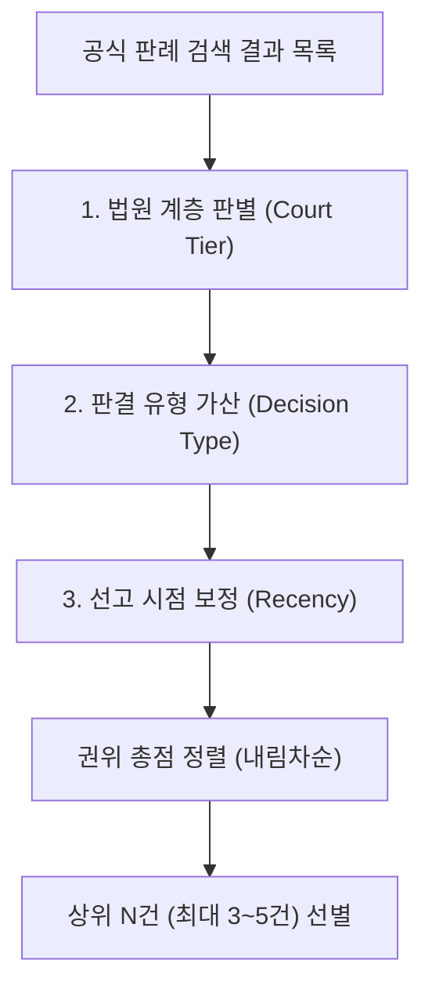

# [설계 메모] TK-138 관련 판례 탐색 및 판례 권위 가중 설계 메모

- **문서 위치**: `docs/handoff/requests/TK-138_related_precedents_design_memo.md`
- **작성일**: 2026-11-04 | **작성자**: Antigravity (구현 에이전트)
- **기준 브랜치**: Steve_ACASiaLAW `c503d11b` (TK-137 메모 병합 기준)
- **대상 티켓**: TK-138 (관련 판례 탐색 + 판례 권위 가중, TK-137 2단계)
- **수칙 준수**: 본 문서는 **설계 메모 전용(제품/시험 코드 0줄)**이며, finding 승격 금지·오프라인 점수 변화 0·사건 고유값 하드코딩 금지·지어낸 판례 인용 0 수칙을 엄수함.

---

## 1. 개요 및 배경

### 1.1 배경 및 문제의식
- 서면 내 법률적 주장(무리한 주장 포함) 검토 시, 언어 모델(LLM)에 자유로운 반박을 맡기면 **실재하지 않는 판례를 지어내거나(hallucination)**, 하급심 판결을 대법원 판례보다 상위 근거로 오인하는 왜곡이 발생할 수 있음.
- 공식 판례 DB(국가법령정보 `lawService.do?target=prec`)로부터 실재성이 보장된 판례 목록을 검색하고, 대한민국 사법 체계의 위계(대법원 전원합의체 > 대법원 판결 > 각급 하급심) 및 최신 선고 시점에 따라 **권위 가중치(Authority Weight)**를 산정·정렬하여 모델에 검토용 반대 근거(authority)로 제공해야 함.
- 이는 TK-137(제한형 관련 조문 탐색: 위임 및 명시 참조)에 이은 2단계 확장 기능임.

### 1.2 4대 핵심 원칙
1. **공식 조회 결과만 사용 (Zero Hallucinated Citations)**: 모델이 판례를 스스로 생성하는 것을 엄격히 차단하며, 오직 공식 API를 통해 실재성이 입증된 판례 메타데이터(사건번호·법원명·선고일자·판결요지)만 근거로 전달함.
2. **순수 검토 자료 격리 (Zero Finding Impact)**: 관련 판례 탐색 결과는 기존 finding(위반/주의 사항)으로 절대 승격되지 않으며, `advisory_only: True`의 순수 참고 검토 자료로만 격리됨.
3. **법원 계층·선고 시점 기반 권위 가중 정렬**: 대법원 전원합의체 판결을 최상위 권위로 두고, 법원 계층(대법원 > 고등법원 > 지방법원) 및 선고일자(최신순)에 따른 결정론적 정렬을 적용함.
4. **오프라인 0 영향 및 철저한 예산 가드**: 오프라인 벤치마크 및 네트워크 비활성화 환경(`allow_network == False`)에서는 조회를 완전히 생략(Skip)하여 고정/은퇴 세트 점수 변화 0을 보장하고, 단일 호출 12초·문서 누계 15초 예산을 준수함.

---

## 2. 세부 설계

### 2.1 [검색 대상 및 질의 구성] 공식 판례 검색 규격
- **공식 API**: 국가법령정보 Open API `lawService.do?target=prec&type=JSON` (`packages/source_adapters/law_go_kr.py`의 `search_case` 및 `_http_get` 재사용).
- **질의(Query) 구성 규칙 (개인정보 보호 엄수)**:
  - 당사자명, 개인 식별 정보, 사건 고유 문구는 검색 질의에 절대 포함하지 않음.
  - 서면에서 확인된 **핵심 법령 조문명**(예: `국가를 당사자로 하는 계약에 관한 법률 제15조`, `근로기준법 제23조`) 및 서면 검토 쟁점에서 추출된 **표준 법률 용어 키워드**(예: `지체상금 상계`, `부당해고 구제`, `신의성실의 원칙`)의 조합으로 정규화된 질의를 구성.
- **반환 데이터 정규화 (`_normalize_case_payload` 재사용)**:
  - 사건번호(`case_number`), 법원명(`court`), 선고일자(`decision_date`), 판결유형(`case_kind`), 사건명(`case_name`), 판시사항(`holding`), 판결요지(`summary`), 판례일련번호(`source_id`).
  - 본문 전문 전체를 한 번에 가져오지 않고, 목록 검색 응답에 포함된 판시사항 및 판결요지만을 1차 활용하여 네트워크 트래픽을 최소화함.

---

### 2.2 [권위 가중치 및 정렬 알고리즘] 법원 계층·판결 유형·선고 시점
검색된 판례 후보 목록을 아래 3대 축에 따라 점수화하여 내림차순 정렬함.



#### (1) 권위 점수 산정식
$$\text{Authority Score} = \text{Court Tier Score} + \text{Decision Type Bonus} + \text{Recency Factor}$$

1. **법원 계층 점수 ($\text{Court Tier}$)**:
   - **대법원**: 100점
   - **고등법원 / 특허법원**: 50점
   - **지방법원 / 가정법원 / 행정법원**: 20점
   - **기타/미확인**: 10점

2. **판결 유형 가산점 ($\text{Decision Type}$)**:
   - **전원합의체 판결**: +50점 (대법관 전원의 합의로 종전 판례를 변경하거나 중요 법리를 선언하므로 최고 권위 부여)
   - **통상 판결**: +0점
   - **결정 / 명령**: -10점 (종국 판결에 비해 규범적 기속력 보수적 평가)

3. **선고 시점 보정 ($\text{Recency Factor}$)**:
   - 동일 계층 및 동일 유형 내에서 최신 판례가 종전 법리를 구체화하거나 변경했을 가능성을 반영.
   - 선고일자 $YYYYMMDD$ 기준 선형 보정: $\frac{YYYYMMDD}{100,000,000}$ (예: 2024년 선고 $\approx 0.20$, 2000년 선고 $\approx 0.20$ 이하로, 상위 계층을 역전하지 않는 타이브레이커로 작용).

#### (2) 정렬 순위 결과
- **1순위**: 대법원 전원합의체 판결 (최신 선고일자 순)
- **2순위**: 대법원 통상 판결 (최신 선고일자 순)
- **3순위**: 고등법원 판결 (최신 선고일자 순)
- **4순위**: 지방법원 판결 (최신 선고일자 순)
- **최종 선별**: 상위 **최대 3건(필요시 최대 5건)**으로 엄격히 절삭(Truncate)하여 프롬프트 예산 초과 및 문맥 분산을 방지함.

---

### 2.3 [출력 위치 및 통합 렌더링] 기존 컨테이너 확장 (Zero-Finding)
- **컨테이너 위치**: 기존 `packages/legal_engine/related_authorities.py`의 `engine_data["related_authorities"]` dict 내 **`precedents`** 키로 확장.
- **데이터 스키마**:
  ```python
  engine_data["related_authorities"] = {
      "origin": "DISCOVERED_AUTHORITY",
      "status": "SOURCE_REVIEW_ONLY",
      "note": "관련 법령 및 권위 가중 관련 판례 검토",
      "candidates": [...],
      "verdicts": [...],
      "advisory_only": True,
      "delegation_status": "COMPLETED",
      "delegations": [...],            # TK-137
      "explicit_references": [...],   # TK-137
      # [TK-138 신규 확장 키]
      "precedent_status": "COMPLETED",  # COMPLETED | NETWORK_DISABLED | LIMIT_EXCEEDED | NO_RESULTS | SOURCE_OUTAGE
      "precedents": [
          {
              "case_number": "2020다293849",
              "court": "대법원",
              "decision_date": "2023-05-18",
              "case_name": "손해배상(기)",
              "case_kind": "전원합의체 판결",
              "authority_score": 150.2023,
              "authority_tier": "SUPREME_COURT_EN_BANC",  # EN_BANC | SUPREME_COURT | HIGH_COURT | DISTRICT_COURT
              "holding": "지체상금 약정의 법적 성질 및 감액 요건...",
              "summary": "민법 제398조 제2항에 따른 손해배상의 예정액 감액에 있어서...",
              "source_id": "123456",
          }
      ]
  }
  ```
- **법리 검토 모델(LLMRouter) 전달**:
  - `_semantic_review` 또는 법률적 주장 타당성 검토 시 `evidence["authorities"]["precedents"]`에 위 정렬된 상위 판례의 사건번호, 법원, 선고일자, 판결요지만을 전달.
  - 프롬프트 지침: *"제공된 공식 관련 판례 외에 임의로 가공의 사건번호나 판례를 인용하지 말고, 상위 권위 판례(대법원 전원합의체 등)의 취지에 비추어 당해 주장의 법리적 타당성을 검토하라."*

---

### 2.4 [시간 예산 및 네트워크 가드]
- **단일 호출 상한**: `settings.http_timeout` (기본 12.0초 준수).
- **문서 누계 예산**: 15.0초 상한 공유 (TK-137 조문 탐색과 시간 누적을 공유하며, 잔여 예산 부족 시 즉시 `precedent_status: "LIMIT_EXCEEDED"`로 안전 복귀).
- **네트워크 가드**: `settings.allow_network == False` 또는 `adapter.status() != AdapterStatus.READY` 시 즉시 `precedent_status: "NETWORK_DISABLED"` 반환 (호출 수 0).
- **장애 격리**: 어댑터 연속 실패(outage) 또는 차단 상태 시 외부 조회를 즉시 중단하여 파이프라인 지연을 방지함.

---

## 3. 측정 계획 및 미측정 항목

### 3.1 측정 계획 (온라인 OFF/ON 쌍 비교)
- **측정 원칙**: 오프라인 벤치마크(`eval_testset.py`, 고정/은퇴 세트) 점수는 회귀 방지(변화 0) 확인용으로만 사용하며, TK-138의 효과는 **온라인 공식 환경에서의 OFF/ON 쌍 비교**로만 측정함.
- **측정 지표**:
  1. **지어낸 인용 0 (Zero Hallucination)**: 모델 답변 내 공식 DB 미확인 판례 인용 발생 0건.
  2. **권위 정렬 정확도 100%**: 대법원 전원합의체 > 대법원 판결 > 하급심 정렬 순위 위배 0건.
  3. **예산 준수율 100%**: 타임아웃 발생 0건 및 15초 누적 예산 내 정상 완료.
  4. **Finding 불변성**: 기존 finding 개수 및 심각도 점수 변동 0건.

### 3.2 미측정 항목 (정직한 한계 명시)
- 공식 국가법령정보 API에 등록되지 않은 비공개 하급심 판례나 최근 2~3일 내 선고된 최신 판례의 반영 여부는 측정할 수 없음.
- 모델의 자연어 반박 논거 질적 수준은 주관적 평가 요소가 포함되므로 단일 수치로 단정하지 않음.

---

## 4. 수용 계획 및 사전 합성 시험 계획 (구현 지시 수신 시)

| 구분 | 검증 시나리오 / 합성 입력 | 기대 결과 |
|---|---|---|
| **양성 P1 (전합 우선)** | 대법원 전원합의체 판결과 대법원 일반 판결, 고등법원 판결이 동시 검색된 경우 | 전원합의체 판결이 1순위로 배치되고 `authority_tier: "SUPREME_COURT_EN_BANC"` 부여 |
| **양성 P2 (계층 정렬)** | 대법원 일반 판결(2015년)과 하급심 판결(2023년)이 동시 검색된 경우 | 연도가 앞서더라도 법원 계층에 따라 대법원 판결이 상위 순위로 정렬 |
| **양성 P3 (시점 정렬)** | 동일한 대법원 통상 판결 2건(2022년 선고 vs 2012년 선고)인 경우 | 2022년 선고 판결이 상위 순위로 정렬 |
| **대조 C1 (오프라인)** | `settings.allow_network = False` 환경 실행 | 네트워크 호출 0회, `precedents: []`, `status: "NETWORK_DISABLED"`, 점수 변동 0 |
| **대조 C2 (예산 초과)** | 누적 시간 15.0초 초과 시뮬레이션 | 추가 외부 API 호출 중단, `precedent_status: "LIMIT_EXCEEDED"`, 예외 미발생 |
| **대조 C3 (격리 검증)** | 무리한 주장 검토 결과 생성 전후 finding 비교 | finding 목록 및 점수 게이트 변동 0건 확인 |

---
**Agent: implementer**
