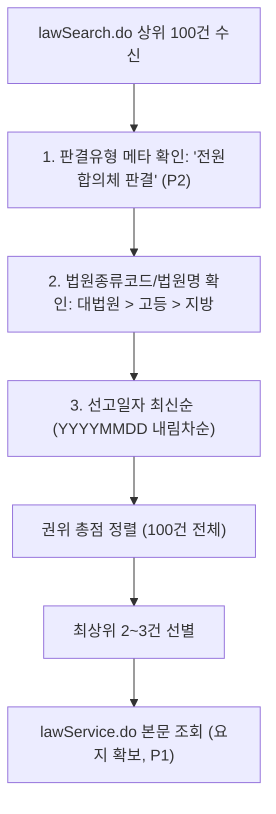

# [설계 메모] TK-138 관련 판례 탐색 및 판례 권위 가중 설계 메모 (보정본)

- **문서 위치**: `docs/handoff/requests/TK-138_related_precedents_design_memo.md`
- **작성일**: 2026-11-04 (보정본) | **작성자**: Antigravity (구현 에이전트)
- **기준 브랜치**: Steve_ACASiaLAW `c503d11b` (TK-137 메모 병합 기준)
- **대상 티켓**: TK-138 (관련 판례 탐색 + 판례 권위 가중, TK-137 2단계)
- **근거 자료**: 평가 측 보정 지시(P1~P9, 2026-11-04)
- **수칙 준수**: 본 문서는 **설계 메모 전용(제품/시험 코드 0줄)**이며, 오프라인 점수 변화 0·사건 고유값 하드코딩 금지·지어낸 판례 인용 0 수칙을 엄수함.

---

## 0. 평가 측 보정 지시(P1~P9) 반영 요약표

| 항목 | 핵심 지적 사항 | 보정 반영 내용 |
|---|---|---|
| **P1. 목록 응답 필드와 본문 조회 분리** | `lawSearch.do` 목록 응답에는 요지가 없으며, `lawService.do`는 검색이 아닌 본문 상세 조회임 | 1단계 목록 검색(`lawSearch.do?target=prec`, 검색 파라미터 정정)으로 상위 100건 메타 수집 $\to$ 권위 정렬 $\to$ 최상위 2~3건만 `lawService.do?target=prec&ID=` 본문 조회하여 요지 확보. 예산 부족 시 목록 메타로 안전 폴백. |
| **P2. 전원합의체 판별 결정성** | 본문 정규식 검색은 인용 언급 오탐 유발(2020도12017) | 목록 응답의 `판결유형 == "전원합의체 판결"`(2016다248998 확인) 값으로만 결정론적 판별. 본문 낱말 검색 완전 배제. |
| **P3. 질의 구성의 결정성** | 닫힌 낱말 사전/모델 생성 금지, 상위 몇 건 절삭 시 선택 편향 | 공식 확인된 인용 조문 `'법령명 제N조'`로 `search=2&display=100&page=1` 본문검색 수행. 100건 전체를 로컬에서 권위 정렬하므로 선택 편향 제거. |
| **P4. 연결 지점 하나로 확정** | `_semantic_review`와 무리한 주장 검토 경로 혼선 | 연결 지점을 **무리한 주장 검토 경로**(`packages/legal_engine/argument_validity_verifier.py` 및 `related_authorities.py`) 하나로 확정. TK-141 입력 예산(`_excerpt_budget_chars`)에 바이트 산입. |
| **P5. finding 영향 범위** | '변동 0'은 오프라인에만 해당, 온라인 측정 항목 정의 필요 | 오프라인 벤치마크는 회귀 방지(변동 0), 온라인 측정 지표로 ① 무리한 주장 판정 변화 건수, ② 지어낸 인용 0, ③ 제공 목록 밖 인용 0 정의. |
| **P6. 제공 목록 밖 사건번호 제거** | 모델 응답 내 임의 판례 인용 발생 시 처리 규칙 부재 | 모델 응답에서 사건번호 추출 $\to$ 제공된 `precedents` 목록 대조 $\to$ 미포함 사건번호는 인용 목록에서 자동 제거(`filtered_out_unprovided`) 및 반박 근거 배제. |
| **P7. 누계 15초 예산 분배** | TK-137과 시간 누적 공유 규칙 명확화 필요 | 누계 15.0초 중 TK-137 상한 8.0초, TK-138 잔여(최대 7.0초 이상). 새 호출 전 `남은 시간 >= 3.0초` 가드 적용, 본문 조회 최대 2~3건 제한. |
| **P8. 화면·보고서 위치 및 문구** | 병렬 자리 금지, 검토 자료 문구 및 PR 승인 절차 명시 | 기존 `engine_data["related_authorities"]` 화면/보고서 슬롯 활용. `[관련 판례] ... / 검토 자료` 표기. 화면 PR은 캡처·사용자 확인 뒤 수용. |
| **P9. 어댑터 낱말 검색 메서드** | `search_case`는 사건번호 전용임 | `search_cases_by_query(query, display=100, page=1)` 신설 규격 정의. |

---

## 1. 개요 및 배경

### 1.1 배경 및 목적
- 서면 내 법률적 주장(무리한 주장) 검토 시, 언어 모델(LLM)에 자유로운 반박을 맡기면 실재하지 않는 가공의 판례를 지어내거나(hallucination), 하급심 판결을 상위 근거로 오인하는 왜곡이 발생함.
- 공식 법제처 API(`lawSearch.do?target=prec`)로부터 실재성이 보장된 판례 목록을 검색하고, 대한민국 사법 체계의 위계(대법원 전원합의체 > 대법원 판결 > 각급 하급심) 및 최신 선고 시점에 따라 **권위 가중치(Authority Weight)**를 산정·정렬하여 모델에 검토용 반대 근거(authority)로 제공함.

### 1.2 핵심 원칙
1. **공식 조회 결과만 사용 (Zero Hallucinated Citations)**: 모델이 판례를 스스로 생성하는 것을 엄격히 차단하며, 오직 공식 API를 통해 실재성이 입증된 판례 메타데이터만 근거로 전달함.
2. **순수 검토 자료 격리 (Zero Finding Impact in Offline)**: 오프라인 벤치마크에서는 네트워크 비활성화로 판례 조회를 생략(점수 변화 0)하며, 온라인 환경에서도 finding으로의 임의 승격을 금지하고 `advisory_only: True`의 순수 참고 검토 자료로 격리함.
3. **결정론적 판별 및 권위 가중 정렬**: 목록 응답의 `판결유형` 메타데이터로 전원합의체를 식별하고, 법원 계층 및 선고일자 최신순에 따른 결정론적 정렬을 적용함.

---

## 2. 세부 설계 및 보정 지시(P1~P9) 반영

### 2.1 [검색 대상 및 질의 구성] 공식 판례 검색 규격 (P1, P3, P9 반영)
- **검색 엔드포인트**: 국가법령정보 Open API `lawSearch.do?target=prec&type=JSON` (P1 반영).
- **어댑터 메서드 신설 규격 (P9 반영)**:
  `packages/source_adapters/law_go_kr.py` 내 낱말/조문 전용 검색 메서드 추가:
  ```python
  def search_cases_by_query(self, query: str, *, display: int = 100, page: int = 1) -> AdapterResponse:
      """조문 본문 검색을 통해 관련 판례 목록을 조회한다 (lawSearch.do?target=prec&search=2)."""
      params = {
          "OC": self.api_key,
          "target": "prec",
          "type": "JSON",
          "search": 2,          # 본문 검색
          "query": query,        # 공식 확인된 조문명
          "display": display,    # 100건 (선택 편향 방지)
          "page": page,
      }
      # HTTP GET 및 _case_payload_shape_ok 검증 후 _normalize_case_payload 반환
  ```
- **질의(Query) 구성의 결정성 (P3 반영)**:
  - 닫힌 낱말 사전이나 모델 임의 생성 키워드는 완전 배제함(2-2 규약).
  - 서면 검토(`source_review`)에서 공식 확인된 **인용 조문명 `'법령명 제N조'`**(예: `근로기준법 제23조`, `국가를 당사자로 하는 계약에 관한 법률 제15조`)를 그대로 검색 질의어로 사용.
  - 복수 조문 인용 시 문서 내 인용 빈도 최상위 1~2개 조문으로 한정하여 호출 수를 제한.
- **선택 편향 방지 (P3 반영)**:
  - `display=100`, `page=1`로 상위 100건 목록을 한 번에 수신.
  - 상위 5~10건만 잘라 읽지 않고, **수신된 100건 전체 목록을 대상으로 로컬에서 권위 가중치 정렬**을 수행하므로 검색 순서에 따른 선택 편향을 완전히 제거함.

---

### 2.2 [권위 가중치 및 정렬 알고리즘] 법원 계층·전원합의체·선고 시점 (P1, P2 반영)



#### (1) 전원합의체 판별 규칙 (P2 반영)
- 본문 텍스트 내 정규식 검색 방식 완전 배제 (일반 판결 본문 내 전합 인용에 따른 오탐 방지).
- 목록 응답의 **`판결유형` 필드 값이 정확히 `'전원합의체 판결'`**(또는 `선고` 필드 일치)인 경우에만 전원합의체로 판별.
- `판결유형 == "결정"`은 결정례로 분류.

#### (2) 권위 점수 산정 및 정렬
1. **법원 계층**: 대법원(100점) > 고등법원/특허법원(50점) > 지방법원/행정법원/가정법원(20점) > 기타(10점).
2. **전원합의체 가산**: `판결유형 == "전원합의체 판결"`인 경우 **+50점 가산**. (결정례는 -10점)
3. **선고 시점**: 선고일자 $YYYYMMDD$ 기준 최신순 정렬 (동일 계층·유형 내 타이브레이커).
- **정렬 순서**:
  1. 대법원 전원합의체 판결 (최신순)
  2. 대법원 일반 판결 (최신순)
  3. 고등법원 판결 (최신순)
  4. 지방법원 판결 (최신순)

#### (3) 본문 상세 조회 및 요지 확보 (P1 반영)
- 목록 검색(`lawSearch.do`) 결과에는 `holding`(판시사항)과 `summary`(판결요지)가 없으므로:
- 정렬을 마친 **최상위 2~3건에 한해서만** `lawService.do?target=prec&ID={판례일련번호}&type=JSON` 본문 상세 조회를 수행하여 판결요지를 확보함.
- 본문 조회가 실패하거나 잔여 시간 예산이 부족할 경우, 목록 메타데이터(`사건번호`, `법원명`, `선고일자`, `사건명`)만으로 모델에 전달하도록 안전 폴백.

---

### 2.3 [연결 지점 및 프롬프트 예산] 단일 경로 확정 (P4 반영)
- **확정 연결 지점**: **무리한 주장 검토 경로** (`packages/legal_engine/argument_validity_verifier.py`의 주장 타당성 검토 및 `packages/legal_engine/related_authorities.py`의 `review_related_authorities`).
  - `_semantic_review`(인용 판례 의미 검토, pipeline.py 1432행)와 분리하여 원장 범위인 '무리한 주장 후보'에만 반대 권위 근거로 제공.
- **TK-141 입력 예산 산입 (P4 반영)**:
  - 모델에 전달되는 권위 판례 블록의 바이트 크기를 `_excerpt_budget_chars(input_cap, document_text)` 계산에 사전 산입하여 공급자 입력 한도를 초과하지 않도록 보장.
  - 기존 과업 문구(지침 텍스트) 줄은 임의로 수정하거나 치환하지 않고 제자리에 보존.

---

### 2.4 [모델 응답 내 비인가 인용 차단 규칙] (P6 반영)
- 모델이 제공된 공식 판례 외에 임의의 가공 판례나 목록 밖 사건번호를 인용하는 것을 결정론적으로 방지:
  1. 모델의 응답 텍스트(`rationale`, `evidence_quotes` 등)에서 사건번호 추출 정규식(`\d{2,4}[가-힣]+\d+`)으로 인용된 사건번호 집합 $C_{resp}$를 추출.
  2. 사전에 프롬프트로 제공한 권위 판례 사건번호 집합 $C_{provided}$와 대조.
  3. $C_{resp} \setminus C_{provided} \neq \emptyset$인 경우 (제공 목록 밖 사건번호 검출):
     - 해당 사건번호를 모델 인용 목록에서 **결정론적으로 제거**(`filtered_out_unprovided: True`).
     - 공식 출처 검증 파이프라인(`source_review`)을 거치지 않은 가공 인용으로 분류하여 `UNVERIFIED_INVENTED_IN_RESPONSE` 표기를 부여하고, 법률적 주장의 타당성 판단 근거에서 즉시 배제.

---

### 2.5 [시간 예산 분배 규칙] TK-137과의 누계 15초 공존 (P7 반영)
- 문서 단위 전체 공용 시간 예산: **15.0초**.
- **단계별 상한 분배**:
  - **TK-137 (조문 위임 및 명시 참조)**: 최대 **8.0초**. 8초 경과 시 추가 조문 조회를 중단하고 조기 완료.
  - **TK-138 (관련 판례 탐색)**: 잔여 예산 사용 (최소 7.0초 확보).
- **호출 전 가드**:
  - `lawSearch.do` 목록 검색 전: `남은 예산 >= 5.0초` 확인. 미달 시 즉시 `precedent_status: "BUDGET_EXHAUSTED"` 반환.
  - `lawService.do` 개별 본문 조회 전: `남은 예산 >= 3.0초` 확인. 미달 시 본문 조회를 생략하고 목록 메타데이터로 폴백.
  - 본문 조회 횟수는 최대 2~3건으로 제한하여 단일 문서 내 총 HTTP 호출 수를 최소화.

---

### 2.6 [출력 위치 및 화면·보고서 렌더링] (P8 반영)
- **병렬 컨테이너 신설 금지**: 기존 `engine_data["related_authorities"]` dict 내 **`precedents`** 키로 확장.
- **데이터 스키마**:
  ```python
  engine_data["related_authorities"]["precedent_status"] = "COMPLETED"  # COMPLETED | NETWORK_DISABLED | BUDGET_EXHAUSTED | NO_RESULTS
  engine_data["related_authorities"]["precedents"] = [
      {
          "case_number": "2016다248998",
          "court": "대법원",
          "decision_date": "2018-10-30",
          "case_name": "...",
          "case_kind": "전원합의체 판결",
          "authority_score": 150.2018,
          "authority_tier": "SUPREME_COURT_EN_BANC",
          "summary": "...",  # lawService.do 성공 시 요지, 미조회 시 빈 문자열
          "source_id": "123456",
          "detail_link": "https://...",
      }
  ]
  ```
- **화면 렌더링 (`apps/web/static/app.js`)**:
  - AI 탭 배제. 기존 참고자료/관련근거 패널(인용·참고자료 영역)에 배치.
  - 표기 문구: `[관련 판례] {사건번호} ({법원명}, {선고일자}, {판결유형}) / 검토 자료 (사건 당시 적용·주장 타당성은 별도 검토)`
  - 화면 PR 수용 조건: **화면 캡처 제출 및 사용자 확인 뒤 승인**.
- **보고서 렌더링 (`pdf_report.py`, `docx_report.py`)**:
  - `report_lines`에 `[관련 판례] {사건번호} ({법원명}, {선고일자}, {판결유형}) / 검토 자료` 라인 추가.

---

## 3. 측정 계획 및 검증 (P5 반영)

### 3.1 오프라인 벤치마크 (점수 변동 0)
- `settings.allow_network == False` 환경에서 실행.
- 네트워크 호출 0회, finding 생성 0건, 고정/은퇴 세트 점수 변동 0을 검증 (회귀 방지).

### 3.2 온라인 OFF/ON 측정 계획 (P5 반영)
- 공식 국가법령정보 API 및 모델이 활성화된 온라인 환경에서 동일 서면에 대해 관련 판례 OFF/ON 쌍 비교 수행:
  1. **무리한 주장 판정 변화 건수**: 권위 판례가 반대 근거로 제공됨에 따라 타당성 결여 또는 주의 의견으로 정밀화된 건수 집계.
  2. **지어낸 인용 0 (Zero Hallucination)**: 모델 답변 내 공식 DB 미확인 판례 인용 발생 0건 검증.
  3. **제공 목록 밖 인용 0건**: 모델이 제공된 `precedents` 외의 임의 사건번호를 인용하지 않고 프롬프트 제약에 엄격히 복종하는지 검증.

---

## 4. 수용 계획 및 사전 합성 시험 계획 (구현 단계)

| 구분 | 검증 시나리오 / 합성 입력 | 기대 결과 |
|---|---|---|
| **양성 P1 (전원합의체 판별)** | `판결유형: "전원합의체 판결"`과 일반 판결이 공존 | `authority_tier: "SUPREME_COURT_EN_BANC"` 부여 및 1순위 정렬 (P2) |
| **양성 P2 (본문 검색 100건 정렬)** | `search=2`로 100건 수신 후 대법원/하급심 혼재 | 선택 편향 없이 전체 100건 대상 권위 정렬 완료 (P3) |
| **양성 P3 (상위 요지 조회)** | 정렬된 최상위 2건에 대해 `lawService.do` 호출 | 상위 2건만 요지(`summary`) 채워지고 나머지는 메타 유지 (P1) |
| **대조 C1 (목록 밖 인용 제거)** | 모델 응답에 제공하지 않은 `2099다1234` 인용 포함 | P6 규칙에 의해 인용 목록에서 자동 제거 및 반박 근거 배제 |
| **대조 C2 (예산 분배 가드)** | TK-137이 8.5초 소진 후 진입 | 남은 예산 6.5초 확인, 잔여 3초 미만 도달 시 본문 조회 생략 후 복귀 (P7) |
| **대조 C3 (오프라인 회귀 방지)** | `allow_network = False` | 네트워크 호출 0, finding 변동 0, 고정/은퇴 점수 불변 (P5) |

---
**Agent: implementer**
