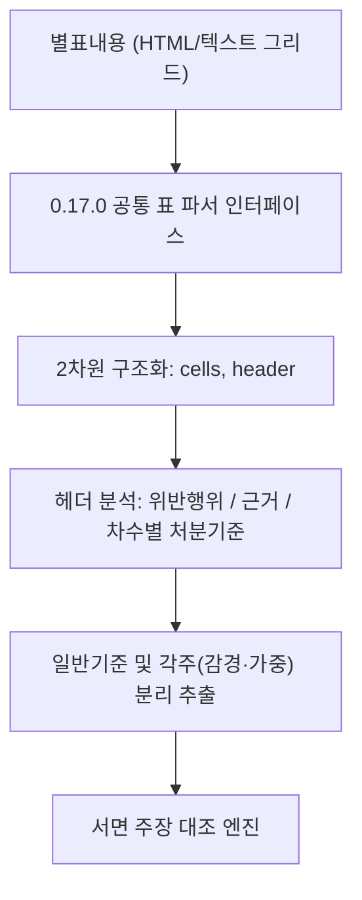

# [설계 메모] TK-139 처분기준 별표 대조 1유형 설계 메모

- **문서 위치**: `docs/handoff/requests/TK-139_disposition_criteria_design_memo.md`
- **작성일**: 2026-11-04 | **작성자**: Antigravity (구현 에이전트)
- **기준 브랜치**: Steve_ACASiaLAW `c503d11b`
- **대상 티켓**: TK-139 (처분기준 별표 대조 1유형)
- **수칙 준수**: 본 문서는 **설계 메모 전용(제품/시험 코드 0줄)**이며, 행 오연결 0·단위/각주 누락 0·구버전 혼동 0·불완전 표 확정 판정 0 수칙을 엄수함.

---

## 1. 개요 및 목적

### 1.1 배경
- 행정소송(영업정지·면허취소·과징금부과처분 취소 등) 및 행정심판 서면에서 당사자가 주장하는 행정처분의 내용(처분 수위, 기간, 부과금액, 위반 횟수)이 **처분 당시 효력이 있던 법령(시행령·시행규칙)의 [별표] 행정처분기준**에 부합하는지 여부는 재량권 일탈·남용 및 법령 위반을 가르는 핵심 쟁점임.
- 그러나 서면 주장과 별표를 기계적으로 매핑할 경우:
  1) 위반 사유가 다의적인데 엉뚱한 별표 행과 잘못 연결(행 오연결)하거나,
  2) 별표 일반기준/각주에 명시된 감경·가중 재량 범위를 무시하고 정액·정기 기준만을 단정하거나,
  3) 처분일 이후 개정된 신버전 또는 종전 구버전 별표를 혼동하여 오탐이 발생할 위험이 큼.
- 따라서 TK-139 1유형은 **확정된 효력일 버전의 별표 확보 $\to$ 0.17.0 표 파서 재사용 $\to$ 보수적 대조 및 엄격한 UNVERIFIED 안전 가드**를 통해 신뢰할 수 있는 처분기준 검토 결과를 제공하는 것을 목표로 함.

---

## 2. 법제처 별표 API 선행 조사 및 확보 구조

### 2.1 법제처 Open API 별표 응답 구조
- **법령 상세 연계 조회**: `lawService.do?target=eflaw&MST={MST}&efYd={efYd}&type=JSON`
  - 법령 상세 JSON 응답 내 루트(`법령` 또는 `LawService`)에 `별표` 노드가 존재함.
  - 구조: `별표` $\to$ `별표단위` (단일 객체 또는 리스트).
  - 필드 명세:
    - `별표구분`: `별표` 또는 `별지서식`.
    - `별표번호`: 4자리 숫자 문자열(예: `0001`, `0002`).
    - `별표가지번호`: 2자리 숫자 문자열(예: `00`).
    - `별표제목`: 별표 표제(예: `[별표 1] 행정처분기준(제○조 관련)`, `과징금 부과기준`).
    - `별표내용`: 표 본문 텍스트 또는 HTML 마크업.
    - `별표서식파일링크` / `별표PDF파일링크` / `별표HWP파일링크`: 파일 다운로드 URL.
- **별표/서식 전용 조회 타깃 (`target=licbfl`)**:
  - `lawSearch.do?target=licbfl`: 별표 목록 검색.
  - `lawService.do?target=licbfl&ID={ID}`: 개별 별표 상세 조회.

### 2.2 버전 일치 보장 (구버전 혼동 0 규칙)
- `source_review` 및 `temporal_review`에서 확정된 **해당 법령의 기준일(처분일/위반행위일) 효력 버전 MST**만을 별표 조회에 사용함.
- 법령 기본정보의 `시행일자(`effective_from`)`와 요청한 `efYd`가 정확히 일치하는지 재검증하며, 버전 불일치 또는 미확보 시 별표 대조를 즉시 중단하고 `status: "UNVERIFIED"`로 안전 처리함.

---

## 3. 표 구조화 및 0.17.0 표 파서 재사용



### 3.1 0.17.0 표 파서 계약 재사용
- 0.17.0에서 정립된 `doc.structure["tables"]`의 표준 표 규격(`table_ref`, `cells`, `header`)을 별표 표 파싱에 그대로 적용.
- 셀 병합(`rowspan`, `colspan`) 정규화:
  - 위반행위 대분류-소분류 병합 셀을 하위 행으로 전파하여 각 행이 완전한 `(대분류, 소분류, 근거법령, 1차, 2차, 3차)` 튜플을 갖도록 정규화.
- 불완전 표 탐지:
  - 행/열 크기 불일치, 셀 구분자 누락 등으로 정형화할 수 없는 경우 `partial_tables` 규격으로 분류하고 확정 대조를 거부.

---

## 4. 대조 알고리즘 및 4대 안전 가드 (수용 기준 엄수)

### 4.1 4대 안전 가드 규칙 (Zero Error Acceptance)

| 번호 | 수용 조건 | 실패 유형 | 방지 규칙 및 가드 메커니즘 |
|---|---|---|---|
| **G1** | **행 오연결 0건** | 서면의 위반 사실과 다른 별표 행을 잘못 연결하여 부당 처분으로 오진단 | 서면 기재 위반 사유와 별표 행의 어휘 유사도 및 조문 번호가 **단일 행으로 명확히 수렴하지 않는 경우(다의적/복수 후보)**, 절대 임의 선택하지 않고 `status: "UNVERIFIED (적용 행 특정 불가)"` 처리. |
| **G2** | **단위/각주 누락 0건** | 처분 단위(일/월/년, 원/만원) 혼동 및 감경/가중 각주 미반영 | 1) 단위 정규화: '2월'과 '60일', '500만원'과 '5,000,000원'의 단위를 엄격히 통일.<br>2) **각주/일반기준 감경 재량 가드**: 별표 하단에 "1/2 범위에서 감경 가능" 등의 재량 규정이 있는 경우, 기준 처분기간과 다르더라도 '위법'으로 단정하지 않고 `discretionary_scope_noted: True`로 병기. |
| **G3** | **구버전 혼동 0건** | 개정 전/후 다른 기준의 별표를 적용하여 잘못된 처분기준 비교 | 확정된 효력일 MST의 별표만 로드. 기준일 불명확 시 `status: "UNVERIFIED (기준일 미확정)"` 처리. |
| **G4** | **불완전 표 확정 판정 0건** | 별표 표 파싱 결함/누락 상태에서 오진단 생성 | 표 파싱 신뢰도 검증 통과(완전한 행/열 구조) 시에만 대조를 수행하며, 결함 시 finding 생성 0건 및 `status: "UNVERIFIED (별표 표 구조 불완전)"` 유지. |

---

## 5. 출력 데이터 스키마 및 격리 원칙

- **출력 위치**: `engine_data["related_authorities"]["disposition_criteria"]` 또는 `engine_data["disposition_criteria"]`
- **데이터 구조**:
  ```python
  {
      "status": "COMPLETED",  # COMPLETED | UNVERIFIED | NO_CRITERIA_TABLE
      "law_name": "식품위생법 시행규칙",
      "table_title": "[별표 23] 행정처분의 기준(제89조 관련)",
      "version_mst": "123456",
      "effective_date": "2023-01-01",
      "matched_row": {
          "category": "개별기준",
          "violation_item": "유통기한 경과 제품 조리·판매 목적 보관",
          "legal_basis": "제44조 제1항 제3호",
          "criteria_1st": "영업정지 15일",
          "criteria_2nd": "영업정지 1개월",
          "criteria_3rd": "영업정지 3개월"
      },
      "document_claim": {
          "violation": "유통기한 경과 제품 보관",
          "disposition": "영업정지 2개월",
          "violation_order": 1
      },
      "comparison_result": "DISCREPANCY_DETECTED",  # MATCHED | DISCREPANCY_DETECTED | UNVERIFIED
      "discretionary_notes": "위반사항 중 경미한 위반이거나 고의성이 없는 경우 처분기준의 1/2 범위에서 감경 가능(일반기준 제1호)",
      "advisory_only": True
  }
  ```

---

## 6. 측정 및 검증 계획

### 6.1 측정 원칙
- 오프라인 벤치마크 점수 변화 0 (기존 고정 및 은퇴 세트에 행정처분 별표 대상 서면이 없으며, 오프라인 환경에서 네트워크 호출 0).
- 온라인 OFF/ON 쌍 비교로 실제 행정소송 서면 대상 대조 정확도 측정.

### 6.2 사전 시험 계획 (구현 단계)
- **양성 P1 (정상 기준 일치)**: 처분기준과 서면 주장이 1차 위반 기준에 정확히 일치하는 경우 `MATCHED` 검증.
- **양성 P2 (기준 초과 불일치)**: 1차 위반 기준(15일) 대비 법정 한도를 초과한 처분(2개월) 주장 시 `DISCREPANCY_DETECTED` 검출.
- **대조 C1 (적용 행 모호)**: 위반 내용이 2개 이상의 행에 걸치는 경우 `UNVERIFIED` 복귀.
- **대조 C2 (각주 감경 사유)**: 1/2 감경 각주가 존재하는 경우 단정적 위반이 아닌 감경 재량 범위 검토 의견 표기.
- **대조 C3 (불완전 표)**: 비정형 표 입력 시 `UNVERIFIED` 처리 및 예외 0.

---
**Agent: implementer**
