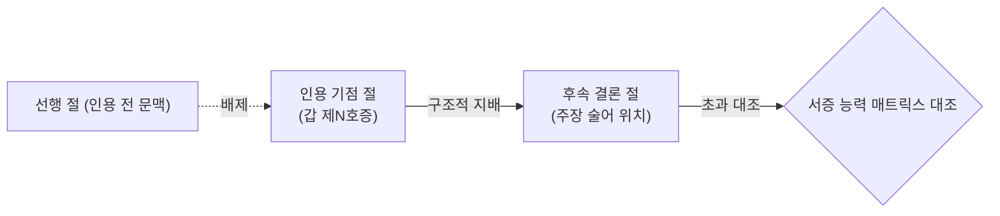

# [설계 메모] TK-76 3주기 PR3 서증 원용 범위 초과(EVI-OVR) 설계 메모 (재작성본)

- **문서 위치**: `docs/handoff/requests/TK-76_cycle3_evi_ovr_design_memo.md`
- **작성일**: 2026-11-04 (재작성본) | **작성자**: Antigravity (구현 에이전트)
- **기준 브랜치**: Steve_ACASiaLAW `c503d11b` (TK-76 PR2 병합 기준)
- **대상 범위**: TK-76 3주기 PR3 (EVI-OVR 서증 원용 범위 초과 단일 유형 한정)
- **근거 자료**: 승인 메모 `requests/128_tk91_evi_ovr_design_revision.md` 및 평가 측 재작성 지시(R1~R8, 2026-11-04)
- **수칙 준수**: 본 문서는 **설계 메모 전용(제품/시험 코드 0줄)**이며, 2-2 규약(문장틀 금지, 단일 유형 원칙, 2-2 다 필수 항목) 및 비공개 세트 비접근 수칙을 엄수함.

---

## 0. 평가 측 재작성 지시(R1~R8) 반영 요약표

| 항목 | 핵심 지적 사항 | 재작성 반영 내용 |
|---|---|---|
| **R1. 출처 및 비공개 추정 제거** | 손실 현황표의 비공개 고정/은퇴 세트 문맥·점수 추정은 2-2 가 위반 | 비공개 세트 문맥 및 점수 추정치 완전 삭제. 승인 메모 `128_tk91_evi_ovr_design_revision.md`의 **소송법상 서증 증명력 한계(7대 서증 능력 범주)** 법률 개념에서 출발. |
| **R2. 문장 틀 금지 (2-2 나-1)** | 연결 어미 추가안('명시·되어·있는·바와·같이' 등 3어절 이상)은 문장틀 위반 | 고정 낱말 정규식 연결 완전 삭제. **"서증 인용 토큰 뒤 동일 문장 내 결론 절까지를 지배 범위로 보는 절·문장 경계 구조 규칙"**으로 전면 전환. |
| **R3 & R4. EVI-INCONS 분리** | S1 닫힌 목록은 평가 코멘트 예문 위반이며, N월분은 계산기 결함임. 한 PR 한 유형 원칙 준수 필요 | EVI-INCONS 후속(S1 속성 경계 및 N월분 피연산자)은 **본 PR(#229)에서 완전히 삭제·분리**. 본 문서는 **EVI-OVR 단일 유형**만 다룸. |
| **R5. 2-2 다 항목 필수 명시** | 범주 사전 전체 목록, 득점 귀속표 계획, 3대 변형 시험, train 미득점 원인표 누락 | 2-2 다 필수 4대 항목(전체 사전 목록, 득점 귀속표, 어순·어미·동의어 변형 시험 계획, train 미득점 분석 계획)을 본문에 상세 기술. |
| **R6. 정당한 권리행사 대조군** | 계약 체결 술어 확장 시 형성권 행사 및 처분문서 원용 누락 | 형성권 행사('해제·해지·취소 의사표시 도달 $\to$ 해제됨') 및 처분문서(계약서·합의서) 원용을 정당한 대조군으로 명시하고 판정 제외 규정. |
| **R7. 상대방 주장 가드 구조화** | 가드 완화 범위가 모호함 | 인용 서증 제출자가 서면 작성 당사자(자기 측)이고, 결론 절이 작성자 자신의 주장 사실일 때만 가드를 완화. 탄핵 변론(C3)은 배제 유지. |
| **R8. 수용 기준 정정** | 점수 기여 추정은 수용 근거가 아님 | 점수 추정치 삭제. 평가 측 **비공개 탐침 양성 2/3 이상, 대조 오탐 0건, 고정/은퇴 점수 하락 0 및 오탐 0**을 수용 기준으로 정정. |

---

## 1. 개요 및 법률적 기초 (R1 반영)

### 1.1 소송법상 서증의 객관적 증명력 한계
- 민사소송 및 행정소송에서 서증은 그 종류와 작성 주체에 따라 **단독으로 직접 증명할 수 있는 객관적 사실의 범위**가 법률상 엄격히 제한됨.
- 예컨대 내용증명·최고서 등 '일방 통지류' 문서는 통지 사실 및 도달 사실만을 직접 증명할 수 있을 뿐, 상대방의 승낙이나 계약 체결, 통지 내용 자체의 진실성을 단독으로 증명할 수 없음.
- 그럼에도 불구하고 소송 서면에서 특정 서증이 지배하는 결론으로 그 서증의 객관적 범위를 현저히 초과하는 주장을 단정하는 경우, 이는 **'서증 원용 범위 초과(EVI-OVR)'**로서 논리적 비약에 해당함.

### 1.2 단일 유형 한정 원칙 (R4 반영)
- 본 설계 메모는 **EVI-OVR (증거 과장 / 서증 원용 범위 초과)** 단일 유형만을 다루며, EVI-INCONS의 잔여 후속 과제(S1 속성 경계 및 산식 N월분)는 본 PR 범위에서 완전히 제외함.

---

## 2. 서증 능력 대 주장 술어 범주 체계 (R5-1 필수 사전 목록 반영)

승인 메모 `128_tk91_evi_ovr_design_revision.md`에 기초하여, 장면별 고유 명사를 전면 배제하고 문법적 한정/전칭 표지 및 소송법적 문서 유형으로 닫힌 체계를 구성함.

### 2.1 7대 서증 종류 범주 전체 사전 (EVIDENCE_KIND_CATEGORIES)
1. **일방통지**: `내용증명`, `최고서`, `통고서`, `통지서`, `안내문`, `공문`, `내용증명우편`, `배달증명`
   - *직접 증명 범위*: 발송·도달 사실, 통지 의사표시의 고지 존재.
   - *초과 범위*: 상대방의 승낙, 계약 성립, 채무 승인, 일방 주장 사실 자체의 진실.
2. **견적계획**: `견적서`, `견적`, `공사계획서`, `산출내역서`, `공사비산출내역서`, `설계도`, `예산서`, `내역서`
   - *직접 증명 범위*: 제안 금액, 예정된 시공/용역 내역.
   - *초과 범위*: 실제 지급 완료, 공사/용역의 최종 완료, 확정적 계약 체결.
3. **명의식별**: `통장표지`, `통장사본`, `사업자등록증`, `등록증`, `신분증`, `가족관계증명서`, `주민등록등본`, `법인등기부`
   - *직접 증명 범위*: 계좌 개설 사실, 명의자 식별, 등록 사실.
   - *초과 범위*: 실제 금원 이체 완료, 대여금 지급 완료, 법률행위의 존재.
4. **진단상태**: `진단서`, `소견서`, `진료기록`, `의무기록`, `상해진단서`
   - *직접 증명 범위*: 진단 당시의 신체/물리적 상태 및 의학적 소견.
   - *초과 범위*: 가해자의 특정, 가해 행위의 존재, 고의/과실 등 불법행위 책임 단정.
5. **영상사진**: `사진`, `영상`, `캡처`, `녹화`, `동영상`, `화면캡처`
   - *직접 증명 범위*: 촬영 당시 시점의 외형적 상태.
   - *초과 범위*: 전 기간에 걸친 계속성, 행위자의 내심의 악의/의사.
6. **영수입금**: `영수증`, `입금증`, `이체확인증`, `송금확인증`, `무통장입금표`, `계좌이체영수증`, `입금확인증`, `계좌거래내역`, `통장거래내역`, `거래내역`, `세금계산서`, `지급증명서`, `확인증`
   - *직접 증명 범위*: 해당 기재 금액의 수령 및 입금 사실.
   - *초과 범위*: 별개 채무를 포함한 전체 채무의 완전 변제, 전액 정산 완료.
7. **진술확인**: `확인서`, `인우보증서`, `진술서`, `사실확인서`
   - *직접 증명 범위*: 제3자 작성자의 진술 존재 사실.
   - *초과 범위*: 당사자 간의 객관적 법률관계 확정 (C등급 한정).

### 2.2 주장 술어 범주 전체 사전 (CLAIM_PREDICATE_CATEGORIES)
1. **전칭_전기간 (문법 부사)**: `항상`, `매번`, `모든`, `계속`, `내내`, `줄곧`, `일체`
2. **내심의상태**: `고의`, `악의`, `인식`, `공모`, `통모`
3. **완료_확정**: `완납`, `완료`, `변제`, `이행완료`, `지급완료`, `정산완료`, `시공완료`, `준공`, `완성`, `확정`, `확정되었`
4. **상대방의사표시 및 계약성립 (R6 반영)**: `승낙`, `승인`, `동의`, `합의`, `수락`, `계약체결`, `약정성립`, `체결되었`, `성립되었`

---

## 3. 구조적 지배 범위 및 가드 설계 (R2, R6, R7 반영)

### 3.1 문장 틀 없는 구조적 지배 범위 산출 규칙 (R2 반영)
- 특정 고정 연결어 어미 정규식 나열을 전면 배제함 (규약 2-2 나-1 준수).
- **절·문장 경계 기반 구조 규칙**:
  1. 문장을 문장부호(`,`, `;`) 및 대등/종속 접속 어미로 절(clause) 목록으로 분할.
  2. 서증 인용 토큰(`(갑|을|병) 제\d+호증`)이 위치한 절을 **'인용 기점 절'**로 식별.
  3. 인용 기점 절 및 해당 토큰 뒤에 이어지는 동일 문장 내 후속 절들을 결론 술어까지 **'지배 범위(`proof_scope`)'**로 지정.
  4. 인용 토큰보다 앞서 위치한 절은 인용의 지배를 받지 않으므로 증명 대상 범위에서 제외.

### 3.2 정당한 권리행사 및 처분문서 대조군 (R6 반영)
- 일방통지라도 법률상 도달로써 효력이 발생하는 **형성권 행사**는 EVI-OVR 대상에서 제외:
  - `해제`, `해지`, `취소`, `상계`, `철회`의 의사표시 통지 및 그에 따른 효력 발생 주장 $\to$ **정상 변론 (판정 제외)**.
- **처분문서 원용**:
  - `계약서`, `합의서`, `공정증서` 등 처분문서 원용은 계약 체결 및 합의 성립의 직접 증거이므로 $\to$ **정상 원용 (판정 제외)**.

### 3.3 상대방 주장 가드의 구조적 한정 (R7 반영)
- 기존 `_is_opponent_claim` 가드가 작성자의 정상적인 탄핵 변론까지 일괄 배제하던 문제를 해결:
  - **가드 완화 조건**:
    1) 인용 서증의 제출자가 서면 작성 당사자(자기 측 서증)이고,
    2) 후속 결론 절의 주어/술어가 작성자 자신의 주장 사실인 경우에 한해서만 상대방 주장 가드를 완화하여 EVI-OVR 검출 허용.
  - **배제 유지 (대조군 보존)**:
    - 상대방의 주장을 인용하여 반박/탄핵하는 문맥(예: "원고는 채무를 완제하였다고 주장하나, 을 제1호증에 비추어 보면 사실이 아니다")은 **정상 탄핵 변론이므로 판정 제외 유지 (C3 대조군 유지)**.

---

## 4. 2-2 다 규약 필수 계획 (R5 반영)

### 4.1 규칙별 득점 귀속표 계획 (R5-2)
구현 후 아래 표에 따라 각 서증 범주 $\times$ 술어 범주별로 검출 건수를 기록하고 귀속을 검증함.

| 규칙 ID | 서증 범주 | 주장 술어 범주 | 판정 코드 | 기대 판정 등급 |
|---|---|---|---|:---:|
| **OVR-01** | 일방통지 | 상대방의사표시 / 계약성립 | `NOTICE_AGREEMENT_OVERREACH` | B |
| **OVR-02** | 일방통지 | 완료_확정 | `NOTICE_COMPLETION_OVERREACH` | B |
| **OVR-03** | 견적계획 | 완료_확정 / 계약성립 | `ESTIMATE_COMPLETION_OVERREACH` | B |
| **OVR-04** | 명의식별 | 완료_확정 (금원지급) | `IDENTIFIER_PAYMENT_OVERREACH` | B |
| **OVR-05** | 진단상태 | 내심의상태 (고의/가해) | `DIAGNOSIS_INTENT_OVERREACH` | B |
| **OVR-06** | 영상사진 | 전칭_전기간 / 내심의상태 | `PHOTO_CONTINUITY_OVERREACH` | B |
| **OVR-07** | 영수입금 | 전칭_전기간 (채무전액완제) | `RECEIPT_TOTAL_DEBT_OVERREACH` | B |
| **OVR-08** | 진술확인 | 법률관계 확정 | `STATEMENT_LEGAL_OVERREACH` | C |

### 4.2 변형 시험 계획 (R5-3: 3대 변형)
동일한 사실관계에 대해 표현 틀에 갇히지 않음을 입증하기 위해 각 규칙마다 3대 변형을 의무 시행:
1. **어순 변형**: 서증 인용이 문두에 오는 경우 vs 문중/문미에 오는 경우.
2. **연결 어미 변형**: 대등 연결(`,`, `하며`), 종속 연결(`-하므로`, `-하여`), 단순 병렬(`-한바`).
3. **동의어 변형**: 같은 범주 내 다른 서증명(내용증명 vs 최고서 vs 통고서) 및 다른 술어(완납 vs 변제 vs 이행완료).

### 4.3 train 미득점 원인표 계획 (R5-4)
공개 train 데이터셋 재실행 시 검출되지 않은 항목에 대해 아래 원인 분류표를 작성하여 보고서에 첨부:
- 분류 A: 서증 목록 미기재 또는 서증 번호 파싱 불가.
- 분류 B: 복수 서증 결합 원용에 따른 증명력 충족(정상 판정 제외).
- 분류 C: 형성권 행사 또는 처분문서 원용(정당한 권리행사).
- 분류 D: 상대방 주장 탄핵 문맥(정상 변론).

---

## 5. 수용 계획 및 사전 시험 명세 (R8 반영)

### 5.1 엄격한 수용 기준 (R8 반영)
- 평가 측이 판정용으로 새로 구축하는 **비공개 탐침에서 양성 2/3 이상 검출**.
- 비공개 대조군 시험에서 **오탐 0건**.
- 고정 세트(dev/holdout) 및 은퇴 세트에서 **점수 하락 0 및 오탐 0건** (회귀 0).

### 5.2 사전 시험 시나리오 (양성 3건, 대조 3건)

| 구분 | 검증 시나리오 / 합성 입력 | 기대 결과 |
|---|---|---|
| **양성 P1 (일방통지 계약단정)** | "원고는 최고서(갑 제1호증)를 발송하여 본건 매매계약이 유효하게 성립되었습니다." | EVI-OVR 검출 (`NOTICE_AGREEMENT_OVERREACH`) |
| **양성 P2 (견적서 공사완료)** | "갑 제2호증(공사견적내역서)에 의하여 본건 인테리어 공사가 모두 완료되었습니다." | EVI-OVR 검출 (`ESTIMATE_COMPLETION_OVERREACH`) |
| **양성 P3 (일부영수 전액완제)** | "원고는 갑 제3호증(입금확인증)으로 본건 채무 5,000만원 전액을 완제하였습니다." | EVI-OVR 검출 (`RECEIPT_TOTAL_DEBT_OVERREACH`) |
| **대조 C1 (형성권 행사 통지)** | "원고는 최고서(갑 제1호증)로써 계약 해제의 의사표시를 통지하여 해제되었습니다." | 정상 원용 (형성권 행사이므로 오탐 0, R6) |
| **대조 C2 (처분문서 확정 증명)** | "갑 제4호증(합의서)에 의하여 피고와 사이에 본건 합의가 성립되었습니다." | 정상 원용 (합의서는 처분문서이므로 오탐 0, R6) |
| **대조 C3 (상대방 주장 탄핵)** | "원고는 채무를 완제하였다고 주장하나, 을 제1호증에 비추어 보면 이는 사실이 아닙니다." | 정상 변론 (탄핵 문맥이므로 오탐 0, R7) |

---
**Agent: implementer**
