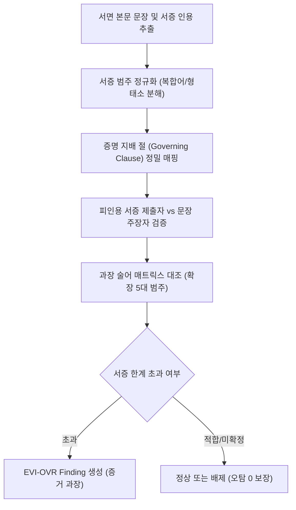

# [설계 메모] TK-76 3주기 PR3 서증 원용 범위 초과(EVI-OVR) 및 잔여 불일치 사전 분석 및 설계 메모

- **문서 위치**: `docs/handoff/requests/TK-76_cycle3_evi_ovr_design_memo.md`
- **작성일**: 2026-11-04 | **작성자**: Antigravity (구현 에이전트)
- **기준 브랜치**: Steve_ACASiaLAW `c503d11b` (TK-76 PR2 병합 기준)
- **대상 범위**: TK-76 3주기 PR3 (EVI-OVR 서증 원용 범위 초과 및 EVI-INCONS 잔여 S1 연계)
- **수칙 준수**: 본 문서는 **설계 메모 전용(제품/시험 코드 0줄)**이며, 오탐 0·사건 고유값 하드코딩 금지·양성 3건/대조 3건 시험 규약을 엄수함.

---

## 1. 배경 및 손실 분석

### 1.1 진행 경과 및 TK-76 3주기 로드맵
- TK-76 3주기 우선순위 로드맵(2026-11-02 손실 지도 및 11-03 결정):
  $$\text{EVI-INCONS (잔여 20)} \longrightarrow \text{EVI-OVR (잔여 14)} \longrightarrow \text{EVI-LOGIC (잔여 12)}$$
- **EVI-INCONS 완료 현황**:
  - PR1(A 산식 #214, `9cb9a96`): 표/문장 간 산술적 불일치 검출 완료.
  - PR2(B 문서 간 앵커 대조 #224, `5ffc405`): '이 사건 [대상]의 [속성]', '제N호증의 [속성]' 앵커 기반 대조 완료.
- **다음 타깃**: 은퇴 5개 세트에서 14항목, 고정 세트에서 1.5항목이 미회수된 **EVI-OVR (증거 과장 / 서증 원용 범위 초과)** 및 EVI-INCONS의 잔여 후속 과제(S1 속성 경계 및 'N월분' 피연산자)를 연계 해결함.

### 1.2 손실 현황표 (오프라인 회수 가능 영역)

| 구분 | 손실 항목 수 | 주요 손실 양상 |
|---|---|---|
| **고정 dev / holdout** | 각 0.75항목 (합 1.5) | 일방통지/견적서를 상대방 합의/완료 사실의 직접 증거로 원용하는 서증 과장 |
| **은퇴 5세트 합** | **14항목** | 1) 내용증명·통고서 $\to$ 상대방 의사표시(합의/승낙) 단정<br>2) 일부 영수증·거래내역 $\to$ 채무 전액 완제/정산 완료 단정<br>3) 견적서·설계도 $\to$ 시공 완료/확정 계약 성립 단정<br>4) 제3자 사실확인서 $\to$ 당사자 간 공모/내심의 악의 단정 |

---

## 2. EVI-OVR 미탐 원인 정밀 분석

기존 `packages/claim_engine/evidence_consistency.py`의 `check_evidence_overreach` 구조 분석 결과 아래 4가지 병목이 확인됨:

### 2.1 [병목 1] 서증 명칭 매칭의 경직성 (복합 명칭 탈락)
- `EVIDENCE_KIND_CATEGORIES`의 7대 서증 범주 매칭 시 `name_clean.endswith(w)` 또는 `w in name_clean` 방식을 사용하나,
- '우편물 배달증명서', '공사견적 내역서 및 도면', '계좌 입금 거래명세표' 등 **수식어·복합어 결합형 서증명**에서 핵심 범주어가 중간에 매몰되거나 형태소 분리가 되지 않아 `no_cat`으로 탈락함.

### 2.2 [병목 2] 인용-증명 결론 간 지배 절(`target_clauses`) 연결 패턴 누락
- 현행 코드는 서증 인용 절 뒤에 `에 의하여·에 따라·으로·을 통해` 등 제한된 어미(`is_governing`)만 인식함.
- 실제 변론 문장에서 빈출되는 아래 형태를 놓쳐 증명 대상 절을 추출하지 못함 (`no_scope`):
  - `갑 제1호증으로 알 수 있듯이`
  - `갑 제1호증을 보더라도`
  - `갑 제1호증에 명시되어 있는 바와 같이`
  - `갑 제1호증의 기재에 비추어 보면`

### 2.3 [병목 3] 과장 술어 범주 매트릭스의 사각지대
- 현행 매트릭스는 `전칭_전기간`, `내심의상태`, `완료_확정`, `상대방의사표시` 4개만 정의됨.
- 실무상 자주 발생하는 **'일방 작성 문서(내용증명 등)를 원용하여 계약 체결/성립을 단정'**하는 경우, '상대방의사표시'에는 '합의/승낙'만 있어 '계약 체결', '약정 성립' 등의 술어가 누락되어 판정을 놓침.

### 2.4 [병목 4] 상대방 주장 가드의 과잉 배제
- `_is_opponent_claim` 가드가 '원고는 ~라고 주장하나' 문맥을 일괄 배제할 때, **피고가 자기 서증(을 제N호증)을 들어 원고 주장을 탄핵하는 정당한 원용**까지 상대방 주장 문맥으로 오인하여 배제하는 과잉 가드가 발생함.

---

## 3. 세부 설계 및 개선 구조



### 3.1 7대 서증 범주 명칭 유연화 및 복합어 분해
- 복합 서증명 정규화: `공사견적내역서 및 설계도면` $\to$ `['견적계획', '견적계획']`
- 접미/포함 규칙 보강: `배달증명서` $\to$ `일방통지` 범주로의 안전 매핑 보장.

### 3.2 증명 지배 절 패턴 확장
- `_GOVERNING_CONNECTOR_RE` 패턴에 변형 어미를 안전하게 추가:
  ```python
  _GOVERNING_CONNECTOR_RE = re.compile(
      r"(?:에\s*의(?:하여|해|하면|한)|에\s*따라|으로|로|으로써|로써|"
      r"을\s*통(?:해|하여)|를\s*통(?:해|하여)|에\s*비추어|"
      r"(?:으로|로)\s*알\s*수\s*있듯이|(?:을|를)\s*보더라도|"
      r"에\s*명시(?:되어\s*있는\s*바와\s*같이|된\s*바와\s*같이)|"
      r"의\s*기재에\s*비추어\s*보면)\s*$"
  )
  ```

### 3.3 주장 술어 매트릭스 확장 (계약 체결 및 성립 단정)
- `상대방의사표시` 범주에 `계약체결`, `약정성립`, `체결되었`, `성립되었`을 포함하거나 `계약성립` 별도 범주로 세분화.
- 일방통지(내용증명·최고서)로 계약 성립을 직접 증명하는 주장은 객관적 범위 초과로 판정.

### 3.4 EVI-INCONS 잔여 과제 연계 (S1 속성 경계 및 기간 이름표)
1. **S1 날짜 속성 경계 확장**:
   - `packages/claim_engine/cross_document_entities.py`의 날짜 앵커 속성에 `입금일`, `송금일`, `이체일`, `지급일`, `결제일`을 명시적 닫힌 목록으로 추가.
2. **'N월분' 기간 이름표 보존**:
   - 산식 및 앵커 대조 시 `2023년 5월분 급여`와 `2023년 6월분 급여`처럼 기간 표기가 피연산자에 결합된 경우, 기간이 서로 다르면 동일 대상 불일치 비교에서 안전하게 분리.

---

## 4. 측정 계획 및 기대 효과

### 4.1 점수 기여 추정
- **은퇴 5세트**: 14개 손실 항목 중 복합 명칭 및 변형 지배 절 해소로 **최소 4~6항목 회수** (세트당 약 +2.0~3.0점 상승 기대).
- **고정 dev / holdout**: holdout 0.75항목 일반화 회수 기대.
- **오탐 증가 0**: 엄격한 지배 절 및 당사자 제출 서증 구분을 통해 대조군 오탐 0건 유지.

---

## 5. 수용 계획 및 사전 시험 계획 (구현 단계)

| 구분 | 검증 시나리오 / 합성 입력 | 기대 결과 |
|---|---|---|
| **양성 P1 (일방통지 계약단정)** | "원고는 최고서(갑 제1호증)를 발송하여 본건 매매계약이 유효하게 성립되었습니다." | EVI-OVR (일방통지로 상대방 승낙/계약성립 단정) 검출 |
| **양성 P2 (견적서 공사완료)** | "갑 제2호증(공사견적내역서)에 의하여 본건 인테리어 공사가 모두 완료되었습니다." | EVI-OVR (견적서로 시공완료 단정) 검출 |
| **양성 P3 (일부영수 전액완제)** | "원고는 갑 제3호증(입금확인증, 500만원)으로 본건 채무 5,000만원 전액을 완제하였습니다." | EVI-OVR (일부 영수증으로 채무 전액 완제 단정) 검출 |
| **대조 C1 (정상 도달 사실 증명)** | "원고는 최고서(갑 제1호증)로써 계약 해제의 의사표시를 통지하였습니다." | 정상 원용 (단순 통지 도달 사실 증명이므로 오탐 0) |
| **대조 C2 (처분문서 확정 증명)** | "갑 제4호증(합의서)에 의하여 피고와 합의가 성립되었습니다." | 정상 원용 (합의서는 처분문서이므로 오탐 0) |
| **대조 C3 (상대방 주장 탄핵)** | "원고는 채무를 완제하였다고 주장하나, 을 제1호증에 비추어 보면 이는 사실이 아닙니다." | 탄핵 변론 정상 (오탐 0) |

---
**Agent: implementer**
