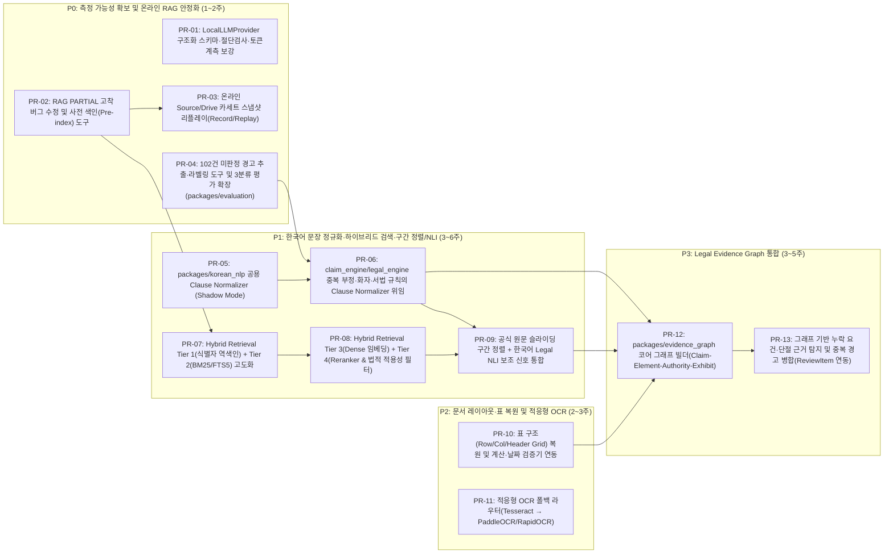

# AegisLAW (ACASia_LAW) 차세대 고도화 단계별 구현 및 PR 분할 계획서 (Step C)

- **작성일**: 2026-11-19
- **적용 원칙**:
  1. **작고 독립적인 PR 단위**: 각 PR은 단일 책임을 가지며, 기존 CI 필수 게이트 3개(`점수 하락 게이트` · `테스트` · `Docker OCR readiness`)를 통과해야 병합한다.
  2. **Feature Flag 기반 점진적 롤아웃**: 모든 신규 분석·검색·추론 계층은 `Shadow Mode (관측만 수행, 판정 불변) → Canary (옵트인 프로필 적용) → Default (기본 활성화)` 3단계로 전환한다.
  3. **`AGENTS.md` 규칙 엄수**:
     - 보호 경로(`tests/acceptance/**`, `tests/fixtures/**`, `scripts/eval_testset.py`, `scripts/scorecard.py`, `scripts/score_gate.py`, `docs/scorecards/**` 등)는 구현 PR에서 직접 수정하지 않으며, 평가 측 반영이 필요한 사항은 `docs/handoff/requests/`에 요청 티켓으로 제출한다.
     - 사건 고유 리터럴(당사자명, 사건번호, 금액, 서면 한글 10자 이상 문구, 영문 대문자 12자 이상 식별자) 하드코딩을 금지하고, 신규 규칙은 **서로 다른 양성 예시 3건 이상 + 대조군 3건 이상**의 단위 시험을 반드시 동반한다.

---

## 1. 우선순위 로드맵 및 PR 의존성 그래프

---

## 2. PR 단위 상세 실행 계획

### Phase P0 — 측정 가능성 확보, 온라인 RAG 안정화 및 즉시 결함 수정

#### PR-01: `LocalLLMProvider` 구조화 출력·절단 검출·사용량 계측 보강
- **대상 파일**:
  - [`packages/llm_router/providers.py`](file:///home/antigravity/stevelee0119/ACASia_LAW/packages/llm_router/providers.py#L479-L523)
  - [`packages/common/config.py`](file:///home/antigravity/stevelee0119/ACASia_LAW/packages/common/config.py) (`local_llm_backend: str = "openai_compat"`, `local_llm_guided_json: bool = True`)
  - `tests/unit/test_local_llm_provider.py` (신규)
- **구현 내용**:
  1. `request.schema`가 주어졌을 때 `vllm`/`openai_compat`(`response_format: json_schema`) 및 `ollama`(`format: schema`) 백엔드별 JSON 스키마 강제 파라미터를 전송한다.
  2. 응답에서 `finish_reason`을 추출해 `_checked()`를 호출함으로써 토큰 상한 절단(`length`) 시 `LLMTruncatedResponseError`를 발생시킨다.
  3. `data.get("usage")`에서 `prompt_tokens`, `completion_tokens`를 추출해 `LLMResponse`에 반영한다.
- **리스크 및 안전장치**: 기존 오프라인 회귀 시험에는 영향 없음(로컬 LLM 호출 모킹 단위 시험 6건 이상 추가).
- **완료 기준**: 스키마 강제·절단 예외·토큰 집계 단위 시험 100% 통과.

#### PR-02: 온라인 RAG `PARTIAL` 영구 고착 해소 및 사전 색인(Pre-indexing) 러너
- **대상 파일**:
  - [`packages/rag_engine/extract.py`](file:///home/antigravity/stevelee0119/ACASia_LAW/packages/rag_engine/extract.py)
  - [`packages/rag_engine/library.py`](file:///home/antigravity/stevelee0119/ACASia_LAW/packages/rag_engine/library.py)
  - `packages/rag_engine/preindex.py` (신규: 배치 완독 색인기 및 `coverage_ledger` 리포트)
  - `tests/unit/test_rag_preindex_and_continuation.py` (신규)
- **구현 내용**:
  1. 시각 전용 페이지 및 `continuation=None`인 `PARTIAL` 파일이 캐시에서 영구 재사용되지 않도록 재추출 조건과 원인 분류(`BUDGET_EXHAUSTED` vs `RENDER_UNAVAILABLE`)를 바로잡는다(열린 PR `#349` TK-208과 정합성 유지).
  2. 검증 실행 전에 Drive 참고자료를 전 페이지 완독(`STATUS_COMPLETE`)할 때까지 배치 추출하는 `preindex_drive_library()` 함수와 페이지 완독률 지표를 추가한다.
- **완료 기준**: 다중 페이지 스캔 PDF 픽스처에서 배치 사전 색인 후 `PARTIAL` 0건, 페이지 완독률 100% 확인.

#### PR-03: 외부 공식 DB 및 Drive 조회의 카세트 스냅샷 리플레이 (`RECORD` / `REPLAY`)
- **대상 파일**:
  - [`packages/source_adapters/transport.py`](file:///home/antigravity/stevelee0119/ACASia_LAW/packages/source_adapters/transport.py)
  - `packages/source_adapters/cassette.py` (신규)
  - [`packages/common/config.py`](file:///home/antigravity/stevelee0119/ACASia_LAW/packages/common/config.py) (`source_replay_mode: str = "LIVE"`, `source_cassette_dir: Optional[str] = None`)
  - `tests/unit/test_source_cassette_replay.py` (신규)
- **구현 내용**:
  1. `transport.py`의 HTTP 요청 계층에 카세트 인터셉터를 추가하여 `RECORD` 모드에서는 정규화 요청 키와 PII 검증을 거친 응답 스냅샷을 저장하고, `REPLAY` 모드에서는 네트워크 없이 결정론적으로 응답을 재생한다.
  2. 카세트에 PII가 포함되거나 스냅샷 유효기간(`max_age_days`)이 만료된 경우 fail-closed로 차단한다.
- **완료 기준**: 네트워크 차단(`LV_ALLOW_NETWORK=0`, `LV_SOURCE_REPLAY_MODE=REPLAY`) 상태에서 녹화된 공식 판례·법령 응답으로 Level 1~4 판례·법령 검증이 라이브와 100% 동일한 결과를 생성함을 입증.

#### PR-04: 102건 미판정 경고 아티팩트 추출기 및 3분류 평가 확장 (`packages/evaluation/`)
- **대상 파일**:
  - [`packages/evaluation/schemas.py`](file:///home/antigravity/stevelee0119/ACASia_LAW/packages/evaluation/schemas.py)
  - [`packages/evaluation/quality.py`](file:///home/antigravity/stevelee0119/ACASia_LAW/packages/evaluation/quality.py)
  - `packages/evaluation/adjudication.py` (신규)
  - `docs/handoff/requests/REQ_NEXT_GEN_EVALUATION_SCORECARD.md` (평가 에이전트용 핸드오프 요청)
  - `tests/unit/test_evaluation_adjudication.py` (신규)
- **구현 내용**:
  1. 보호 경로(`scripts/scorecard.py`, `scripts/evaluation_v2.py`)를 수정하지 않고, `packages/evaluation/adjudication.py`에 검증 실행 결과 JSON으로부터 미판정 경고(102건)를 추출·중복 클러스터링·라벨링(`TRUE_DEFECT_UNLISTED`, `TRUE_DEFECT_TOKEN_MISMATCH`, `DUPLICATE_FINDING`, `OVERREACH_FALSE_POSITIVE`, `ADVISORY_MISCLASSIFIED`)하고 오프라인 결함을 3분류(`OFFLINE_VERIFIABLE`, `EXTERNAL_SOURCE_REQUIRED`, `SOURCE_AVAILABLE_MISSED`)로 집계하는 순수 함수를 구현한다.
- **완료 기준**: 단위 시험 통과 및 102건 미판정 경고의 결함 유형·엔진·중복 클러스터 분포표 생성 가능.

---

### Phase P1 — 한국어 문장 정규화기, 하이브리드 RAG, 구간 정렬 및 Legal NLI

#### PR-05: `packages/korean_nlp` 공용 Korean Legal Clause Normalizer 신설 (Shadow Mode)
- **대상 파일**:
  - `packages/korean_nlp/__init__.py`, `tokenizer.py`, `clause_normalizer.py`, `legal_dictionary.py` (신규)
  - `docs/handoff/requests/DESIGN_CLAUSE_NORMALIZER.md` (`AGENTS.md` 규칙: 검출 휴리스틱 변경 전 1쪽 설계 메모 선발행)
  - `tests/unit/test_korean_clause_normalizer.py` (신규: 문형별 양성 3건+ / 대조군 3건+ 시험)
- **Feature Flag**: `LV_USE_CLAUSE_NORMALIZER=shadow` (기본값 `shadow`: 기존 판정은 바꾸지 않고 `doc.structure["normalized_clauses"]` 생성 및 기존 `polarity.py`와의 차이만 `engine_data`에 기록).
- **구현 내용**:
  1. `kiwipiepy` 기반(미설치 시 결정론 정규식 폴백) 형태소·어절 분석 및 문장→절(`NormalizedClause`) 분해.
  2. 화자 귀속(`AUTHOR` / `OPPONENT` / `COURT`), 극성(`ASSERTED` / `NEGATED` / `DOUBLE_NEGATED_ASSERTED`), 서법(`DEFINITIVE` / `HYPOTHETICAL` / `ALTERNATIVE`), 시제(`PAST_FACT` / `FUTURE_PLAN`), 원문 오프셋(`reading_span`), 불확실성(`parse_confidence`, `uncertainty_reasons`) 추출.
- **완료 기준**: 양성·대조군 문장 세트(이중부정, 판례 재인용, 상대방 주장 요약 후 반박, 가정적·예비적 주장, 주어 생략문) 단위 시험 100% 통과 및 기존 오프라인 성적표 회귀 0건.

#### PR-06: `legal_engine` 및 `claim_engine` 중복 문법 규칙의 Clause Normalizer 단계적 위임
- **대상 파일**:
  - [`packages/legal_engine/polarity.py`](file:///home/antigravity/stevelee0119/ACASia_LAW/packages/legal_engine/polarity.py)
  - [`packages/legal_engine/claim_review.py`](file:///home/antigravity/stevelee0119/ACASia_LAW/packages/legal_engine/claim_review.py)
  - [`packages/claim_engine/classification.py`](file:///home/antigravity/stevelee0119/ACASia_LAW/packages/claim_engine/classification.py)
  - [`packages/claim_engine/date_verifier.py`](file:///home/antigravity/stevelee0119/ACASia_LAW/packages/claim_engine/date_verifier.py)
  - [`packages/claim_engine/fact_store.py`](file:///home/antigravity/stevelee0119/ACASia_LAW/packages/claim_engine/fact_store.py)
- **Feature Flag**: `LV_USE_CLAUSE_NORMALIZER=canary` → 검증 후 `default`.
- **구현 내용**:
  1. PR-04의 102건 미판정 경고 중 `OVERREACH_FALSE_POSITIVE`(부정·가정·상대방 주장 오탐)로 확인된 패턴을 `NormalizedClause` 기반으로 통합 제거한다.
  2. 각 모듈에 흩어진 부정·전달·가정 정규식을 `ClauseNormalizer` 어댑터 호출로 일원화한다.
- **완료 기준**: 오프라인 재현율 하락 0건(`score_gate.py` 통과), `FP-TRAP` 및 대조군 오탐 0건 유지, 미판정 경고 중 화자·부정·가정 오탐 감소 확인.

#### PR-07: Hybrid Retrieval Tier 1 (법률 식별자 역색인) + Tier 2 (형태소 결합 BM25/FTS5)
- **대상 파일**:
  - [`packages/rag_engine/library.py`](file:///home/antigravity/stevelee0119/ACASia_LAW/packages/rag_engine/library.py)
  - [`packages/rag_engine/relevance.py`](file:///home/antigravity/stevelee0119/ACASia_LAW/packages/rag_engine/relevance.py)
  - `packages/rag_engine/identifier_index.py` (신규)
  - `tests/unit/test_rag_identifier_and_bm25.py` (신규)
- **구현 내용**:
  1. 청크 색인 시 사건번호(`canonical_case_number`), 법령명+조문(`canonical_article`), 서증 번호를 추출해 `chunk_identifiers` 테이블에 색인한다.
  2. 검색 시 인용 식별자가 일치하는 청크를 Tier 1으로 최우선 고정 선택(Pinning)하고, Tier 2에서 형태소 명사·어간 토큰과 음절 바이그램 BM25 점수로 보완한다(열린 PR `#351` TK-218의 선택 관측성과 연동).
- **완료 기준**: 사건번호·조문번호가 명시된 참고자료 검색에서 Tier 1 Recall@1 99% 이상(합성·단위 시험 기준).

#### PR-08: Hybrid Retrieval Tier 3 (Dense Embedding) + Tier 4 (Reranker & 법적 적용성 필터)
- **대상 파일**:
  - `packages/rag_engine/hybrid_retriever.py` (신규)
  - `packages/rag_engine/applicability_filter.py` (신규)
  - [`apps/api/db.py`](file:///home/antigravity/stevelee0119/ACASia_LAW/apps/api/db.py) (`DocumentBlock.embedding` 연동)
  - `tests/unit/test_hybrid_retriever_and_applicability.py` (신규)
- **Feature Flag**: `LV_RAG_HYBRID_MODE=lexical_only | rrf_dense | rrf_rerank`.
- **구현 내용**:
  1. 플러그형 `EmbeddingAdapter`(`LocalOnnxEmbeddingAdapter` / `OpenAICompatibleEmbeddingAdapter` / `NullEmbeddingAdapter`) 및 RRF($k=60$) 결합기를 구현한다.
  2. Cross-Encoder Reranker 어댑터와 **법적 적용성 필터(시행일/행위시법 불일치, 판례 변경/폐기 상태, 사건 절차 유형 불일치)** 를 결합하여, 텍스트만 유사하고 법적 효력이 상실된 판례·조문이 `SUPPORTED` 근거로 오용되는 것을 차단한다.
- **완료 기준**: 어휘가 다른 패러프레이즈 법률 질의 검색 Recall@10 향상 및 폐기 판례/시행 전 조문 대조군 차단 시험 100% 통과.

#### PR-09: 슬라이딩 원문 구간 정렬 및 한국어 Legal NLI 보조 검증기 통합
- **대상 파일**:
  - [`packages/legal_engine/evidence_basis.py`](file:///home/antigravity/stevelee0119/ACASia_LAW/packages/legal_engine/evidence_basis.py)
  - `packages/legal_engine/nli_verifier.py` (신규)
  - [`packages/legal_engine/verifier.py`](file:///home/antigravity/stevelee0119/ACASia_LAW/packages/legal_engine/verifier.py)
  - [`packages/legal_engine/argument_validity_verifier.py`](file:///home/antigravity/stevelee0119/ACASia_LAW/packages/legal_engine/argument_validity_verifier.py)
  - `docs/handoff/requests/DESIGN_LEGAL_NLI_STAGE2.md` (1쪽 설계 메모)
  - `tests/unit/test_legal_nli_and_span_alignment.py` (신규)
- **Feature Flag**: `LV_LEGAL_NLI_MODE=off | shadow | assist`.
- **구현 내용**:
  1. 공식 판결문·법령 본문 내 문장 슬라이딩 윈도우 정렬기를 추가하여 간접 인용(요지 인용)에서도 최적 대응 원문 구간(`passage`)을 찾는다.
  2. Stage 1(`quote_diff.py`)에서 확정되지 않은 중간 유사도 인용에 대해 `LegalNLIVerifier` 보조 신호를 계산하되, **원문 구간 특정 + 구조적 반전 요소가 확인될 때만** `CONTRADICTED`를 제안하고 그 외에는 `INSUFFICIENT` / `PENDING_REVIEW`로 fail-closed 처리한다.
- **완료 기준**: 카세트 리플레이(`REPLAY` 모드) 및 합성 판례 취지 왜곡(`CIT-MIS`)·인용 날조(`CIT-FAB-Q`) 시험에서 근거 구간 연결 정확도 95% 이상, 무근거 `CONTRADICTED` 오탐 0건.

---

### Phase P2 — 문서 레이아웃·표 구조 복원 및 적응형 OCR

#### PR-10: 표 구조(Row/Col/Header Grid) 복원 및 수치·날짜 검증 연동
- **대상 파일**:
  - `packages/document_engine/table_structure.py` (신규)
  - [`packages/document_engine/pdf_parser.py`](file:///home/antigravity/stevelee0119/ACASia_LAW/packages/document_engine/pdf_parser.py), `hwp_parser.py`, `hwpx_parser.py`, `docx_parser.py`
  - [`packages/claim_engine/calculation.py`](file:///home/antigravity/stevelee0119/ACASia_LAW/packages/claim_engine/calculation.py)
  - `tests/unit/test_table_grid_recovery.py` (신규)
- **구현 내용**:
  1. 파서별로 표 블록에 `attributes["table_grid"]` (`rows`, `headers`, `cells`, `bbox`)를 표준화하여 기록한다.
  2. 손해배상 산정표·연표·투표 집계표에서 행/열 헤더 문맥을 보존한 합계·비율·기간 검산을 수행한다.
- **완료 기준**: 다중 행·병합 셀 표 픽스처에서 헤더-셀 매핑 및 합계 불일치 검출 시험 통과.

#### PR-11: 적응형 OCR 폴백 라우터 (`Tesseract` → `PaddleOCR`/`RapidOCR`)
- **대상 파일**:
  - [`packages/document_engine/ocr.py`](file:///home/antigravity/stevelee0119/ACASia_LAW/packages/document_engine/ocr.py)
  - `packages/document_engine/paddle_ocr_adapter.py` (신규, 선택적 의존성)
  - `tests/unit/test_adaptive_ocr_router.py` (신규)
- **Feature Flag**: `LV_OCR_FALLBACK_ENGINE=none | rapidocr | paddleocr`.
- **구현 내용**:
  1. `TesseractOCRAdapter` 인식 후 `page_quality()`가 `low_quality=True`인 페이지에 한해 보조 OCR 어댑터로 자동 폴백 재인식을 수행하고, 품질이 개선된 경우에만 채택한다.
  2. CI 기본 환경(tesseract 5.3.4 단독)에서는 `none`으로 동작하여 Docker OCR readiness 게이트와 100% 호환을 유지한다.
- **완료 기준**: 저화질·다단 스캔 샘플에서 한글 비율(`hangul_ratio`) 및 평균 신뢰도 향상, CI Docker OCR readiness 통과.

---

### Phase P3 — Legal Evidence Graph 통합

#### PR-12: `packages/evidence_graph` 코어 그래프 빌더 (`Claim ↔ Element ↔ Authority ↔ Exhibit`)
- **대상 파일**:
  - `packages/evidence_graph/__init__.py`, `schema.py`, `builder.py` (신규)
  - [`packages/verification_engine/pipeline.py`](file:///home/antigravity/stevelee0119/ACASia_LAW/packages/verification_engine/pipeline.py) (`CROSS_CHECKING` 단계에 그래프 빌드 훅 추가)
  - `tests/unit/test_evidence_graph_builder.py` (신규)
- **Feature Flag**: `LV_EVIDENCE_GRAPH_MODE=shadow` (기본 `shadow`).
- **구현 내용**:
  1. 문서에서 추출된 `NormalizedClause`, `Claim`, `CitationVerdict`, `Entity`, `Event`, 첨부 서증(`attachments.py`), 청구원인 요건(`pleading_structure.py`)을 연결하여 `LegalEvidenceGraph`를 구축한다.
  2. 각 노드에 원문 좌표(`SOURCE_SPAN`)와 검증 상태를 매핑하고 `doc.engine_data["evidence_graph"]`에 직렬화한다.
- **완료 기준**: 복합 법률 주장 문서에서 노드·엣지 구축 무결성 및 원문 오프셋 역추적 시험 100% 통과.

#### PR-13: 그래프 기반 누락 전제·단절 근거 탐지 및 중복 경고 병합 (`ReviewItem` 통합)
- **대상 파일**:
  - `packages/evidence_graph/analyzer.py` (신규)
  - [`packages/verification_engine/finalize.py`](file:///home/antigravity/stevelee0119/ACASia_LAW/packages/verification_engine/finalize.py)
  - [`packages/verification_engine/review_items.py`](file:///home/antigravity/stevelee0119/ACASia_LAW/packages/verification_engine/review_items.py)
  - `docs/handoff/requests/DESIGN_EVIDENCE_GRAPH_DEDUP.md` (1쪽 설계 메모)
  - `tests/unit/test_evidence_graph_analyzer.py` (신규)
- **Feature Flag**: `LV_EVIDENCE_GRAPH_MODE=canary` → `default`.
- **구현 내용**:
  1. 동일 원인 노드(깨진 인용 1건, 날짜 오기 1건 등)에서 파생된 중복 `Finding`을 그래프 연결 컴포넌트 단위로 병합하여 문서당 불필요한 중복 경고를 제거한다.
  2. 법적 효과 주장(`LEGAL_CLAIM`)의 필수 요건사실(`REQUIREMENT_ELEMENT`)이나 뒷받침 서증(`EXHIBIT_EVIDENCE`)이 누락·모순된 경우 구조화된 검토 의견(`ReviewItem.reasoning_sections`)에 전제 사실 점검표를 추가한다.
- **완료 기준**: 동일 문서·유형 중복 경고(기존 24건) 80% 이상 감소, 기존 적중 항목(`hits`) 손실 0건.

---

## 3. 단계별 품질 게이트 및 롤백 기준

| 게이트 항목 | 측정 도구 / 명령 | 통과 기준 (Rollout 승격 조건) | 즉시 롤백(Flag Off) 조건 |
| --- | --- | --- | --- |
| **회귀 방지 게이트** | `python scripts/score_gate.py` (CI 자동 실행) | 기존 적중 항목(`by_type[*].hits`) 감소 **0건**, 엔진 에러(`engine_errors`) **0건** | 어느 결함 유형에서든 기존 적중 항목이 1건이라도 감소할 때 |
| **케이스 리터럴·하드코딩 금지** | `pytest tests/acceptance/test_no_case_literals.py` & `scripts/check_hardcoding_diff.py` | 위반 **0건** | 시험 문서 고유 문구·사건번호·금액 패턴이 코드에 유입될 때 |
| **대조군·함정 오탐 게이트** | `fp_trap_false_positives`, `control_false_positives`, `a_grade_false_positives` | 모두 **0건** 유지 | 대조군 또는 `FP-TRAP`에서 오탐이 발생할 때 |
| **PII 및 적대적 보안 게이트** | `injection_defended == True`, outbound PII leak tests | 프롬프트 인젝션 방어 성공 및 외부 전송 PII **0건** | 마스킹되지 않은 원문이 외부 공급자나 카세트에 기록될 때 |
| **지연시간(Latency) 예산** | 문서당 파이프라인 실행 시간 (`run_manifest`) | 오프라인 결정론 경로 문서당 평균 **+15% 이내**, 로컬 NLI/임베딩 활성화 시 타임아웃 0건 | 메모리 초과(OOM) 또는 문서당 처리 시간 2배 이상 급증 시 |
