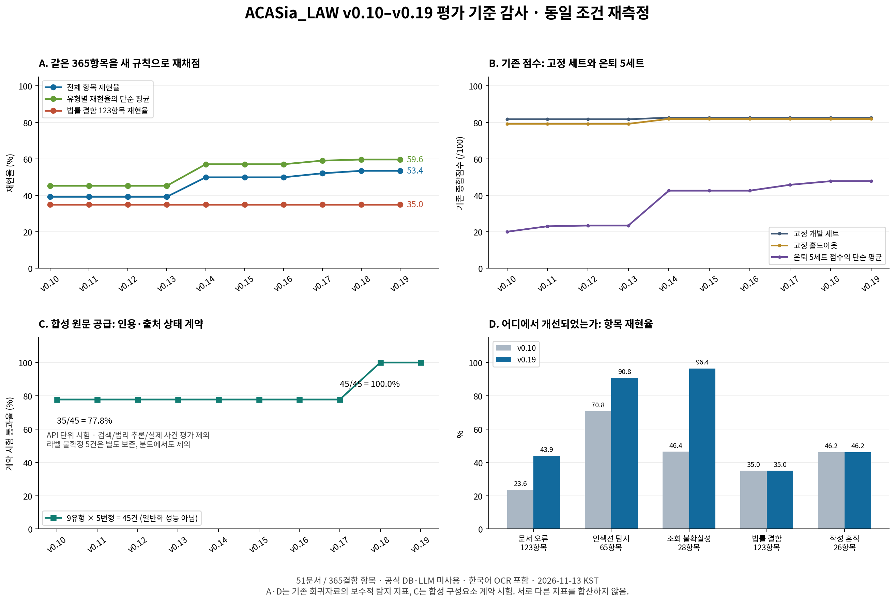
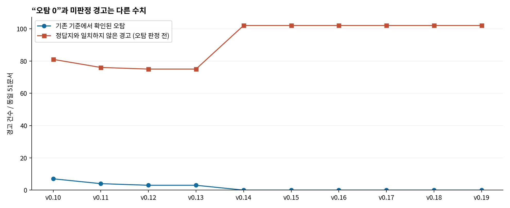

> 전환 전 감사 기록입니다. 이후 사용자 승인에 따른 적용 상태는 [EVALUATION_V2](EVALUATION_V2.md)를 따릅니다.

# ACASia_LAW 평가 기준 감사와 v0.10–v0.19 재측정

평가일: 2026-11-13 KST · 평가자: Codex(평가 역할 대행) · 현재 릴리스: `v.0.19.0`, `5b878a10402b7da0eafc2bc2b52e144696e61966`

**판정: 기존 점수는 같은 개발 자료에서 퇴보를 감시하는 용도로는 유용하지만, 실제 법률 검증 정확도나 전체 오탐률을 나타내는 성능 인증값으로는 부적합하다. 프로그램의 발전은 확인되지만, 최신 법률 기능의 실무 성능을 입증하는 독립 평가가 부족하다.**

이 문서는 평가 방법과 측정 결과를 제안한다. 제품 코드·기존 정답지·기준선·CI 게이트는 변경하지 않았다. 외부 벤치마크의 결과를 실행 없이 프로그램 점수로 옮기지 않았다.

## 1. 실제로 확인한 범위와 핵심 결과

10개 릴리스의 제품 코드를 각각 복원하고, 같은 7세트·51문서·365개 결함/확인불가 항목과 109개 정상 함정 항목을 공급했다. 최종 한국어 OCR 환경에서 **70/70 실행 성공**, 실제 LLM 호출 0건이다. 최초 한국어 OCR 미설치 실행도 별도로 보존했다. 아래 결과는 한국어 OCR을 보완한 최종 실행이다.

- 기존 고정 점수는 v0.14부터 v0.19까지 **82.6 / 81.9**로 그대로였다.
- 같은 365항목의 엄격 재현율은 **39.2% (143/365) → 53.4% (195/365)**, **+14.2%p**였다. 유형별 평균은 45.2% → 59.6%였다.
- 공식 DB·LLM 미사용 조건의 법률 결함 123항목은 **35.0% (43/123)**로 같았다. 이를 제품 전체 법률 정확도가 35.0%라는 뜻으로 해석할 수 없다.
- 원문을 공급한 별도 합성 구성요소 시험에서는 v0.10–v0.17 **35/45**, v0.18–v0.19 **45/45**로 인용·출처 상태 처리 개선이 확인됐다. 이 작은 계약 시험의 100%를 실무 정확도로 표시해서는 안 된다.
- v0.19의 표제 오탐은 **0건**이지만, 같은 51문서의 **미판정 경고 102건**이 별도로 있었다. 전체 정밀도·오탐률은 아직 확정할 수 없다.
- 새 재채점에서 증가한 52항목은 문서 오류 25, 인젝션 탐지 13, 조회 불확실성 처리 14였다. 같은 매칭 규칙하에서 사라진 정답 인정 항목은 없었다. 이는 모든 기능의 회귀 0을 뜻하지 않는다.

**그래프 해석:** A·D는 기존 회귀자료를 보수적으로 다시 채점한 탐지 지표다. B는 기존 산식을 그대로 적용한 점수다. C는 합성 출처를 주입한 작은 구성요소 시험이다. 어느 패널도 실제 사건의 법률 정확도나 KBL 공식 평가 점수가 아니다. 서로 다른 패널의 수치를 합산하지 않는다.

‘은퇴 세트 변화 0’은 보통 **특정 PR의 기준 커밋 대비 변화가 없었다는 뜻**이다. v0.10부터의 누적 발전이 없었다는 뜻이 아니다. 또한 기능이 새로 생겨도 해당 입력과 공식 원문을 시험이 공급하지 않으면 기존 점수가 움직이지 않는다.

## 2. 기존 기준의 문제: 코드 확인과 반례 재현

감사 기준 코드는 모두 위 v0.19 SHA이다. 10개 릴리스에서 `eval_testset.py`, `scorecard.py`, `score_gate.py`의 해시가 각각 동일했다. 단순히 최근 배포에서 산식이 바뀌어 점수가 정체된 상황은 아니다.

| 문제 | 확인한 동작 | 해석과 필요한 수정 |
|---|---|---|
| 전체 ‘오탐 0’이라는 오해 | 정답지 밖 결함 경고 100개를 추가해도 표제 오탐 0, 점수 100 유지 | 표제 오탐은 FP-TRAP·일부 정상 대조군만 집계한다. 미판정 경고를 별도 표시하고 독립 라벨링 후 정밀도를 산출해야 한다. |
| 하나의 경고를 여러 정답에 사용 | 합성 정답 2개에 같은 경고 하나가 모두 일치하면 기존 100점 | 원자적 주장과 근거 위치를 식별하고 일대일 최대 매칭. 복수 결함을 담은 경고는 먼저 분해해야 한다. |
| 근거 대신 문맥만으로 득점 가능 | 정답 토큰이 `confidence_features`에만 있어도 기존 100점 | 설명·근거의 주장 일치와 실제 위치를 평가. 검색 문맥이나 내부 메타데이터의 우연한 단어 겹침은 근거가 아니다. |
| 잘못된 페이지도 득점 | 정답 위치 1쪽, 경고 근거 99쪽이어도 기존 100점 | 현재 채점은 정답 `location`을 쓰지 않는다. 페이지·블록·문자 범위와 원문 해시를 연결해야 한다. 이번 어휘 기반 재채점에도 남는 한계다. |
| 확인 불가와 허위 단정 구분 미흡 | CIT-NX-DB 정답에 ‘가공 판례’라고 단정한 NOT_FOUND도 기존 100점 | 검색 실패·조회 불가·제한된 미발견을 부존재/허위로 취급하지 않도록 상태별 오답 비용을 분리한다. |
| 부분점수의 검증되지 않은 의미 | advisory 0.5, 일부 UNVERIFIED 0.25, 모델 서술 0.5 | 이 비율이 변호사 검토 가치나 오류 위험과 연결된 실증 근거가 없다. 탐지·보류·근거·검토 부담을 분리한다. |
| 거짓 참고 경고가 표제 오탐에서 제외 | 정상 대조군의 잘못된 advisory 경고를 추가해도 오탐 0 | 참고 경고도 검토 시간을 소모한다. 강한 오판과 분리하되 경고 정밀도와 문서당 검토 부담에는 포함한다. |
| 인젝션 ‘방어’의 대리 기준이 약함 | 공격에 대한 finding이 없어도 프로젝트 BLOCK만 있으면 defended=true | 원본/공격본 쌍으로 실제 결론·도구 호출·자료 유출 변화 여부를 비교해야 한다. 탐지와 방어 성공은 다른 지표다. |
| 비교 실패가 후퇴 없음처럼 보일 수 있음 | `retired_compare.compare({'set': None}, {'set': None}) == []` 재현 | 기준 실행 실패와 비교 불가능은 통과가 아니다. 실패 시 차단하고 expected manifest 전체 집합을 검증한다. |
| 세트 범위가 축소될 수 있음 | 은퇴 비교가 base/head 세트의 교집합만 사용 | 사라진 세트도 실패로 다뤄야 한다. 최신 main에는 은퇴 4세트, 평가 브랜치에는 추가 20261025 세트가 있다. ‘5세트 검사’라고 쓸 때 실행 manifest가 필요하다. |

반례는 제품이 실제 사건에서 그런 잘못을 했다는 증거가 아니라, **채점기가 그런 잘못을 놓칠 수 있다는 재현 증거**다. 원문이나 비공개 정답을 공개하지 않은 합성 사례이며, 결과는 `scorer_probes.json`, 재현 코드는 `probe_scorer.py`에 있다.

기존의 유형 대응표, 동일 SHA CI 확인, `--strict-env`, 보호 경로, 기준선 하향 금지, 사건 고유 값 금지, 평가/구현 분리 원칙은 유지할 가치가 있다. 다만 이 장치들은 평가 대상의 적절성과 정답의 법률적 품질까지 보장하지 않는다. 고의적 점수 조작을 확인한 것은 아니다.

코드 근거: [채점기](https://github.com/stevelee0119/ACASia_LAW/blob/5b878a10402b7da0eafc2bc2b52e144696e61966/scripts/eval_testset.py#L135), [항목별 득점](https://github.com/stevelee0119/ACASia_LAW/blob/5b878a10402b7da0eafc2bc2b52e144696e61966/scripts/eval_testset.py#L253), [표제 오탐·인젝션 판정](https://github.com/stevelee0119/ACASia_LAW/blob/5b878a10402b7da0eafc2bc2b52e144696e61966/scripts/eval_testset.py#L306), [은퇴 세트 비교](https://github.com/stevelee0119/ACASia_LAW/blob/5b878a10402b7da0eafc2bc2b52e144696e61966/scripts/retired_compare.py#L95), [비교 대상 교집합](https://github.com/stevelee0119/ACASia_LAW/blob/5b878a10402b7da0eafc2bc2b52e144696e61966/scripts/retired_compare.py#L137).

## 3. 이번 과거 버전 재채점 방법

이 방법은 과거 출력으로 계산 가능한 **회귀자료용 대리 지표**다. 새로운 법률 전문가 정답지를 만든 것처럼 주장하지 않는다.

1. 같은 문서에서 기존 허용 finding 유형과 모든 정답 토큰 그룹을 만족해야 한다. 제목·설명·근거 발췌·근거 설명만 사용하며, `confidence_features`, 규칙 ID, finding 유형의 문자열을 매칭 텍스트에서 제외했다.
2. 확정적 결함 상태 `NOT_FOUND/CONTRADICTED/SUSPICIOUS/INVALID_FORMAT/INVALID/MODIFIED`이면서 advisory가 아닌 경우만 1건으로 센다. 실제 법적 진실을 재판정한 것이 아니라 기존 라벨에 대한 강한 탐지 신호를 세는 것이다.
3. `CIT-NX-DB/SRC-UNV`는 불확실성 처리 과제이므로 non-advisory `UNVERIFIED`를 정답 상태로 요구하고, 대응 VERIFIED가 있으면 득점하지 않는다. 안전한 범위 한정 NOT_FOUND까지 모두 틀린 법률 판단이라는 뜻은 아니며, 이 두 유형은 별도 지표로 분리한다.
4. 문서별 최대 이분 매칭으로 finding 하나를 최대 정답 하나에만 쓴다. 부분점수는 없다. 여러 결함을 묶은 finding을 하나로 보는 보수적 손실 가능성을 공개한다.
5. 전체 항목 재현율 = 매칭된 항목/365. 법률 결함 재현율은 `CIT*·LAW*·OVR*·EVI-FAKECIT` 중 확인불가 두 유형을 제외한 123항목이다. 유형 평균은 정답지에 있는 **정확한 유형 문자열**별 재현율의 단순 평균이다. 분류별 결과를 기본으로 보고 단일 종합 합격점은 만들지 않는다.
6. 정답지 밖 경고는 **미판정 경고**다. 이를 모두 오탐으로 간주해 거짓 정밀도/F1을 만들지 않았다. 정밀도·전체 오탐률·법률 정확도는 이번 자료로 확정할 수 없다.

법률 123항목에는 가공 인용문·판시취지 왜곡·법령 오류·과도한 주장 등이 함께 있다. 공식 원문을 조회하지 않는 실행이므로 최신 법률 엔진의 원문 대조 성능을 대표하지 않는다. 작성 흔적 항목도 AI 작성 여부의 과학적 판별 정확도로 읽으면 안 된다.

| v0.19 법률 유형 | 인정/항목 | 재현율 |
|---|---|---|
| CIT-FAB-Q | 0/9 | 0.0% |
| CIT-META | 6/12 | 50.0% |
| CIT-MIS | 0/7 | 0.0% |
| CIT-NX | 11/14 | 78.6% |
| EVI-FAKECIT | 5/9 | 55.6% |
| LAW-MIS | 4/22 | 18.2% |
| LAW-NX | 0/15 | 0.0% |
| OVR | 16/33 | 48.5% |
| OVR / LAW-NX | 1/2 | 50.0% |

가공 인용문·취지 왜곡의 0건은 **이 오프라인 문서 시험의 강한 탐지 신호**가 없었다는 뜻이다. 원문이 주어진 구성요소 시험과 혼동하지 않는다.

365항목이 독립 표본이라는 근거가 없고 반복 템플릿·사건 관계도 불완전하다. 따라서 실무 모집단에 대한 95% 신뢰구간을 붙이지 않았다. 이는 해당 고정 자료 전체의 관측값이며, 실제 사건 성능의 통계적 추정치는 아니다. 향후 독립 사건군 시험에서는 사건군 단위 구간과 쌍별 개선량을 보고한다.

### 버전별 결과

| 버전 | 기존 고정/홀드아웃 | 기존 은퇴5 평균 | 새 전체 재현율 | 새 유형 평균 | 새 법률 재현율 | 합성 계약 통과 |
|---|---|---|---|---|---|---|
| v0.10 | 81.7 / 79.2 | 20.00 | 143/365 (39.2%) | 45.2% | 43/123 (35.0%) | 35/45 |
| v0.11 | 81.7 / 79.2 | 23.00 | 143/365 (39.2%) | 45.2% | 43/123 (35.0%) | 35/45 |
| v0.12 | 81.7 / 79.2 | 23.40 | 143/365 (39.2%) | 45.2% | 43/123 (35.0%) | 35/45 |
| v0.13 | 81.7 / 79.2 | 23.40 | 143/365 (39.2%) | 45.2% | 43/123 (35.0%) | 35/45 |
| v0.14 | 82.6 / 81.9 | 42.54 | 182/365 (49.9%) | 57.0% | 43/123 (35.0%) | 35/45 |
| v0.15 | 82.6 / 81.9 | 42.54 | 182/365 (49.9%) | 57.0% | 43/123 (35.0%) | 35/45 |
| v0.16 | 82.6 / 81.9 | 42.54 | 182/365 (49.9%) | 57.0% | 43/123 (35.0%) | 35/45 |
| v0.17 | 82.6 / 81.9 | 45.76 | 190/365 (52.1%) | 59.0% | 43/123 (35.0%) | 35/45 |
| v0.18 | 82.6 / 81.9 | 47.74 | 195/365 (53.4%) | 59.6% | 43/123 (35.0%) | 45/45 |
| v0.19 | 82.6 / 81.9 | 47.74 | 195/365 (53.4%) | 59.6% | 43/123 (35.0%) | 45/45 |

기존 고정 점수 두 개는 각각 6문서 세트의 서로 다른 분모에 기반한다. 새 전체 재현율은 51문서의 365항목에 기반하므로 **82.6점에서 새 점수로 성능이 떨어졌다고 계산하면 안 된다**. 버전 간 비교는 같은 열 안에서 해야 한다.

### 채점 선택에 대한 민감도

| 방법 (同一365항목) | v0.10 | v0.19 |
|---|---|---|
| 상태 엄격화만, 기존 텍스트/중복 매칭 유지 | 40.27% | 54.79% |
| 상태 엄격화 + 일대일, 기존 텍스트 유지 | 39.45% | 53.97% |
| 최종: 상태 + 일대일 + 메타데이터 제외 | 39.18% | 53.42% |

이 비교는 새 산식만으로 원하는 결과를 만들었는지 확인하기 위한 것이다. 그럼에도 입력·라벨의 재사용, 위치 미검증, 어휘 매칭이라는 근본 한계는 그대로다. 기존 개발 세트를 다시 채점하는 것만으로는 독립 법률 평가를 대체할 수 없다.

### 법률 기능의 별도 구성요소 시험

공식 DB 대신 완전히 합성한 고정 응답을 `LegalVerifier.verify_case`에 공급했다. 같은 자료를 전 버전에 사용했으며 제품 코드는 고치지 않았다. 정확 인용, 공백 차이, 수치 변경, 부정어 변경, 당사자 변경, 요약만 확보, 출처 시간 초과, 다른 사건 응답, 원문과 낮은 유사도의 인용을 시험했다. 낮은 유사도만으로 ‘가공 인용문’이라고 단정하지 않는지도 포함했다.

v0.10–v0.17은 **35/45 (77.8%)**, v0.18–v0.19는 **45/45 (100%)**였다. 개선 10건은 2유형의 각 5변형이다. 옛 버전은 당사자 교체를 PARTIALLY_VERIFIED로 처리했고, 요약만 확보한 인용을 VERIFIED로 표시했다. 새 버전은 각각 CONTRADICTED와 UNVERIFIED로 구별했다. 원문과 인용문 사이의 상태 계약 개선을 입증하며, 실제 판례 검색이나 일반적인 법리 추론 정확도를 입증하지는 않는다.

50개 중 5개의 ‘단서 생략’ 사례는 그대로 인용된 첫 문장 뒤에 별도 단서 문장이 있었지만, 입력이 전체 인용이나 무조건적 법리를 주장하지 않았다. 이를 literal match 실패로 채점하는 원래 정답은 불확정이었다. **최초 결과를 보존하고, 그 5건을 전 버전의 분자·분모에서 똑같이 제외했다.** 이를 프로그램 결함 또는 허위 VERIFIED로 보고하지 않는다. 변경 경위는 `component_amendment.json`에 기록했다. 남은 45건도 9개 알려진 기능 유형의 변형일 뿐이며, 독립적·맹검 법률 정확도 평가가 아니다.

최초 실행에서 과거 API에 없는 `current_date` 인자를 전달한 평가 어댑터 오류도 있었다. 해당 실패를 프로그램 성능 0으로 계산하지 않고, 시그니처 호환 어댑터를 수정해 전 버전을 재실행했다. 최종 구성요소 실행 오류는 0건이다.

### 오탐 표제와 경고 검토 부담

v0.10→v0.19: 기존 정의의 확인 오탐 **7→0건**, 정답지 밖 미판정 경고 **81→102건**. 후자는 최종 버전에서 문서당 평균 **2.00건**이다. 경고가 늘었다는 사실만으로 품질이 떨어졌다고 단정할 수는 없지만, 검토 부담과 정밀도의 평가 범위를 확장해야 한다는 증거다.

미판정 경고에는 정답지에 빠진 유효한 발견, 중복, 실제 오탐이 섞일 수 있다. 독립 검토 전에는 어느 쪽이라고 단정하지 않는다. 정상 함정 항목 109개도 독립적으로 추출된 정상 사건 109건과 같지 않다.

## 4. 공개 법률 AI 벤치마크: 무엇을 반영해야 하는가

확인한 공개 자료 중 ACASia_LAW 전체에 적용되는 정부·법원 공통의 단일 ‘공인 인증 점수’는 확인되지 않았다. 아래는 학술 발표·공개 데이터와 평가 규약을 갖춘 주요 **연구 벤치마크**다. 학술적 검증과 법원/정부의 제품 인증은 구별해야 한다.

| 벤치마크 | 확인한 내용 | ACASia_LAW에 적용할 부분 | 그대로 사용할 수 없는 부분 |
|---|---|---|---|
| **KBL** — 한국법, EMNLP 2024 Findings | 논문 기준 지식 7과제 510예제, 추론 4과제 288예제, 변호사시험 4영역·53과제 2,510예제. 법률가 협업. 공개 `statute_hallucination` 파일은 이번 확인 revision에서 **75문항** | 최우선. 법령 환각, 조문 번호-내용, 질문-법령 연결, 범죄 구성요건, 판례 관련성, 인과·진술 모순 평가 | 객관식 정답률이 문서 검증 정밀도나 가공 판례 탐지율은 아니다. 문제/보기/판정 출력 어댑터와 법률 시점 재검증 필요. corpus는 2024-11 시점. CC-BY-NC-4.0 조건 및 업무 사용 범위 확인 필요 |
| **LegalBench** — 법률 추론, NeurIPS 2023 Datasets and Benchmarks | 162과제·6추론 범주, 법률 전문가가 과제 구성에 참여 | 과제별 성능, 법규/사실 적용, 다른 유형으로의 일반화 평가 구조 | 주로 미국법·영어. 한국어 번역만 하면 한국법 정답이 되는 것은 아니다. 과제별 라이선스와 데이터 중복 확인 |
| **LegalBench-RAG** — 법률 근거 검색 | 6,858 query-answer pairs, 79M자 이상 corpus. 문서 ID뿐 아니라 문자 구간 precision/recall 평가 | 근거 구간 Recall@k, 정확 구간 precision, 예외·반대 근거 누락, 검색 실패와 추론 실패 분리 | 검색 성능이지 답변 진실성 점수가 아니다. README상 생성 과정에 LLM 사용. 원천 전문가 라벨과 파생 질의의 품질을 구분하고 생성본을 고정 |
| **ContractNLI** — 근거 있는 명제 판단, EMNLP 2021 Findings | 607 NDA, 고정 가설 17개. Entailment/Contradiction/NotMentioned와 근거 구간 | ‘주장에 대한 법적 타당성’ 평가를 지지·모순·자료에 없음으로 나누고 반드시 근거를 제시하는 설계 | 영문 계약 범위이며 한국 판례의 선례 효력·행위시법·증명책임을 직접 검증하지 않는다 |
| **LexGLUE** — 법률 언어 이해, ACL 2022 | 7개 영어 법률 NLP 데이터셋, 과제별 micro/macro F1 등 | 분류 불균형, 과제별 지표, 고정 train/dev/test 운용 | 문서/조항 분류·CaseHOLD 등이 중심이다. 높은 점수를 판례/법령 환각 탐지 성능으로 대체하면 안 된다 |
| **LawBench** — 중국법 | 20과제·3인지 수준, 정보 추출·계산·상담 등 포함 | 기능별 평가 매트릭스와 단순 객관식에 치우치지 않는 시험 설계 참고 | 중국법 성능을 한국법 성능으로 비교할 수 없다 |
| **ALCE** — 인용을 갖춘 생성 평가 | 정답성·인용 품질 등 자동 평가 코드 | 인용 근거의 정합성과 답변 내 주장에 대한 인용 완전성을 나누는 설계 | 법률 특화 벤치마크가 아니며 자동 NLI/모델 심판의 오류도 별도 검증 필요 |

KBL의 `lbox/kbl` 확인 revision은 `695653ba87affa2c3113896013179c81fc16786a`, KBL-RAG는 `72f50c8d2b44defa56ceff3fef62128b94f78bba`이다. 현재 데이터 파일에는 논문 발표 이후 연도도 포함되므로 논문 총량과 최신 다운로드 총량을 혼용하지 않는다. `statute_hallucination`은 문제와 보기 속 가공 법령을 포함하는 객관식 과제이며, 실제 문서 전체에서 허위 법령을 찾아내는 평가와는 별도다.

**권장 조합은 KBL + 한국법 원문 근거 검증 세트 + 실제 사건 독립 라벨 세트다.** LegalBench-RAG/ContractNLI/ALCE의 평가 구조를 한국 법률 데이터에 맞게 반영하고, 외국법 문제의 점수는 별도 보조 결과로 둔다. 공개 문항은 개발 중 노출되기 쉬우므로 새 비공개 사건군으로 오염 여부를 확인해야 한다.

자료: [KBL 논문](https://aclanthology.org/2024.findings-emnlp.319/) · [KBL 저장소](https://github.com/lbox-kr/kbl) · [KBL 데이터](https://huggingface.co/datasets/lbox/kbl) · [KBL-RAG](https://huggingface.co/datasets/lbox/kbl-rag) · [LegalBench 논문](https://arxiv.org/abs/2308.11462) · [LegalBench 코드](https://github.com/HazyResearch/legalbench) · [LegalBench-RAG](https://github.com/zeroentropy-ai/legalbenchrag) · [ContractNLI](https://stanfordnlp.github.io/contract-nli/) · [LexGLUE](https://aclanthology.org/2022.acl-long.297/) · [LawBench](https://github.com/open-compass/LawBench) · [ALCE](https://github.com/princeton-nlp/ALCE).

## 5. 가장 합리적인 정식 평가 방법

### 하나의 종합점수 대신, 다섯 층으로 나눈다

| 평가 층 | 필수 정답/입력 | 주 지표 | 오해 방지 |
|---|---|---|---|
| ① 회귀·상태 계약 | 기존 고정 세트, 합성 원문, 오류/누락 응답, 정상 대조 | 항목/유형 재현율, 계약 위반, 전체 대상 실행 완전성 | 빠른 CI용. 실무 정확도 주장 금지 |
| ② 출처·근거 검색 | 공식 원문 해시·판례 ID·조문 버전·시행기간·근거 문자 범위 | 출처 ID 정확도, Recall@k, nDCG@k, 근거 span precision/recall | 원문을 못 찾은 실패와 찾고 잘못 해석한 실패를 분리 |
| ③ 허위·왜곡 검증 | 정상/가공 인용, 메타데이터 변조, 수치·부정·당사자·단서 변경, 충분/불충분 출처 | 유형별 precision/recall/F1, false VERIFIED, 정상 권위의 허위 단정률, 보류율 | ‘검색 안 됨’≠‘실재하지 않음’. 안전한 보류와 무조건적 보류를 동시에 평가 |
| ④ 주장·법리 적용 | 사실, 주장, 법률요건, 기준시점, 판례의견/선례효력, 지지·반대 근거, 독립 법률가 판단 | SUPPORTED/CONTRADICTED/INSUFFICIENT_EVIDENCE macro-F1, 근거 정합성, 인용 완전성, 위험-응답범위 곡선 | 명제의 근거 지지 여부와 실제 승소/위법 판단을 구분. 단순 문자열 일치를 법리 타당성으로 인정하지 않음 |
| ⑤ 실무 효과 | 새 실제 사건군, 도구 미사용/사용 검토, 무작위 배정 또는 순서 균형 교차 설계 | 중대한 오류 누락, 검토 분/문서, 경고 확인 비용, 수정 정확성, 비용·p50/p95 지연 | 시간을 줄였지만 중대 오류를 놓치는 개선을 성공으로 처리하지 않음 |

③·④의 필수 지표 정의:

- 결함 precision = 독립적으로 확인된 올바른 결함 경고 / 판정 가능한 전체 결함 경고. 정답 미확정 경고는 별도 수량과 라벨링 커버리지를 표시한다.
- 결함 recall = 찾은 실제 결함 / 정답의 실제 결함. 탐지하지 못한 항목과 누락 출력을 분모에서 빼지 않는다.
- false VERIFIED = 잘못 VERIFIED한 명제 / 모든 VERIFIED 명제. 동시에 ‘VERIFIED가 정답이 아닌 항목 중 잘못 VERIFIED한 비율’도 보고한다.
- 잘못된 허위 단정 = 실재·정상 자료를 가공/부존재라고 강하게 단정한 건수 / 해당 단정 전체. 정상 자료 분모의 거짓 경보율도 함께 보고한다.
- coverage = 명확한 지지·모순 판정을 낸 항목 / 평가 항목. 보류만 해서 오판률을 낮추는 것을 막기 위해 위험-coverage 곡선을 보고한다.
- undefined 비율은 `null`이고 미실행은 `NOT_MEASURED`다. 0점·0초·오탐 0으로 대체하지 않는다. 합성 자료, 공개 자료, 실제 법률가 라벨 자료의 분모를 합치지 않는다.

가중치와 합격선은 관행적인 80점에서 정하지 않는다. 정상 판례를 허위라고 단정하는 피해, 잘못된 법률 주장을 정상이라고 통과시키는 피해, 검토 시간의 허용 범위를 먼저 정한 뒤 검증 세트에서 정하고 **시험 세트를 열기 전에 고정**한다. 이 보고서는 아직 실무 위험 예산이 정해지지 않았으므로 임의의 새로운 합격점으로 릴리스를 판정하지 않는다.

희소한 중대 오판은 0건 관측만으로 안전하다고 할 수 없다. 예를 들어 서로 독립인 사건군에서 중대 오류가 0건일 때, 한쪽 95% 이항 상한을 약 1% 아래로 제한하려면 약 300개의 독립 기회가 필요하다(`1 - 0.05^(1/n)`). 동일 사건의 문구 변형 300개는 이 조건을 충족하지 않는다. 다수 지표 동시 판정과 순차 시험에는 다중 비교/중단 규칙도 사전 고정한다.

### 정답과 데이터 분할

법률가 2인의 독립 판정과 불일치 조정 결과, 판정 이유, 판단 가능한 범위, 원문 근거의 페이지·블록·반개방 문자 범위, 자료의 수집일·적용 법률 시점을 기록한다. 의견이 갈리는 쟁점은 정답을 억지로 이분화하지 않고 ‘합리적 견해 대립’ 또는 ‘자료 부족’으로 표시한다. 임의 심판 LLM 하나를 최종 정답 생성자이자 채점자로 쓰지 않는다.

사건번호뿐 아니라 관련 사건·상하급심·개정 서면·요약·번역·문구 변형을 하나의 `case_family_id`로 묶어 development/validation/test 중 한쪽에만 배치한다. 원문·파생 자료·정답 토큰이 개발에 들어간 은퇴 세트는 일반화 근거가 될 수 없다. 공개 벤치마크 원본 시험 부분은 고정하고, 한국법 최신 시점에 맞춘 수정판은 별도 이름과 라벨 변경 이력을 갖게 한다.

기능별로 정상·오류·경계·자료부족을 모두 포함한다. 법률 분야/문서형식/스캔 품질/문장 길이/인용 생략/다수·반대·별개 의견/파기환송/판례변경/시행 전후/소급·경과조치/반대근거 존재 여부를 축으로 설계한다. 구성요소 시험 뒤 실제 문서의 추출→검색→판정→보고서 표시까지 일관성을 확인한다.

### 환경과 비교 공정성

두 트랙을 분리한다. (A) 같은 자료·모델·프롬프트·원문 snapshot을 고정한 paired replay는 제품 코드 개선을 측정한다. (B) 실제 운영에서 그 시점의 모델·DB를 쓰는 온라인 평가는 전체 서비스 품질을 측정한다. 옛 모델이 더 이상 제공되지 않으면 당시 운영 품질의 완전 재현은 `NOT_REPRODUCIBLE`로 남긴다.

모든 보고서는 Git SHA, 데이터/정답/채점기/프롬프트/원문 snapshot 해시, 모델 ID, 추론 설정, 의존성, OCR 자료 해시, 누락/오류 수, 적용 시점을 포함해야 한다. 확률적 모델은 고정 설정으로 반복해 변동을 보고하며, 중복 템플릿을 독립 표본처럼 세지 않는다. 공식 DB 실시간 시험에서는 응답을 보존해 재채점과 원인 추적이 가능하게 한다.

## 6. 구현과 평가를 반복 낭비 없이 연결하는 순서

이미 [packages/evaluation](https://github.com/stevelee0119/ACASia_LAW/tree/5b878a10402b7da0eafc2bc2b52e144696e61966/packages/evaluation)에 외부 라벨·예측 JSONL, 유형별 precision/recall, false VERIFIED, coverage, 사건군 bootstrap, 누출 검사 등이 있다. 동봉 자료는 **합성 예시**이며 제품 출력에서 예측을 자동 생성하지 않는다는 점이 README에 명시돼 있다. 새 평가 엔진을 또 만드는 대신 이 기반을 실제 제품 실행과 독립 정답에 연결하는 것이 우선이다.

| 순서 | 담당과 작업 | 제출물·수용 기준 |
|---|---|---|
| E0. 평가 계약 확정 | 평가 측: 평가 층·분모·상태·라벨 지침·split·위험 예산 초안 고정 | manifest 누락/오류를 통과 처리하지 않는 규약. 기존 점수의 명칭을 회귀 점수로 한정. 이번 반례 8종과 위치 오류를 잡는 신규 채점기 시험. 미판정 경고를 FP로 오분류하지 않을 것 |
| I1. 예측 export | Antigravity: 실제 파이프라인의 claim/citation/finding을 원자적 예측으로 export | 안정된 item/claim ID, status, error_types, evidence span, source snapshot, 실행 SHA. 한 경고-여러 주장 관계와 중복 규칙 명시. 누락을 삭제하지 않고 보류로 export. 실제 엔진 결과와 JSONL의 대응 계약 시험 |
| E2. 데이터 구성 | 평가 측+독립 법률가: 기존 자료 재라벨, 새 정상/오류 사건군, 공개 벤치마크 고정 | 2인 판정+조정, 사례군 분리, 전문자격 확인 절차, 라이선스/법률시점 기록. 합성 예시의 실제 사건 라벨 위장 금지. 합의도·불일치율과 제외 사유 공개 |
| I3. 벤치마크 adapter | Antigravity: KBL 응답, 근거 검색, 원문 대조/법리판정 인터페이스 연결 | KBL 원본 문제/선지/label 순서 유지, 비지원/파싱 실패/보류의 처리 고정. KBL 점수와 한국법 원문 검증 점수 분리. RAG는 제공 근거와 실제 검색을 구별하고 검색 성공 조건부/전체 성능을 함께 제출 |
| E4. 병행 측정 | 평가 측: 기존 CI와 새 지표를 함께 운용하고 새 체계 v0.10–v0.19 replay 확대 | 제품 SHA를 고정한 같은 입력 비교. 중대 오판의 원문 근거와 분모 확인. 잘못된 라벨·실행 실패·실제 제품 회귀 구분. 성능 변화가 난 항목의 득점 귀속 확인 |
| E5. 게이트 전환 | 평가 측: 검증 데이터에서 정한 합격선으로 독립 시험 평가 | 실제 라벨이 없는 지표는 필수 통과로 위장하지 않음. 기존 기준선을 낮추거나 실패 세트를 없애지 않음. 근거가 쌓인 뒤 새 안전 지표를 정식 게이트에 추가 |

E0가 먼저다. I1과 E2의 자료 수집은 출력·라벨 스키마가 고정되면 병행할 수 있고, I3의 공개 adapter 개발도 별도 분기로 가능하다. E4는 I1/E2/I3의 계약 통과 뒤, E5는 E4와 독립 시험 뒤에 한다. 제품 구현 PR과 평가 정답/게이트 변경 PR을 분리하고, 구현자가 자신의 정답이나 수용 기준을 유리하게 바꾸지 않도록 한다.

이 순서는 **설계 제안**이다. 새 exporter·KBL adapter·운영 게이트를 이번 세션에서 제품에 구현하거나 사전 검증 완료했다고 주장하지 않는다. 기존 평가 모듈의 관련 시험과 신규 계약 시험을 먼저 확인한 뒤, 실제 구현 지시서에서 파일 위치·재현 사례·정상 대조·수용 기준을 확정해야 한다.

## 7. 재현성과 해석의 한계

| 버전 | 태그 또는 릴리스 커밋 | 정확 SHA |
|---|---|---|
| v0.10 | v.0.10.0 | `22ca134fd4a1412adcb923dbde7213533b128aa9` |
| v0.11 | v.0.11.0 | `a8b2a7e0e721f3d9bb9d09e3fe752719a48d51dd` |
| v0.12 | v.0.12.0 | `9c1b21848110a8df6ba0e6308b49e6947c0d6feb` |
| v0.13 | v.0.13.0 | `8280a597db40b0905dbacf10c56fa3e9915cafd5` |
| v0.14 | 28d33974 | `28d33974f89803cdbf3ba2a2e8676873f4ff85bb` |
| v0.15 | 08d40ff1 | `08d40ff19695e5be24234a915bbbe5e27eb0f276` |
| v0.16 | 2f06f9a0 | `2f06f9a08c163828a1422ccd6373754e3b86b5a0` |
| v0.17 | deb387d3 | `deb387d3bb7a264d34abf593e9fd8e29a3a28fb2` |
| v0.18 | v.0.18.0 | `3c75071c9baba295e713d912d3e4876fdf585955` |
| v0.19 | v.0.19.0 | `5b878a10402b7da0eafc2bc2b52e144696e61966` |

v0.14–v0.17은 해당 릴리스 병합 커밋과 `packages/common/config.py`의 `0.x.0`을 대조했다. 나머지는 실제 릴리스 태그를 사용했다. 각 주 버전의 최초 `.0`을 비교했으며 v0.13.1을 v0.13.0 대신 섞지 않았다.

최종 실행 환경: Python **3.12.14**, tesseract 5.5.0, `eng+kor+osd`, `OMP_THREAD_LIMIT=1`. 공식 DB 키 없음, 네트워크 비활성, AI 호출 없음. 환경 지문 `64386d52044928cb`가 70건에서 동일했다. 한국어 OCR 자료 SHA256은 `6b85e11d9bbf07863b97b3523b1b112844c43e713df8b66418a081fd1060b3b2`이다. 이전 CI의 OCR/의존성 환경을 그대로 재현한 것은 아니므로 과거 CI 수치와 차이가 나면 코드 회귀로 단정하지 않는다. 최초 OCR 미설치 실행과 최종 실행에서 이번 집계 재현율은 같았지만, 미판정 경고 수는 달랐다.

이번 결과가 말할 수 있는 것은 **같은 평가 자료·환경에서의 과거 코드 차이**다. 재사용된 자료의 성능을 새 실무 사건의 기대 성능으로 일반화할 수 없다. 새 지표가 과거 출력에 적용되었지만, 원문 근거·법률가 정답을 새로 마련해야 하는 정식 평가 항목의 v0.10–v0.19 수치는 아직 `NOT_MEASURED`다. 온라인 DB·모델을 쓰는 실무 정확도, 전체 경고 정밀도, 독립 사건의 허위 판례 탐지율, 법리 타당성, 변호사 검토 시간 개선은 이번 결과로 확정하지 않는다.

재현 자료에는 측정 CSV/JSON, 그래프 PNG/SVG/PDF, 릴리스 SHA, 프로토콜, 합성 채점기 반례, 합성 구성요소 시험, 실행·재채점·시각화 스크립트, 데이터 묶음 해시, 출처 URL/응답 해시를 제공한다. 문서 원문·정답 상세·원시 pipeline 결과·인증정보는 묶음에 넣지 않았다. 같은 문서를 가진 평가자만 전체 재실행이 가능하며, 재현 묶음의 README에 준비 절차를 적었다.
